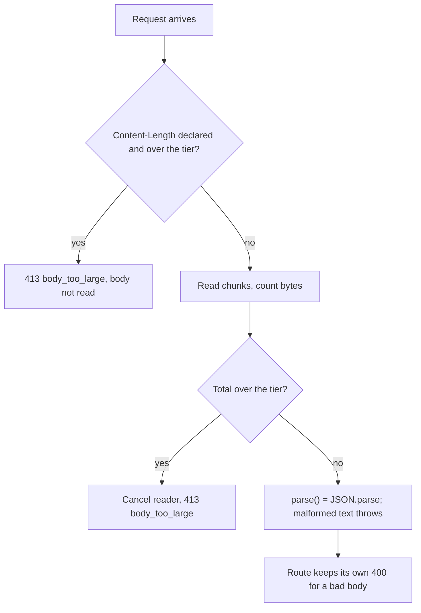

# Request size ceilings and list bounds

The design tool parses request data with Zod. Two properties made an oversized request expensive: a route's `req.json()` buffered whatever the caller sent, and Zod keeps one issue object per failing element of a list that has no size constraint. The 2026-10-25 hardening (a stopgap for Zod advisory GHSA-mrhx-c7xc-m3w5, recorded in `docs/ledger.md`) put a ceiling in front of both. This page is the canonical home of those rules. Consult it before adding a route, a request schema, or any field that holds a list or a free-form object.

## Body ceilings: `readJsonBody`

`design-tool/lib/api/jsonBody.ts` exports `JSON_BODY_LIMITS` and `readJsonBody(req, maxBytes)`. The tiers are named, not bare numbers:

| Tier | Limit | Used for (from the file's own comments) |
|---|---|---|
| `small` | 16 KiB | Events, feedback, and the pre-auth token exchange (`auth/exchange`), the one route an unauthenticated caller reaches |
| `default` | 256 KiB | Everything else (about 18x the largest stored payload, 8.7 KiB) |
| `longText` | 1 MiB | Essay answers, item sets, client error batches, rubric and resource text, batch AI generation |
| `peekImage` | 3 MiB | Peek screenshot upload (2,000,000 base64 characters) |
| `csvImport` | 5 MiB | Items CSV import |

Two behaviours matter for callers. The check runs on the declared length first and again on the counted bytes, because a length can be absent or false. A malformed body does not come back as 413: `parse()` throws exactly as `req.json()` did, so each route keeps its own 400.

**Route coverage is a test, not a convention.** `test/json-body-cap.test.ts` fails if any file under `app/api` calls `req.json()` or `request.json()`. It also pins the tier of every route that reads JSON: the `NON_DEFAULT` table names each route that is not on `default`, and the test asserts that 45 routes read through `readJsonBody`. Adding a route means picking a tier and, if it is not `default`, adding it to that table on purpose.

## List and record bounds

`packages/schema/src/limits.ts` defines the bounds:

- `MAX_ITEM_LIST` (100): lists inside one item or one answer, such as choices, pairs, blanks, table rows, rubric levels and selected ids.
- `MAX_ASSESSMENT_LIST` (1000): assessment-wide lists, such as a bundle's items and item sets, id lists, and accommodation ids.
- `boundedRecord(key, value, max)`: a `z.record` that counts keys before it validates a single value. A `.refine()` on the count would run only after every value had been checked, which is the cost being avoided.

`items.ts` and `responses.ts` import these, so the authoring and student-answer schemas carry them. `delivery.ts` is deliberately left unbounded (it is the bundle the server builds for a single assessment, and a bound there could only refuse a large assessment's own delivery). `test/list-bounds.test.ts` scans `app/api`, `lib/api` and `packages/schema/src` for every `z.array`-style list and every raw `z.record(`, and fails on an unbounded one that is not exempt. It also checks that a bound really turns a huge bad list into one issue.

When you add a list to a request schema, give it `.max(MAX_ITEM_LIST)` or `.max(MAX_ASSESSMENT_LIST)`, or use `boundedRecord` for an object. Pick the constant by scope, not by the size of the current data.

## Other caps on the same path

- **TIDE workbook import.** `lib/api/importTide.ts` refuses a workbook whose zip central directory declares more than 64 MiB inflated (`DEFAULT_TIDE_LIMITS.maxInflatedBytes`) or more than 200,000 populated rows (`maxRows`, error `too_many_rows`), and the route refuses a declared `Content-Length` over 25 MiB before reading the body. The inflation is counted by inflating each entry under a budget, because the sizes a zip declares are not trusted. See [accommodations and roster](../design-tool/accommodations-and-roster.md).
- **Attempt events.** `POST /api/attempts/[attemptId]/events` replaces a `detail` over 4 KiB rather than storing it, answers `429 too_many_events` once an attempt holds 1,000 rows (the end-of-test kinds `sitting_closed`, `lockdown_end` and `time_expired` may still land up to ten times each), and refuses events more than 15 minutes after hand-in or sitting end. See [sittings and attempts](../design-tool/sittings-and-attempts.md#events-and-the-monitor).
- **Drawing and peek bytes.** Upload and saved-drawing limits are separate constants and are listed in [storage and assets](../design-tool/storage-and-assets.md). Change them deliberately, together.

## Measuring what the numbers should be

`lib/observability/payloadSizes.ts` reads the stored JSON size of each route's rows (`PAYLOAD_CATEGORIES`: item writes as whole rows, student answers as one column) and prints count, p50, p99 and max per category. It reads sizes only, with no ids and no content. Run it with `DATABASE_URL=… bun scripts/payload-sizes.ts` from `design-tool/`. The operator path is the one-off task in `design-tool/infra/scripts/` (see [deployment and observability](../operations/deployment-and-observability.md)). `test/payload-sizes.test.ts` pins the aggregates. The tier comments cite the 2026-10-25 measurement, so update them when you re-measure.

## Change checks

- New route with a body: use `readJsonBody(req, JSON_BODY_LIMITS.<tier>)`, then run `cd design-tool && bun test test/json-body-cap.test.ts`. A route that is not on `default` must also appear in the test's table.
- New list or record in a request schema: bound it, then run `cd design-tool && bun test test/list-bounds.test.ts`. The test imports `@secure-test/schema`, so build the package first: `cd packages/schema && bun run build`.
- Changing a client-visible limit (for example a text length): the Swift mirror is `BridgeLimits`. `design-tool/test/bridge-limits.test.ts` fails on drift; see [lockdown and security](../client/lockdown-and-security.md#sealed-page) and [wire formats](wire-formats.md).

Scope boundary: these ceilings protect memory on the request path. They do not change what a valid request means, so a limit change alone does not change the wire format or the database.

Related: [wire formats](wire-formats.md) (the schemas these bounds apply to), [system architecture](overview.md) (trust boundaries), [testing](../testing/testing-and-validation.md).
stem architecture](overview.md) (trust boundaries), [testing](../testing/testing-and-validation.md).
