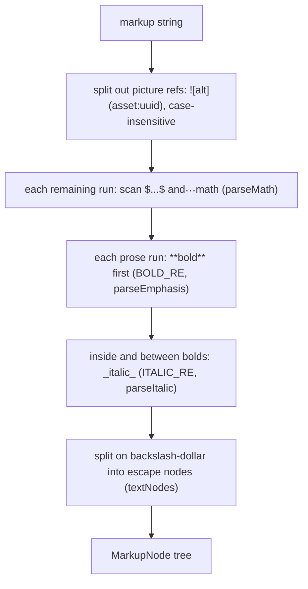

# `@secure-test/markup`: the authored-text grammar

`packages/markup` (`@secure-test/markup`, private workspace package, `exports` points at `src/index.ts`, so consumers read the source directly) is a parser and serializer for the markup string that teachers type into stems, choices, stimuli and labels. It was built as Phase 1 of the [editor redesign](../../docs/editor-redesign-design.md) (R-2, progress 2026-10-25). Its job is to let a future editor work on a tree of nodes without changing what is stored: the stored format stays the markup string (R-1), so [wire formats](wire-formats.md) and the export/import round trip are unchanged.

Status: the package exists, is tested in CI, and is consumed by tests only. The server renderer `design-tool/lib/items/renderItemContent.ts` still has its own copy of the rules and does not import the package. Phase 1 changed no rendered output.

## Public API

| Export | Purpose |
|---|---|
| `parse(markup, options?)` | Returns `MarkupNode[]`. `options.blanks` (`true` or a list of the item's blank ids) enables `[[id]]` blank markers for a fill-in-the-blank stem. Empty or non-string input returns `[]`. |
| `serialize(nodes)` | Concatenates each node's source spelling. Every node keeps what the author wrote, so the output is the input. |
| `renderedForm(nodes, { resolves })` | Projects the tree to what a student sees: escapes folded into text, adjacent text merged, pictures resolved or reported missing. This is the comparable form the golden fixtures are written in. |
| `BLANK_MARKER_RE` | The `[[id]]` pattern, shared with the schema's fill-in-the-blank marker rule. |
| Node types | `text`, `escape` (`\$`), `math` (`tex`, `display`), `image` (`alt`, `id`, optional `scheme`), `strong`, `em`, `blank`. |

Source: `packages/markup/src/index.ts` re-exports `grammar.ts` and `rendered.ts`.

## The grammar, in order

The rules are the server renderer's, applied in the same order (`grammar.ts` header comment cites `design-tool/lib/items/renderItemContent.ts` and `renderAroundBlanks.ts`).

1. **Pictures** `` are split out first, so a picture inside `$…$` splits the formula.
2. **Math.** `$…$` and `$$…$$` are read. `\$` is a literal dollar everywhere. A single `$` followed by a digit opens math only when its run carries `\`+letter, `^` or `_` (the "money rule", C-2 / M-1). An unmatched `$` is text.
3. **Emphasis.** `**bold**` is matched first, then `_italic_` inside and between bolds, by the word-boundary rules of E6. There is no escape syntax: `5**2 and 3**4` is bold.
4. **Blanks** (only with `blanks`). `[[id]]` markers are swapped for a private-use sentinel, the whole stem is parsed once, and sentinels become `blank` nodes, so a blank may sit inside bold or italic. If a sentinel lands inside a formula or an alt text, the stem is parsed segment by segment, as the server's fallback does (`parseWithBlanks`, `freeSentinel`).

Nodes keep the source they were written with. An image keeps the case of its `asset:` scheme, an italic's boundary character stays in the preceding text node, and an escaped dollar is its own node. That is why `serialize` can be a plain concatenation (`serializeNode`).

## Invariants

- **Round trip.** `serialize(parse(s)) === s` holds for every fixture, every construct's canonical spelling, and 5,000 random strings in both modes (`markup.test.ts`).
- **Blank mode.** `[[b1]]` is text in plain mode and a `blank` node only when `blanks` is set. A blank list keeps a marker that names no blank as literal text.
- **Sentinel safety.** A stem that already contains U+E000 still round-trips, because the parser picks a private-use character the stem does not contain. The server instead strips U+E000 from a fill-in-the-blank stem before rendering, so this is a known difference rather than a bug.
- **Known disagreements.** The two renderers agree on every plain stem tried. They disagree only when a blank marker sits inside a formula or a picture's alt text: ER-F1 (alt text), ER-F2 (formula with emphasis after it) and ER-F3 (backslash before the marker). Each is pinned in `design-tool/test/markup-golden.test.ts`. The parser follows the server's general rule. The editor should treat such a marker as unrepresentable rather than copy either renderer.

## Relationship to the renderers

The grammar is a deliberate copy, not an import. `BOLD_RE`, `ITALIC_RE` and the tokenizer carry comments that they match `renderItemContent.ts`. Two things keep the copies honest:

- The golden fixtures in `packages/markup/test/fixtures/golden.json` (name, markup, optional `blanks`, expected `dom` tree) are checked against the server renderer byte for byte. Its `serverHtml` helper writes the expected tree as the HTML `renderItemContent` should emit.
- The same fixtures run against the client's bridge-mode `renderer.js` in the client harness's DOM shim (`design-tool/test/helpers/clientRenderer.ts`, which imports the `RenderedNode` type from this package). The differential pass over random markup holds both renderers to the parser.

The server side of the rules is described in [authoring](../design-tool/authoring.md) (content syntax) and in [fill-in-the-blank items](../design-tool/fill-in-the-blank.md) (`renderAroundBlanks`). The client's page-side renderer is part of the served renderer described in [signed renderer delivery](../client/signed-renderer.md).

## Change recipe

1. Change the rule in `packages/markup/src/grammar.ts` (and `rendered.ts` if the student-visible form changes).
2. Make the same change in `design-tool/lib/items/renderItemContent.ts` or `renderAroundBlanks.ts`, and in the client page renderer if it changes. That renderer is `AssessmentPage.rendererScript` in Swift, which `packages/renderer` extracts byte for byte as `renderer.js` (`scripts/check-extraction.sh`). Nothing else keeps the copies together.
3. Add or update a golden fixture. The `dom` field is the `renderedForm` shape, so write the expected tree, not HTML.
4. Run the narrow checks below. A change that makes the parser and a renderer disagree shows up in `markup-golden.test.ts`.

Escalation: a change that alters rendered output for existing stems changes what teachers already wrote. Check the golden fixtures and the schema's marker rule (`FILL_BLANK_MARKER_RE` in `packages/schema/src/items.ts`, which the package's `BLANK_MARKER_RE` mirrors) before deciding it is safe.

## Validation

- Narrow: `cd packages/markup && bun test` (fixtures, canonical forms, round trip, 5,000 random strings).
- Types: `cd packages/markup && bun run typecheck`.
- Consumer, when a renderer or the golden fixtures change: `cd design-tool && bun test test/markup-golden.test.ts`. This compares the server renderer and the client harness output with the parser.
- Conditional: `cd design-tool && MARKUP_FUZZ=<n> bun test test/markup-golden.test.ts` for a longer differential pass (the default is 1,500 stems). Run it only when the random-markup check is the question.
- CI runs the package's typecheck and tests in a step named "Markup — typecheck + test" (`.github/workflows/ci.yml`); see [testing and validation](../testing/testing-and-validation.md).

Scope boundary: the editor itself (later editor redesign phases, Tiptap or ProseMirror prototypes) is not built. Do not describe it as existing behaviour.
