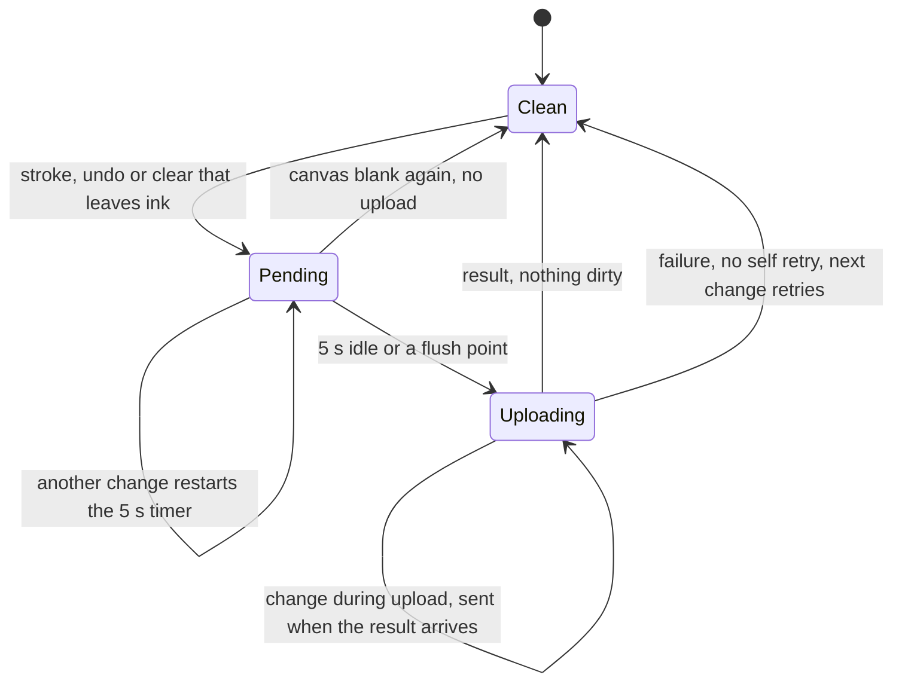

# Drawing canvas in the macOS client

A `drawing_upload` item asks the student to answer on a canvas, typically by drawing working or sketching on it. The canvas is part of the renderer script that `AssessmentPage` writes into the in-app page (see [client overview](overview.md#the-page)). The server side of the same answer, the upload slot and the stored bytes, is described in [sittings and attempts: drawing uploads](../design-tool/sittings-and-attempts.md#drawing-uploads) and [storage and assets](../design-tool/storage-and-assets.md). This page covers the client behaviour that decides when a picture is sent. The design notes are `docs/drawing-tools-design.md` (tools and auto-save) and `docs/drawing-background-design.md` (paper background).

## Tools and controls

`drawingField(item)` in `AssessmentPage.swift` builds the canvas, a toolbar and a controls row, and the page CSS styles them through `.drawing-tools`, `.drawing-controls` and `.drawing-status`.

- **Pen and eraser.** Each tool has three sizes (`PEN_SIZES`: pen 1.5, 2.5, 5; eraser 6, 10, 20, so the eraser is four times the pen at each size). The default is Medium pen. The eraser cuts to transparent (`destination-out`) rather than painting the paper colour, so the paper beneath shows through.
- **Inks.** Black, Red, Blue and Green (`PEN_INKS`). Choosing the eraser disables the ink buttons.
- **Undo.** The canvas keeps a list of strokes and replays the ones that remain, so an eraser stroke is undone correctly. Cmd-Z works only while focus is inside that drawing item (`wrap.onkeydown`), so two drawings cannot undo each other and the essay textarea keeps its own undo. There is no redo.
- **Clear and Save drawing.** Clear empties the stroke list. Save drawing is the manual path that always posts when the canvas is marked.

The toolbar is one tab stop with arrow-key movement (`testTheToolbarIsOneTabStopAndArrowsMoveIt`). Disabled buttons are skipped (`testDisabledButtonsAreSkippedAndUndoJoinsOnceEnabled`).

## Paper background

The background is painted into the canvas itself, before any stroke and before a restored picture is drawn (`GRID_CELL` = 40 canvas pixels). Only the bundle's `grid` and `axes` kinds paint. Any other value, or no value, paints nothing, which is the same as a blank transparent canvas. Because the paper is in the bitmap, `toDataURL` carries it and the server and teacher viewer need no special handling.

`--canvas-paper` is declared as a CSS token that the contrast sets do not override. The student's canvas stays white on a dark contrast set, so ink they draw is visible, while the ink itself stays the same across sets. See `testTheCanvasPaperTokenIsDeclaredAndNoContrastSetOverridesIt`.

## Auto-save lifecycle

Each save is a full upload (a new server slot and a new object), so the page does not save per stroke. `touched()` runs after every stroke end, undo or clear. It restarts an idle timer of `AUTO_SAVE_IDLE_MS` (5000 ms). `flushNow()` is the single entry point for saving.

Flush points call `flushNow` through `DRAWING_FLUSHES`: focus leaving the item (not focus moving within the toolbar or canvas), a page turn, and Finish, which flushes before the submit goes. `inFlight` ensures one upload at a time, and `UploadGate` counts uploads in flight so a hand-in waits for them. Auto-save is switched off when `OFFLINE_MODE` is set; the manual button still posts so the host can report "drawing ignored" in hand-run checks.

## Host bridge and server path

The renderer posts the PNG as a `data:image/png;base64,...` string to the host. `BridgeChecks.swift` refuses anything that is not a base64 PNG (`testRefusesBytesWithoutThePNGSignature`), and refuses any picture over `BridgeLimits.drawingMaxBytes` (20 MB) before decoding (`testRefusesAnOversizedDrawingBeforeDecoding`). The host then requests a slot from the server, and the server re-checks ownership, type and size. See [sittings and attempts](../design-tool/sittings-and-attempts.md#drawing-uploads) and the [bridge checks in lockdown and security](lockdown-and-security.md).

Resume after a rejoin uses the saved upload: `testARestoredDrawingWithBytesIsPaintedOntoTheCanvasAndReadsSaved` covers a picture repainted onto the canvas, and `testARestoredDrawingWithoutBytesStillReadsSavedAndPaintsNothing` covers the case with no stored bytes. See [resume prefill](../design-tool/sittings-and-attempts.md#resume-prefill).

## Change navigation

| Intent | Start at | Focused tests |
|---|---|---|
| Tool sizes, inks, eraser, undo | `AssessmentPage.swift` (`drawingField`, `PEN_SIZES`, `undo`) | `RendererDrawingToolsTests` |
| When a save fires, flush points, offline behaviour | `AssessmentPage.swift` (`touched`, `flushNow`, `AUTO_SAVE_IDLE_MS`, `DRAWING_FLUSHES`) | `RendererDrawingAutoSaveTests` |
| Paper grid or axes, paper token | `AssessmentPage.swift` (`GRID_CELL`, background painter), `PageShell.swift` | `RendererDrawingBackgroundTests`, `PageShellTests` |
| Bridge size or type limits | `BridgeChecks.swift` | `BridgeChecksTests` |
| Upload wait at hand-in | `UploadGate.swift` | `UploadGateTests` |

Invariants to keep: the eraser must not paint paper colour, a blank canvas must not post, and changes to the drawing UI must keep the saved PNG's content identical across contrast sets.

Narrow check: `cd client/SecureTestCore && swift test --filter RendererDrawingAutoSaveTests`. Run the sibling suites (`RendererDrawingToolsTests`, `RendererDrawingBackgroundTests`) when you change the same file. Do not edit the vendored renderer resources by hand. Rebuilding the app is conditional on changes under `client/SecureTest/`.
