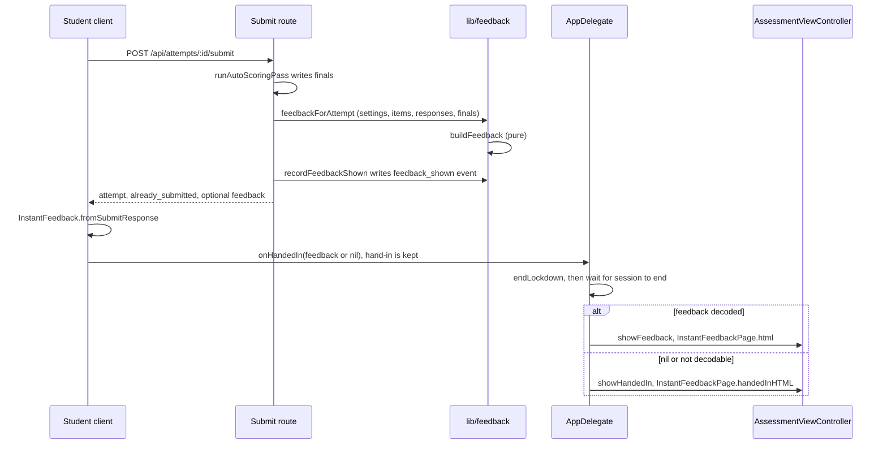

# Instant feedback on the student client

Instant feedback is the optional results screen a student sees right after their own hand-in, when the teacher has turned it on. The design tool decides what the feedback says and whether answers may be shown; the macOS client only decodes that object and presents it. The server rules (levels, finals-only scoring, answer release) live in [scoring and results](../design-tool/scoring-and-results.md). Client placement in the app shell is described in the [client overview](overview.md).

## Flow at hand-in

The submit route returns the feedback object in the same response as the hand-in. The client holds it until the secure session has ended, so the test page cannot be edited after the hand-in.

Caption: the hand-in succeeds first; feedback is a courtesy that is shown only after `endLockdown`. In `AppDelegate`, `pendingFeedback` and `pendingHandedInPage` are held until `showPendingFeedback` sees the session inactive on the server attempt screen. A nil feedback object therefore leads to the handed-in page, not to the test page.

On the server, the submit route calls `feedbackForAttempt` only when `pass_back_count` is 0, after auto-scoring has written its finals. A retry of a hand-in that already recorded `feedback_shown` rebuilds the same object without a second event. The rules are in [scoring and results](../design-tool/scoring-and-results.md).

## Wire model: `InstantFeedback`

`InstantFeedback.swift` mirrors `FeedbackLevel`, `FeedbackResult` and `FeedbackItem` from `design-tool/lib/feedback/buildFeedback.ts`.

- `Level` is `score`, `right_wrong` or `answers`. `items` is absent at `score`. `answersNote` appears at `answers` before answers are released.
- `Result` is `correct`, `partial`, `incorrect` or `pending`. `correctAnswer` is sent only on a missed row, at `answers`, after release.
- `InstantFeedback(json:)` is forgiving in one direction. An unknown `level`, or a missing or non-numeric `earned`, `max_auto` or `pending_count`, returns `nil` for the whole object. An unknown `result` or a missing `number` drops only that row, so a future result word such as "excused" is never shown as "Scored by your teacher". Booleans are rejected where numbers are expected.
- `fromSubmitResponse` never throws. A body that is not JSON, or an older server without a `feedback` key, is simply "no feedback".

Because unknown values degrade silently, a new level or result word must be added here and in the TypeScript union at the same time. Otherwise the student sees less than the server sent, with no error.

## Presentation: `InstantFeedbackPresentation`

`InstantFeedbackPresentation` is pure. It decides every sentence the student reads, so the wording is pinned by tests and not by a manual run.

- Score line: "You scored N of M on the questions scored right away." When nothing is scored right away, the line says so instead.
- Pending line: a singular and plural form, with a different sentence when nothing is auto-scored.
- Row heading: "Question N — Right", "Not right", "Scored by your teacher", or "Partly right (x of y)". Points appear only on a partial row. Points format as whole numbers, with at most two decimals for partial credit.
- Rows are ordered by question number. Empty answers become "(no answer)".

## Page: `InstantFeedbackPage`

`InstantFeedbackPage.html` uses the same `PageShell` as the test, so contrast, font and zoom accommodations apply unchanged. It uses the same Content-Security-Policy, and the same KaTeX assets and `AssessmentPage.mathPassFunctions` as the test page. Every string from the server is HTML-escaped in Swift before insertion, and only then does the math pass turn `$…$` runs into KaTeX.

Accessibility rules, each pinned by a test:
- The heading receives focus first, then the score line, pending line, note and rows, in that order.
- The ✓ and ✗ marks are decoration (`aria-hidden`). The result is always written as words.
- Done and Return both go home. Escape does not. Read aloud appears only with a text-to-speech grant.

`InstantFeedbackPage.handedInHTML` is the page for a hand-in with no feedback. It says "Handed in" and "Your answers are saved. Your teacher will review them.", with one Done button and the same shell.

## Change navigation

| Intent | Start at | Check |
|---|---|---|
| Add a level, result word or row field | `InstantFeedback.swift` (`Level`, `Result`, `Item`, `init?(json:)`), then `lib/feedback/buildFeedback.ts` (`FeedbackLevel`, `FeedbackResult`, `FeedbackItem`) | `InstantFeedbackTests` decode tests; `instant-feedback-builder.test.ts` "buildFeedback — levels" and "per-item results" |
| Change a sentence the student reads | `InstantFeedbackPresentation` in `InstantFeedback.swift` | `testScoreLineAndPendingLineMatchD1`, `testPendingLinePluralAndAbsence`, `testRowHeadingsUseTheResultWords`, `testATestWithNothingScoredRightAwaySaysSo` |
| Change page markup, focus or keys | `InstantFeedbackPage.swift` | `testThePageReadsInOrderHeadingScorePendingNoteRows`, `testTheResultIsWordsAndTheMarkIsHiddenFromVoiceOver`, `testDoneAndReturnEachGoHomeOnceEscapeDoesNot`, `testTheHandedInPageCarriesNoFieldAndADoneButton` |
| Change when feedback is shown | `AppDelegate.swift` (`onHandedIn`, `showPendingFeedback`), `AssessmentViewController.swift` (`showFeedback`, `showHandedIn`) | `AssessmentLockdownTests` for session end; the app-target path has no focused unit test |
| Change what the server returns | `lib/feedback/buildFeedback.ts`, `attemptFeedback.ts`, submit route | `instant-feedback-builder.test.ts`; `instant-feedback-api.test.ts` "submit — feedback by level" and "submit — the event, the retry, and the paths with no feedback" |

Validation: run the Swift filter and the two TypeScript files above for ordinary changes. The API test needs the design-tool database (see [testing](../testing/testing-and-validation.md)). A change to a wire value crosses both sides, so run both suites, not only the one you edited.

Scope boundaries: this page does not cover the teacher's feedback settings UI (`lib/feedback/settingsUi.ts`) or the teacher-side release of answers, both of which are in [scoring and results](../design-tool/scoring-and-results.md). The student's general hand-in and session lifecycle is in [lockdown and security](lockdown-and-security.md).
