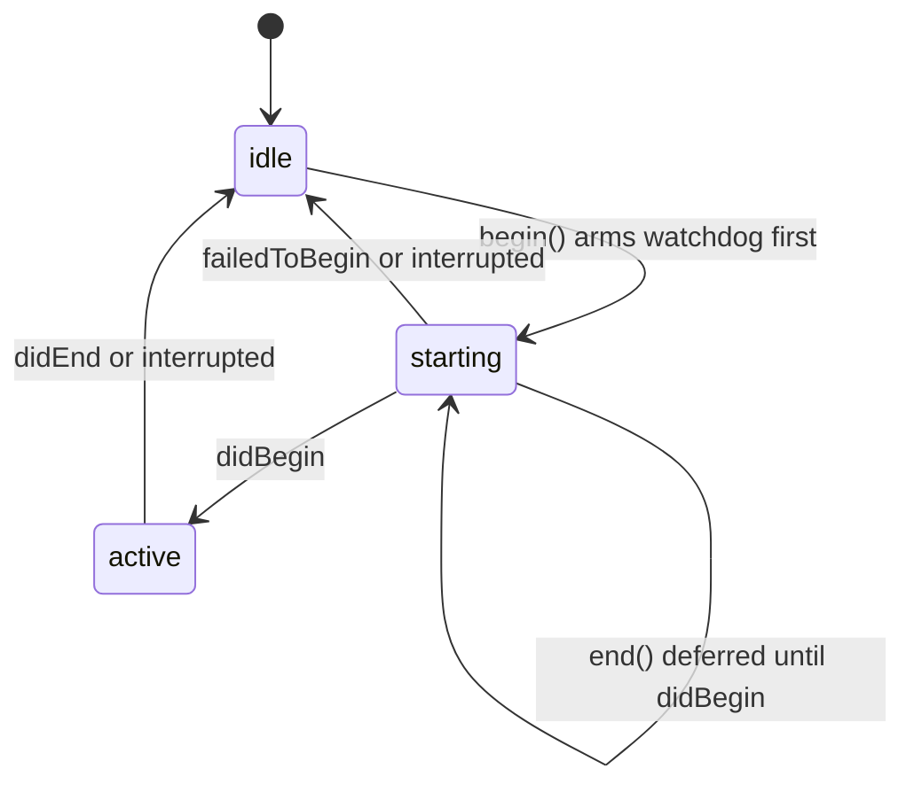
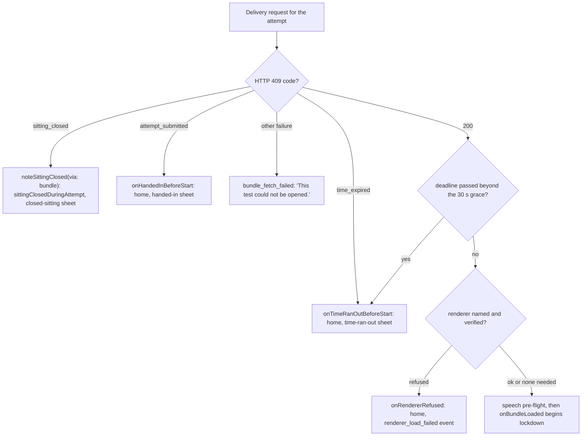

# Client lockdown and security

This page covers how the [macOS client](overview.md) keeps a student inside a test and, equally, how it guarantees a student can always get out. Consult it before touching `AssessmentLockdown`, the web view configuration, the page CSP, message handlers, exit controls or event telemetry.

## Lockdown seam

macOS offers lockdown through `AEAssessmentSession` (Automatic Assessment Configuration, "AAC"). Linking it requires a restricted entitlement (`com.apple.developer.automatic-assessment-configuration`, in `client/SecureTest/SecureTest.entitlements`, with the sandbox keys merged at signing time), so only the signed app target can touch it. The design therefore splits in two:

| Layer | File | Role |
|---|---|---|
| State machine | `SecureTestCore/.../AssessmentLockdown.swift` | `AssessmentLockdown` with states `idle`, `starting`, `active`; watchdog, escalation, teardown handshake; testable with `swift test`. |
| Session protocol | `AssessmentLockdown.Session` | `begin()`, `end()`, `onEvent` delivering `didBegin`, `didEnd`, `failedToBegin`, `interrupted`. |
| Real adapter | `client/SecureTest/RealLockdownSession.swift` | The only file importing `AutomaticAssessmentConfiguration`; maps four delegate callbacks to events and applies a `LockdownConfigurationPlan`. |
| Stand-ins | `SimulatedLockdownSession`, `RefusedLockdownSession` | Simulation for development and CI; a session that fails immediately for a shipped build lacking the entitlement. |

`RealLockdownSession.binaryHasEntitlement` decides which backing is used. A development build without the entitlement falls back to the simulation; a Release build must use `RefusedLockdownSession`, which reports `failedToBegin` so the machine returns to `idle`, the `PageLoadGate` refuses, and the student sees "Couldn't start a secure session" instead of a test on an unlocked Mac. In development, `SECURE_TEST_SIMULATE_LOCKDOWN` (`refuses`, `hangs`, `interrupts`, `slow`) rehearses failure modes on any Mac.

A refused start is written as a `lockdown_failed` attempt event (an alert kind on the monitor, see [sittings and attempts](../design-tool/sittings-and-attempts.md#events-and-the-monitor)). Its detail carries `os_version` and `model` from `DeviceInfo.swift` (the hardware family such as `Mac15,12`, never a serial number), so field reports of `AEAssessmentErrorDomain` failures can be grouped by macOS version and Mac model. The student sees the `JoinErrorCopy` secure-start message, which asks them to wait a minute and open the test again from Your tests.

### Which accommodations open lockdown knobs

`LockdownConfigurationPlan(accommodations:)` starts from everything closed and opens only knobs whose accommodation id is present in the delivery bundle's effective accommodation map: `spell_check` to `allowsSpellCheck`, `word_completion` to `allowsPredictiveKeyboard`, `closed_captioning` to live captions. Screenshots, text replacement and autocorrect stay off, and secondary assistive apps (`permissive_mode`) are not yet supported. Dictation cannot be blocked by AAC on macOS (`allowsDictation` is iOS-only), so speech-to-text exceptions are handled by device profile, not code. The speech controls and their pre-flight are in [speech accommodations](speech-accommodations.md). The server resolves accommodations ([accommodations and roster](../design-tool/accommodations-and-roster.md)); the client only checks presence. In-app text-to-speech is app-side synthesis, not an OS reader.

## Lifecycle and exit guarantees

State machine of `AssessmentLockdown`; a deferred end is paid the moment `didBegin` arrives.

Rules encoded in `AssessmentLockdown` (documented in its header and covered by `AssessmentLockdownTests` and `SimulatedLockdownSlowTests`):

1. **Arm before begin.** Timers go up before `session.begin()`, so no window exists where a session is live and unwatched.
2. **Watchdog is optional and has a floor.** `Timings.watchdog` is nil in a Release build (a ten-minute watchdog had been ending real sessions on the fleet); development arms 600 s, adjustable via `SECURE_TEST_WATCHDOG_SECONDS` only when `allowOverride` is true. The floor is 10 s.
3. **Backstop on its own scheduler.** `backstopScheduler` is separate from the UI scheduler (`LockdownScheduler.swift`), so it still fires if the main thread is stuck.
4. **Confirmed teardown.** `endBeforeTeardown(completion:)` calls `end()`, then waits for `didEnd` up to `Timings.grace` (20 s, with a half-grace log line). If it never confirms, `onUnrecoverable` fires and the app exits the process (the `lockdown_unrecoverable` crash line). The AppKit caller must cancel the quit and re-issue it from the completion, never return `.terminateLater` and wait: a nested run loop starves the completion.
5. **Never `end()` before `didBegin`.** The real framework drops it. `end()` while `starting` sets `endDeferred`; `endIsOwedOnBegin` lets the host avoid building the test for that instant.

Student-reachable exits are the titlebar button, Cmd-E, Cmd-Q, window close and SIGTERM. `ExitConfirmation.shouldConfirm` adds one confirming dialog only while a test is open inside a live session and not yet handed in; system-initiated quits (logout, MDM) are never held up. The default button keeps the student in the test.

`PageLoadGate` (an actor, resolved by `open()` / `refuse()`) holds the page build until lockdown is `active`. Its `Outcome` is `opened`, `refused` (the session went back to `idle` without becoming active) or `timedOut`. Only `opened` may build the test; the other two send the host home with an explanation. `AssessmentViewController` waits up to 60 s, and after 20 s shows "Still starting the secure session…" instead of sending the student home, because one student Mac answered `begin()` about 36 s after the call (SS-1, 2026-10-08). The ordering also fixes a layout bug: the renderer reads viewport width once at build time, and building during the AAC window-resize transition picked the wrong layout.

**Leaving after a hand-in (ending-session race, 2026-10-24).** `AssessmentLockdown.begin()` returns whether that call started a session. A `false` means a previous session is still up, so its state says nothing about the new attempt, and `beginLockdown()` keeps the gate shut. The in-page "Back to your tests" is decided by `BackToTests.decide(feedbackPending:sessionActive:handedIn:)`. It returns `leave` when no session is active, `refuse` when the page asks to go home mid-session without a hand-in, `waitForSessionEnd` when instant feedback is pending (the results page appears at `DID END`), and `leaveAtSessionEnd` otherwise (the student goes home at `DID END`). Before this rule, a press before `DID END` left at once, and joining another test while the old session was still ending drew the new test under that session. The served renderer no longer posts `home` for this reason, so `BRIDGE_REQUIRES` in `packages/renderer/src/requires.ts` omits it (see [signed renderer delivery](signed-renderer.md)). After a hand-in the served page shows "Handed in. Finishing your secure session…" with no way-home button (`AssessmentPage.swift`), and the shell's handed-in or results page replaces it at `DID END`.

## Refusals before a secure session begins

The delivery request is made by `AssessmentViewController` after the attempt is created, and every refusal in this section is decided before `onBundleLoaded` runs, so no lockdown session is begun and no lockdown event is written for the refused start. The host (`AppDelegate`) sends the student back to "Your tests" with the sheet that matches the cause.

The order of the bundle checks in `AssessmentViewController`, and the host handler each refusal reaches.

- **Time already run out (EX-2).** A 409 `time_expired`, or a bundle whose deadline is past the server's grace, fires `onTimeRanOutBeforeStart`. Nothing begins, so there is no session to end, and the host shows the time-ran-out sheet.
- **Sitting closed (SEC-01, Row CS).** A 409 `sitting_closed` on the delivery route is an expected answer, so it logs no error. `sittingClosedDuringAttempt` writes a `sitting_closed` event with `via: "bundle"` and ends the flow the same way as a closed sitting seen by the peek poll. The attempt stays `in_progress` and resumable. This is the same landing as the time limit, not a hand-in.
- **Attempt already handed in (SEC-01).** A 409 `attempt_submitted` fires `onHandedInBeforeStart`. The student goes home with the join's handed-in wording (`JoinOutcome.handedInMessage`), and the attempt screen's peek poll and countdown stop. Nothing is written to `errors.log`.
- **Renderer refused.** Covered in [signed renderer delivery](signed-renderer.md#client-verification-path). The refusal is also written to the teacher's timeline as `renderer_load_failed`.

Any other fetch failure still shows "This test could not be opened." with the error's message and writes `bundle_fetch_failed`. Before the SEC-01 branches existed, a closed sitting or a handed-in attempt that landed during the load fell into that generic failure.

Focused tests: `ResponseSpoolTests` (`testTheSittingClosedErrorCodeMapping`, `testTheAttemptSubmittedErrorCodeMapping`) pin how `APIError` classifies those two codes. The fetch-task branches themselves are not unit tested, so a change to them needs a real sitting. Add a new refusal as its own `catch let error as APIError where …` branch above the generic catch, keep it before `onBundleLoaded`, and give it a host handler that uses `showEntry()`.

## Sealed page

- **Document.** `PageShell` assembles HTML loaded with `loadHTMLString(_, baseURL: nil)`, a no-origin document with no `localStorage` or cookies. Item content is never interpolated into markup; the page receives JSON and builds DOM with `textContent` (see `JSONEmbedding`). Only the title is interpolated, through `HTMLEscape`.
- **CSP.** `PageShell.contentSecurityPolicy` is `default-src 'none'` plus inline style and script, and `data:` fonts and images. There is no `connect-src`, so fetch, XHR and WebSocket are blocked, and no `eval`. Everything (KaTeX, fonts, images) is inlined.
- **Web view.** `LockedDownWebView` unregisters dragged types, swallows `rightMouseDown`, nils `makeTouchBar` and `validRequestor` (Services, "Search with Google", Share). `AssessmentViewController` uses a non-persistent data store, disables `javaScriptCanOpenWindowsAutomatically`, and its `decidePolicyFor` allows only the host's own `about:` loads, counted by `pendingHostLoads`; any other navigation is cancelled and logged to the `[security]` channel. The same non-persistent store is used by `WebViewAuthPresenter` for the Google sign-in sheet.
- **Bridge.** Data leaves the page only through eight named script message handlers in `AssessmentViewController`: `response`, `upload`, `submit`, `home`, `withdraw`, `timer`, `tts`, `stt`. Every payload is untrusted. `BridgeItemTable.check` refuses unknown item ids and mismatched response types and over-length text (measured in UTF-16 units, like Zod); `DrawingPayload.pngBytes` bounds base64 size before decoding and requires the PNG signature. Refusals are `BridgeRefusal` values, logged by id and size, never answer text.
- **Limit parity.** `BridgeLimits` mirrors `@secure-test/schema` constants (`ESSAY_TEXT_MAX_LENGTH`, `SHORT_TEXT_MAX_LENGTH`, `ESSAY_HTML_MAX_LENGTH`, `RESPONSE_CELL_MAX_LENGTH`) and the server's `UPLOAD_MAX_BYTES`. `design-tool/test/bridge-limits.test.ts` reads `BridgeChecks.swift` as text and fails on drift, so a limit change needs both sides. See [wire formats](../architecture/wire-formats.md).
- **Served renderer.** When a bundle names a renderer, the page's script and item styles come from the design tool. The shell verifies them against its compiled-in public keys before lockdown begins (`RendererLoader`, `RendererVerifier`; see [client verification path](signed-renderer.md#client-verification-path)). The bridge checks above are therefore the trust boundary between that page and the app, not the app build alone. ADR 0018 (`docs/adr/0018-server-delivered-renderer.md`) is still marked Proposed in the repository. Without a `renderer` ref, only a Debug build uses the bundled page, and a Release build refuses the test.

## Telemetry and diagnostics

- **Events.** `AttemptEventKind` (quit, emergency_exit, focus_loss, focus_regained, lockdown_begin/end/failed/interrupted, client_error, time_expired, sitting_closed, speech_preflight) mirrors the server's `CLIENT_ATTEMPT_EVENT_KINDS` and is posted to `/api/attempts/:id/events` ([sittings and attempts](../design-tool/sittings-and-attempts.md), [data model](../design-tool/data-model.md)). `AttemptEventReporter.report` returns immediately and posts from a detached task; lifecycle kinds in `retriedKinds` get a bounded retry (up to four attempts, 2/4/8 s). Failures are logged and dropped so an exit is never blocked.
- **Closed sittings.** `PeekResponder` polls `/peek/pending` every 5 s; `PeekPoll.sitting` reading `closed` ends the secure session and returns the student home, and the same poll carries deadline updates and "time limit removed". An unrecognised or absent `sitting` reads as open, so a client never ends a test on news it does not understand. A teacher's peek request renders the frame and shows a visible banner (`PeekNotice`).
- **Errors.** `ClientErrorLog` writes `errors.log` lines (`ClientErrorEntry`, stamped with `AppBuildStamp`); `ClientErrorDrain` posts batches of at most 50 to `/api/client-errors`. `CrashReporter` pre-formats signal lines (SIGABRT, SIGSEGV, SIGBUS, SIGILL, SIGTRAP) ahead of time because a signal handler may only `write(2)`; the drain stamps its own time on them. Server side: [deployment and observability](../operations/deployment-and-observability.md).
- **Sleep during teardown.** `SleepWakeRecorder` records when a teardown started (`markTeardownStarted`), each sleep that happens during it, and the last wake. `teardownContext()` turns that into the exit-70 report fields `slept_during_teardown`, `teardown_wall_s` (wall-clock seconds, which keep counting while the Mac sleeps) and `woke_s_ago`. `AppDelegate` reads it when it writes the `lockdown_unrecoverable` report. The backstop timer runs on the uptime clock, which stops during sleep, so this is the evidence for a teardown that ran far longer than the 20 s grace on the wall clock. The recorder is asserted in `CrashReporterTests` (`testSleepWakeRecorder`).

## Change navigation

| Intent | Start at | Tests |
|---|---|---|
| Exit path or teardown timing | `AssessmentLockdown`, `ExitConfirmation`, app quit handling in `AppDelegate.swift` | `AssessmentLockdownTests`, `SimulatedLockdownSlowTests`, `ExitConfirmationTests` |
| Page-load wait, slow-start notice or refused start | `PageLoadGate` (`open()` / `refuse()` / `wait(timeout:slowAfter:onSlow:)`), the lockdown wait block in `AssessmentViewController.swift` | `PageLoadGateTests` |
| Open a new AAC knob for an accommodation | `LockdownConfigurationPlan`, `RealLockdownSession.begin()` | `LockdownConfigurationPlanTests` |
| Page CSP or document shell | `PageShell`, `JSONEmbedding`, `HTMLEscape` | `PageShellTests`, `JSONEmbeddingTests` |
| New message handler or payload limit | `AssessmentViewController` channel constants, `BridgeChecks.swift` | `BridgeChecksTests`, `bridge-limits.test.ts` |
| New client event kind | `AttemptEventKind`, server `ATTEMPT_EVENT_KINDS` | `AttemptEventReporterTests`, `attempt-events-api.test.ts` |

Invariants to keep: arm timers before `begin()`; every code path that can call `begin()` ships an exit; a Release build never falls back to a cooperative simulation; handler payloads are validated before spooling. Narrow check: `cd client/SecureTestCore && swift test --filter AssessmentLockdownTests`. The real AAC behaviour cannot be exercised headlessly: changes to `RealLockdownSession` or the web view need a hand-run on an entitled Mac, and `xcodebuild` is only needed when files under `client/SecureTest/` change. Entitlements can be confirmed with `codesign -d --entitlements -` against `client/expected-entitlements.txt`.
 with `codesign -d --entitlements -` against `client/expected-entitlements.txt`.
d with `codesign -d --entitlements -` against `client/expected-entitlements.txt`.
nts -` against `client/expected-entitlements.txt`.
nd `xcodebuild` is only needed when files under `client/SecureTest/` change. Entitlements can be confirmed with `codesign -d --entitlements -` against `client/expected-entitlements.txt`.
d with `codesign -d --entitlements -` against `client/expected-entitlements.txt`.
nts -` against `client/expected-entitlements.txt`.
