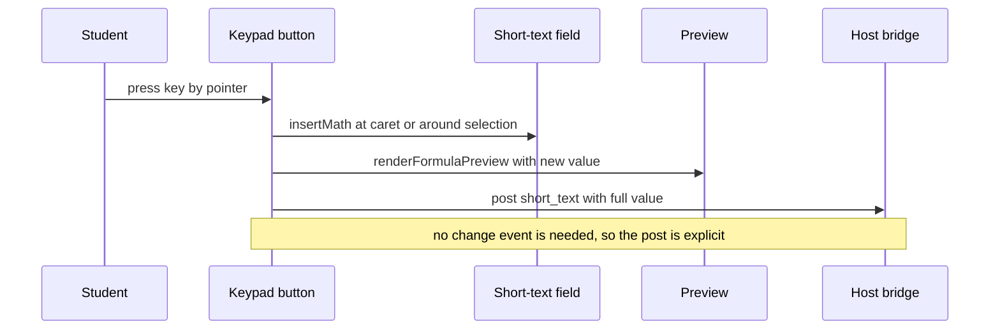

# Math keypad and formula preview for short-text answers

<!-- openwiki: broken internal link [../design-tool/scoring-and-results.md#scoring-rules] heading anchor "scoring-rules" does not exist in "../design-tool/scoring-and-results.md". Fix the href or restore the target, then delete this comment. -->
A `short_text` item is a single line of text, but many questions are math. The student client therefore gives every short-text field a **math keypad** and a **live preview** of the typed answer rendered as KaTeX. The keypad is a student aid. It does not change what is stored or how the answer is scored. The stored response is the raw text, and the design tool reads that text with the rules in [scoring and results](../design-tool/scoring-and-results.md#scoring-rules).

The design rationale is in `docs/math-entry-design.md`. Its header predates the build, so trust its Progress section and the source for what shipped. The handwriting idea in that note remains a spike and is not built.

## Student-side behaviour

Everything below lives in the renderer script inside `AssessmentPage.swift`, which the [client overview](overview.md#the-page) describes.

- **Field and preview.** `shortTextField(item)` builds one `input.short-text`. `oninput` calls `renderFormulaPreview`, which turns the value into TeX with `formulaTex` (drop every `$`, escape `%`, `#`, `&` and `~`, trim, turn whitespace runs into `\ `, wrap in `\mathrm{…}`) and renders it with KaTeX in `throwOnError` mode.
- **Failure handling.** When KaTeX cannot parse a half-typed expression, the last good render stays on screen (`data-last-good`) and a plain note says "Can't read that as math yet — keep typing." KaTeX's red error markup never reaches the page.
- **Hint.** A hint naming the keys appears only where the stem carries `$`. Otherwise the field has no hint.
- **Keypad.** `mathKeypad(item, input, preview)` adds a `Math keys` toggle and a `role=toolbar` pad below the preview. `MATH_KEY_ROWS` defines 22 keys in three rows: six structure keys (fraction, exponent, subscript, square root, parentheses), seven operators and comparisons (times, divide, plus or minus, less than or equal, greater than or equal, not equal, degrees), and nine Greek letters. Structure keys show KaTeX-rendered faces, with a text fallback when KaTeX is absent.
- **Open by default.** Every short-text field gets the toggle. The pad opens by default only when the stem carries `$`, the page's one signal that a question is math-shaped.
- **Insertion.** `insertMath(input, before, after, wrappedBack)` splices the key into the field at the caret, or wraps the selection. A fraction or root with nothing selected inserts an empty structure with the caret in its first slot. A selection becomes the first slot. A symbol key inserts one character.
- **Posting.** Each key press calls `post(item.id, { type: 'short_text', text: input.value })` after the insertion. The comment ties this to the `change` trap: a programmatic value change fires neither `input` nor `change`, so without the explicit post a student who pressed Next after a keypad edit would hand in the older text.
- **Keyboard and pointer.** The pad is one tab stop with a roving index; arrows, Home and End move within it. Pointer-down is cancelled so the field keeps its caret. A pointer click refocuses the field; a keyboard activation does not.
- **Undo.** The text typed before a key press is one undo step, and the insertion is another (RT slice 3 in the source). See the stacked undo model in [formatted essay editor](rich-text-essay.md).

Speech also reads the keypad's output. The rendered formula is announced as math through [speech accommodations](speech-accommodations.md) (`testKeypadLatexIsReadAsMath`).

## What the scorer does with the text

The server does not know about the keypad. It scores the typed text in `design-tool/lib/scoring/auto.ts`:

1. `normalizeShortText` (trim, collapse whitespace, lower-case) and a plain equality check.
2. If that fails and the item has no `exact_form`, `numericAnswersEqual` compares values when both sides parse as numbers (fractions, mixed numbers, scientific notation, thousands separators, a trailing percent). The percent rule is both-sides-or-neither.
3. If that fails and either side carries formula markup (`FORMULA_MARKUP_RE`), `foldFormula` compares both sides after canonicalisation and folding.

`canonicalizeMath` is the shared notation pass. It maps `\times`, `\pi` and similar commands and Unicode super- and subscripts to the characters the keypad inserts, turns `\frac{A}{B}` into `A/B` and `\sqrt` into `√`, and leaves `^` in place because an exponent changes the value. The tests in `scoring-numeric-equivalence.test.ts` pin the value rules (`1/2` matches `0.5`, `50%` does not match `0.5`), and `scoring-math-fold.test.ts` pins the notation-only fold (`H_2O` matches `H2O`, `10^4` does not match `104`). The full match ladder is in [scoring and results](../design-tool/scoring-and-results.md).

`exact_form` is a teacher-side flag on the answer key, set in the authoring editor. It is set on the teacher bundle only and turns off the numeric step. Table cells call `shortTextMatches` through `tableCellMatches`, so they follow the same rules, and a blank in a fill-in-the-blank item applies the same opt-out (see [fill-in-the-blank items](../design-tool/fill-in-the-blank.md#scoring-and-reading)).

## What the teacher sees

Teachers do not see raw text rendered as math by default. `design-tool/lib/reporting/shortTextView.ts` exports `renderShortTextAnswer`. It uses `shortTextTex`, which applies the same transform as the student's `formulaTex`, then renders KaTeX in throw mode. When the TeX fails to parse, the answer is shown as escaped plain text. The function never returns unescaped input.

Callers are the review queue route (`app/api/assessments/[id]/review-queue/route.ts`), the per-student results page and the printable work packet. The scoring queue component also receives this HTML. The reporting side is covered in [reporting and work packets](../design-tool/reporting-and-packets.md).

## Change navigation

- **Adding or reordering a key.** Edit `MATH_KEY_ROWS` in `AssessmentPage.swift`. `RendererMathKeysTests.testTheTwentyTwoKeysAreInOrder` pins the count and order. `testEveryKeysInsertionParsesInTheRealKatex` checks that every key's insertion parses in the real KaTeX library. Keep the key's `text` fallback meaningful, because it is shown when KaTeX is absent.
- **Adding a symbol the scorer should recognise.** Add the command to `MATH_COMMANDS` in `auto.ts`. If it is a new trigger character or command, extend `FORMULA_MARKUP_RE`. Then add a case to `scoring-math-fold.test.ts`. A new notation in `formulaTex` (client) must be mirrored in `shortTextTex` (server), so check `short-text-view.test.ts` as well.
- **Changing the preview transform.** `formulaTex` (client) and `shortTextTex` (server) must produce the same TeX. Their tests in `RendererFormulaInputTests` and `short-text-view.test.ts` are the parity guard.
- **Do not** post a different payload shape from a key press. The wire schema for `short_text` is the same field text as typing. See [wire formats](../architecture/wire-formats.md).
- **Non-goals.** No digit pad, no optional keys, and no handwriting. The client does not score answers, and the keypad adds no KaTeX macros, so saved stems do not change.

Ordinary check: `cd client/SecureTestCore && swift test --filter RendererFormulaInputTests` for the preview, and `cd design-tool && bun test test/short-text-view.test.ts` for the teacher render. Run the full client suite only when the change touches the renderer script generally, because `AssessmentPage.swift` is large and shared with the other item renderers.
ith the other item renderers.
derers.
