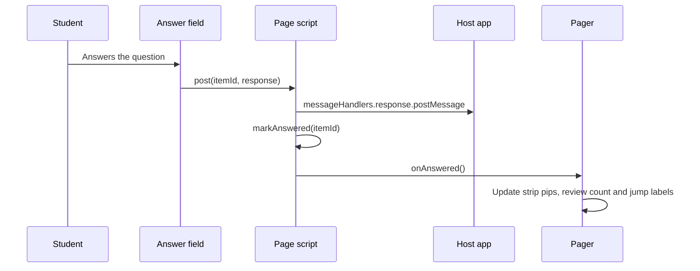

# Paged delivery in the student client

A teacher can set an assessment to **"One question at a time"** instead of the default **"One scrolling page"**. The choice is stored per assessment, carried in the delivery bundle as `layout: "paged"`, and rendered by the macOS client as a set of pages with a fixed navigation bar. The design rationale is in `docs/client-paging-design.md`; this page records what the source ships and how to change it safely.

The server side is small: the `student_layout` column (migration `0027_client_paging_student_layout.sql`) is validated in `lib/api/assessments.ts` and emitted by `buildDeliveryBundle` only when it equals `"paged"`. Both the schema (`StudentLayoutSchema` in `packages/schema/src/items.ts`) and the teacher export use the same rule, so older bundles and clients keep the scroll layout. The teacher's Settings tab offers the choice as "How students move through the test" (`app/dashboard/[id]/AssessmentEditor.tsx`). The preview renderer does not read the field, so the teacher preview stays one scrolling document. The shared rule is described in [wire formats](../architecture/wire-formats.md).

## How the client builds the page

The page script in `AssessmentPage.swift` reads `BUNDLE.layout` once when it loads: `var PAGED = !!(BUNDLE && BUNDLE.layout === 'paged')`. Anything else, including a value this build does not know, takes the scroll path, which builds the same tree as before the field existed.

<!-- openwiki: mermaid parse failed and this diagram was converted to a text fence so it does not break rendering. Fix the diagram source and restore the mermaid fence. Parser error: Heuristic: an unescaped angle bracket inside a label breaks rendering; rephrase the label. -->
```text
flowchart TD
    B["Delivery bundle: layout, item_sets, answered_item_ids"] --> P{"layout == paged?"}
    P -- no --> S["Scroll: stimulus before each set's first member, items in order, hand-in block at the end"]
    P -- yes --> Q["buildPaged: one page per question, one page per inline set, a passage page per own_page set, a review page"]
    Q --> W{"side_by_side and viewport >= 1100 px at build time?"}
    W -- yes --> SBS["Passage in the left column, question in the right, Sources: Beside or Above"]
    W -- no --> OP["Narrow: own_page behaviour, passage on its own page"]
    Q --> BAR["Pager bar: Previous, current page label, Next, and a strip with one button per page"]
```

Caption: how `AssessmentPage.swift` chooses between the scroll and paged builders. Page membership follows `layoutOf(set)`, so the passage, the disclosure and the member routing agree.

`buildPaged()` creates the pages in bundle order:

- **Question page.** One per item that is not a member of an inline set. Its label is "Question n of N".
- **Inline set page.** One page for the whole set, with the stimulus above its member questions. The label is "Questions a–b of N".
- **`own_page` set.** A passage page ("Passage for questions a–b") followed by one page per member. Each member page carries a collapsed "Show the passage" (or "Show the sources") disclosure that holds the same stimulus element, moved with `page.holder`. The passage is one DOM node that travels, so there is only one copy of it.
- **`side_by_side` set.** On a wide build, the sources sit in the left column and the question in the right. A "Sources:" group ("Beside the question" or "Above the question") moves them. Below the 1,100 px threshold the set falls back to `own_page`.
- **Review page.** "Review and hand in" lists every question as a jump link, has a count line, and includes the same hand-in block that scroll mode appends at the end.

## Navigation and answered marks

`show(n)` is the only place the visible page changes. It flushes any dirty drawing, stops read-aloud and dictation, hides every other page, moves the strip's `aria-current`, disables Previous on the first page and Next on the last, scrolls to the top, and focuses the page heading (a `tabindex="-1"` label).

Answered state has three sources, and the page keeps them in one map, `ANSWERED`:

1. **Resume.** `answered_item_ids` from the bundle seeds the map. The server builds this list from the attempt's own saved responses (`lib/api/savedResponses.ts`, see [resume prefill](../design-tool/sittings-and-attempts.md#resume-prefill)), so a relaunch does not show green marks over empty fields.
2. **Posting.** `post(itemId, response)` sends the answer to the host bridge and then calls `markAnswered`. The mark is set when the page hands the answer to the host, not when the server confirms it. The host's spool is responsible for delivery (see [durability](overview.md#durability-the-spool)).
3. **Clearing.** `markUnanswered` removes the mark when a multiple-choice answer is withdrawn or a multi-blank item is emptied.



Caption: an answer posts to the host and then updates the pager. Nothing is read back from the server during the page's lifetime.

Marks follow the page type. A question page is answered when its question is. An inline set page reports "n of m answered" and gets a partial mark when only some of its questions are answered. A passage page has nothing to answer. The review page's count line reads "n of N answered. Go back to any question, or hand in."

## Invariants

- **Scroll is the default.** Scroll mode builds no pages and no bar (`testScrollModeBuildsNoPagesAndNoBar`), and it ignores the answered field entirely (`testScrollModeIgnoresTheField`).
- **Position is not persisted.** The current page lives in memory. A relaunch starts at page 1. This is an explicit non-goal in the design note, because the page has no storage.
- **The layout is read once.** Both the layout and the wide/narrow decision are taken at build time. Re-paging on resize would rebuild the tree and lose unsaved typing. The client starts fullscreen by default, so the threshold is checked once (`WIDE`, `LAYOUT_MIN_WIDE_PX`).
- **Restoring does not mark.** Prefilled fields are set at build time without a post, so restoring never marks a page or sends a write.
- **Hidden pages stay in the DOM.** Every page is built up front and toggled with the `hidden` attribute, so unsaved input survives a page turn.

## Change navigation

| Intent | Start at | Tests |
|---|---|---|
| Page construction, membership, `own_page` or `side_by_side` routing | `AssessmentPage.swift` (`buildPaged`, `layoutOf`, `newPage`, `stimulusBlock`) | `RendererPagingTests`, `RendererLayoutToggleTests`, `RendererStimulusTests` |
| Navigation, the bar, the strip, focus on a page turn | `AssessmentPage.swift` (`show`, `refreshMarks`, `pager` CSS) | `RendererPagingTests` (`testNextAndPreviousMoveOnePageAndTheLastPageDisablesNext`), `RendererKeyboardReachTests.testPagedNavigationButtonsAreReachable` |
| Answered marks, the review count | `AssessmentPage.swift` (`post`, `markAnswered`, `markUnanswered`, `answeredOf`) | `RendererPagingTests` (`testPostingAnAnswerMarksItsPage`, `testSeededAnswersMarkTheStripTheReviewListAndTheCount`) |
| Bundle field decoding | `DeliveryBundle.swift` (`Layout`, `answeredItemIds`) | `DeliveryBundleTests.testLayoutDefaultsToScrollAndOnlyPagedPages`, `testAnsweredItemIdsDefaultToEmpty` |
| Server emission and the teacher setting | `design-tool/lib/api/buildDeliveryBundle.ts`, `lib/api/assessments.ts`, `lib/api/exportBundle.ts` | `assessments-api.test.ts` ("student_layout (client paging)"), `import-api.test.ts` ("import: student_layout"), `delivery-api.test.ts` ("answered_item_ids") |

Narrow checks:

- Client: `cd client/SecureTestCore && swift test --filter RendererPagingTests`. Use `--filter DeliveryBundleTests` when only decoding changes.
- Server: `cd design-tool && $TESTDB bun test test/delivery-api.test.ts` (the answered-ids and layout cases need the test database; see [testing](../testing/testing-and-validation.md)).
- Schema: `cd packages/schema && bun test test/delivery.test.ts` (describe "DeliveryBundleSchema layout (client paging)").

The client is not the only consumer. A change to the `layout` or `answered_item_ids` shape is a wire change, so run both the TypeScript and Swift checks ([wire formats](../architecture/wire-formats.md)). A new layout value needs the Swift `Layout` enum, the page builder, and the server enum to change together. Otherwise an older client silently falls back to scroll, which is the intended safe default.

Scope boundaries: this page does not cover the stimulus authoring rules for `own_page` and `side_by_side` (see [stimulus, item sets and multi-source readings](../design-tool/stimulus-and-item-sets.md)), the server clock or hand-in rules ([sittings and attempts](../design-tool/sittings-and-attempts.md)), or the per-item renderers ([client overview](overview.md)). The design note's "out of scope" list (a timer on the bar, resuming at the page the student left, forcing the order of pages) still holds for this build.
g at the page the student left, forcing the order of pages) still holds for this build.
 ([client overview](overview.md)). The design note's "out of scope" list (a timer on the bar, resuming at the page the student left, forcing the order of pages) still holds for this build.
