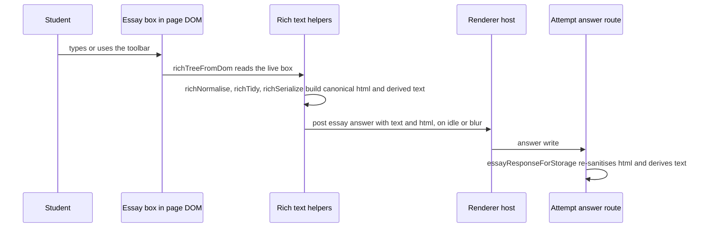

# Formatted essay editor in the macOS student client

When a teacher turns on "Let students format their answer" for an essay (`config.rich_text`, see [authoring](../design-tool/authoring.md#rich-text-essays)), the student's box becomes a small formatted editor instead of a plain textarea. The editor lives inside the same in-app renderer page as every other item ([client overview](overview.md#the-page)). It is built in `AssessmentPageRichText.swift` and spliced into `AssessmentPage.swift` the way the math pass is. Plain essays, short answers and table cells do not use this path, although they share the page's undo stack.

## What the student gets

- A `contenteditable` box named "Your answer", with a toolbar (`role=toolbar`) that controls it through `aria-controls`.
- Toolbar buttons and shortcuts for bold, italic, underline, bulleted and numbered lists (one level only), first-line indent, undo and redo. Shortcuts are Meta-based (for example `Meta+B`, `Meta+Shift+8` for a bulleted list, `Meta+]` for indent), as listed in the `RICH_TOOLS` table in `AssessmentPage.swift`.
- Enter makes a new paragraph (`defaultParagraphSeparator` is `p`). Paragraphs carry no margin, so the answer spaces the way a textarea would.
- No headings, fonts, colours, links or images. These are decided limits, not missing features.

## How a formatted answer moves

The page reads the box as a tree (`richTreeFromDom`) rather than re-parsing markup on each keystroke. It normalises that tree into paragraphs and lists, then serialises the canonical html and the derived plain text. The posted `text` is therefore the same string the server would derive. The server still re-cleans and re-derives everything; the client port exists so the page is honest for an older server and so the word count the student sees matches the stored one.

## Rules that must stay in step with the server

- **Sanitiser port.** `richTokenize`, `richBuildTree`, `richNormalise`, `richTidy` and `richSerialize` port `design-tool/lib/richText/essayHtml.ts`. Lists are one level: a nested list's items join the outer list (D-9). A list item resets the first-line indent (`testListsResetTheFirstLineIndent`).
- **Derived text.** `richTextFromHtml` produces the same lines the server stores. Bullets and numbers become "• " and "1. " lines so scoring and word count see the structure.
- **Shared cases.** The table of cases is shared with `design-tool/test/rich-text-essay-html.test.ts`. Change one side, change both: the Swift side asserts that table in `RendererRichTextTests.testTheSanitiserMatchesTheServersTable` and `testTheTextRuleMatchesTheServersTable`, so a change on one side needs the matching change on the other.
- **Invisible paragraphs (RT-1).** WebKit's list command can leave an empty paragraph with no ` `. `richInvisibleBlock` skips it in both the DOM reader and the caret walk. The markup reader is unchanged, so the server's table still holds.

## Paste, undo and the caret

- **Paste and drop** take `text/plain` only (`richPlainLines`). Pasting is refused when the clipboard is locked for the student (`testPasteIsRefusedWhenTheClipboardIsLocked`).
- **Undo** is one history per field (`undoHistory`). Keystrokes coalesce into one step within `UNDO_COALESCE_MS` (1000 ms) or until a word boundary (`undoBoundary`). A formatting command is its own step. The stack is capped at `UNDO_DEPTH` (200), tested by `testTheHistoryIsCappedAt200Steps`.
- **Cmd-Z / Shift-Cmd-Z** are handled by `undoChord`. Control and Option are not undo on a Mac.
- **Caret moves (RT-2).** A caret move without an edit is recorded on the current state (`history.moved`), so an undo lands the caret where the change was made. `testUndoPutsTheCaretWhereTheUndoneChangeWasMade` pins this.
- **Saving.** Typing autosaves the html and derived text, five seconds after the last keystroke or every 30 seconds during continuous typing (the essay timing in `RendererTextAutosaveTests`). Leaving the box posts at once (`testLeavingTheBoxPostsAtOnce`). A bold-only change is still saved (`testABoldOnlyChangeIsSaved`).

## Word count

<!-- openwiki: broken internal link [../design-tool/authoring.md#item] heading anchor "item" does not exist in "../design-tool/authoring.md". Fix the href or restore the target, then delete this comment. -->
The count is a page-side display of the item's `max_word_count` and `show_word_count` keys from the delivery bundle (both are set by the teacher; see [authoring](../design-tool/authoring.md#item)). Both essay boxes, formatted and plain, use the same rules in `AssessmentPage.swift`:

- A maximum always shows its count as "n / max words" and gets the `word-count over` class when the count passes it.
- Without a maximum, `show_word_count` shows a plain running "n words" count that is never marked over.
- Without either key, no count is drawn.
- The box is named "Your answer". The count is spoken on request, when focus leaves the box, in a hidden phrase such as "12 of 50 words, over the limit", so red alone does not carry the state. Crossing the maximum is announced once in each direction, never word by word.

The server derives the stored word count from the sanitised text, so the number the student sees matches the stored one ([rich-text rules](#rules-that-must-stay-in-step-with-the-server)). Focused checks: `cd client/SecureTestCore && swift test --filter RendererRichTextTests` (formatted boxes, including the WC-2 spoken-count and U-22 `show_word_count` cases) and `swift test --filter RendererBehaviourTests` (plain essays, the over-limit and spoken-count cases); server side: `cd design-tool && bun test test/delivery-api.test.ts` (the U-22 test).

## Resume and read-back

- A saved formatted answer is rebuilt from its html without posting (`testASavedFormattedAnswerIsRestoredWithoutPosting`). A plain saved answer fills one paragraph per line. This is the P-1 path described in [resume prefill](../design-tool/sittings-and-attempts.md#resume-prefill).
- Read-aloud and "read my answer" walk the box as the derived text lines (`richSpeechSegments`, `testSpeechSegmentsReadTheBoxAsTheDerivedTextLines`). Dictation inserts at the caret. The speech controls are described in [speech accommodations](speech-accommodations.md).

## Change navigation

- Start with `AssessmentPageRichText.swift` for the rules and `AssessmentPage.swift` (`richEssayField`, `richExec`) for the DOM wiring and toolbar table.
- If you change what counts as formatting, change the server side first in `design-tool/lib/richText/essayHtml.ts`, then port it here and update the shared cases. The wire format is described in [wire formats](../architecture/wire-formats.md).
- Focused check: `cd client/SecureTestCore && swift test --filter RendererRichTextTests`. For the server half, run `cd design-tool && bun test test/rich-text-essay-html.test.ts`, which needs no database.
- Escalate to the full `swift test` when you touch the page's shared helpers (undo, paste or speech), because other renderer suites share that script.
- Non-goals: do not add headings or links here. Those are out of the decided scope (D-2 in `docs/rich-text-essay-design.md`).

## Related pages

- [Client overview](overview.md) places this editor among the page features.
- [Authoring](../design-tool/authoring.md#rich-text-essays) defines the item flag and the server pipeline.
- [Scoring and results](../design-tool/scoring-and-results.md) and [reporting and packets](../design-tool/reporting-and-packets.md) read the same derived text the student sees.
