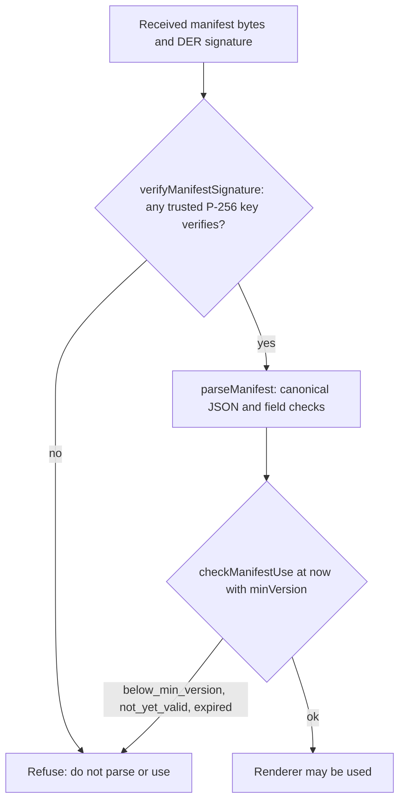

# Signed renderer delivery

<!-- openwiki: broken internal link [../docs/adr/0018-server-delivered-renderer-design.md] file "../docs/adr/0018-server-delivered-renderer-design.md" does not exist. Fix the href or restore the target, then delete this comment. -->
The student test page's code (item rendering, styles, the instant feedback page) is compiled into the signed macOS app as Swift string literals, so every page fix needs a signed client release. [ADR 0018](../docs/adr/0018-server-delivered-renderer-design.md) (status **Proposed**) would have the design tool serve a signed renderer that the native shell verifies before it starts lockdown. The design note is `docs/server-delivered-renderer-design.md`. This page covers the code that exists for that plan and what is still missing. For the current in-app page, see the [client overview](overview.md#the-page).

## Status

| Piece | State (source evidence) |
|---|---|
| Manifest, canonical bytes, `requires`, verification, build (`packages/renderer`) | Built and tested. The renderer file is a **placeholder** (`src/renderer.js`); the real page code moves in later (slice 5). |
| Signing and cross-language verification (`tools/renderer-sign`) | Built. The working public key is committed as `packages/renderer/keys/working.pub.pem`; the private key lives in the maintainer's Secure Enclave. |
| Staging stack that will host the renderer route | Built and deployed per the design log (see [staging stack](../operations/deployment-and-observability.md#staging-stack)). |
| Serving: sign at deploy, store by hash, renderer route, bundle field | **Not built** (design slice 3 commit 4). `packages/renderer/README.md` says serving "is not built yet". |
| Shell fetch, verify, cache, minimum-version and `requires` check | **Not built**. No manifest or signature code exists under `client/`; the only `manifest` match in the Swift sources is an unrelated font-test variable. |

The design doc's log (2026-10-13) lists this as the next step. Treat anything about serving or client verification as a plan, not current behaviour.

## Manifest (`packages/renderer/src/manifest.ts`)

- `buildManifest` takes the built files and returns `{format: 1, version, commit, issued_at, not_after, requires, files}`. `files` maps each published name to `{sha256, bytes}`. Names must match one lowercase path segment; traversal is refused.
- `version` is the HEAD commit's committer time in unix seconds, so it rises on the linear `main` history. `scripts/build.ts` takes it from `git log`. `commit` must be a 40-hex SHA.
- `not_after` is `issued_at` plus 60 days by default (`DEFAULT_VALIDITY_DAYS`), so a renderer nobody re-signs expires without an app release.
- `canonicalManifestBytes` writes UTF-8 JSON with no insignificant whitespace, keys sorted recursively, and safe integers only. `parseManifest` refuses bytes that are not that canonical form, so a manifest has one byte form.

## Requirements vocabulary (`src/requires.ts`)

<!-- openwiki: broken internal link [lockdown-and-security.md#message-bridge] heading anchor "message-bridge" does not exist in "lockdown-and-security.md". Fix the href or restore the target, then delete this comment. -->
`REQUIREMENTS` lists what a served renderer may ask of the shell: the eight bridge handlers (`response`, `withdraw`, `upload`, `submit`, `timer`, `home`, `tts`, `stt`) plus the host features `tts.word_ranges` and `response.generic`. `buildManifest` normalises `requires` to sorted, unique terms. `PLACEHOLDER_REQUIRES` is the set the placeholder uses. The design says the shell refuses a renderer that names a term it lacks, so adding a term is a shell change. The bridge handlers themselves are described in [lockdown and security](lockdown-and-security.md#message-bridge).

## Verification (`src/verify.ts`)

Callers must follow this order:

Caption: the verification order the package defines. Nothing calls it yet outside its tests.

- `verifyManifestSignature(bytes, derSignature, publicKeysPem)` returns true if any key (working or backup) verifies the signature. A malformed signature returns false. A key that is not P-256 throws, so a bad key entry is loud.
- `checkManifestUse(manifest, {now, minVersion})` returns `below_min_version`, `not_yet_valid` (before `issued_at`) or `expired` (after `not_after`). Both window ends are inclusive.

## Build (`scripts/build.ts`)

`bun run build` in `packages/renderer` writes `dist/renderer.js`, `dist/renderer.css` and `dist/manifest.json` (the canonical bytes). It fails if `src/renderer.js` contains `</`. It does not sign or serve anything. `dist/` is generated and gitignored; do not hand-edit it.

## Signing tool (`tools/renderer-sign`)

A Swift package (macOS 14+, CryptoKit and LocalAuthentication, no third-party dependencies). It signs the exact bytes of `dist/manifest.json` with ECDSA P-256 over SHA-256, DER-encoded, the same format `verify.ts` checks.

- `RendererSignCore` holds the testable logic: `signWithSoftwareKey`, `verifyManifestSignature`, `publicKey(fromPEM:)`, `devPrivateKey(fromPEM:)`, `sha256Hex`.
- `renderer-sign` (`Sources/renderer-sign/main.swift`) exposes `create-key`, `public-key`, `sign`, `create-dev-key` and `verify`. `create-key` makes the working key inside the Mac's Secure Enclave, and each signature requires Touch ID.
- A `--dev-key` PEM is for local and Debug use only, and every use prints a `DEV KEY` warning on stderr.

Key-handling rules (from `tools/renderer-sign/README.md`): the maintainer creates the real key once, by hand, after review; do not run `create-key` in automation; never commit a private key, including a dev PEM.

## Cross-language check

`packages/renderer/test/fixtures/cross-language/` holds a manifest signed by the Swift tool with a throwaway dev key; only its public half is committed. `verify.test.ts` checks that the TypeScript verifier accepts the Swift signature and rejects a changed byte or another key. The Swift side checks its own round trip in `testCrossLanguageFixtureVerifies`.

## Relationships

- Consumes the same canonical rules the client shell will need, so a shell change and a manifest change must move together ([wire formats](../architecture/wire-formats.md) describe the other cross-language contracts).
- The design tool's staging stack is where the route will run ([deployment and observability](../operations/deployment-and-observability.md)).
- The bundle is planned to pin each renderer by hash ([sittings and attempts](../design-tool/sittings-and-attempts.md)); that field does not exist yet.
- Its trust model matters for the [lockdown and security](lockdown-and-security.md) boundary: once served, the bridge checks become the trust boundary.

## Change navigation

| Intent | Start at | Focused check |
|---|---|---|
| Manifest shape, canonical form, file names | `packages/renderer/src/manifest.ts` (`buildManifest`, `parseManifest`) | `cd packages/renderer && bun test` (`manifest.test.ts`) |
| Signature or validity rules | `packages/renderer/src/verify.ts` | `bun test` (`verify.test.ts`: "inside the window at or above the minimum version", "before issued_at", "after not_after", "any one of several keys verifies") |
| New requirement term | `packages/renderer/src/requires.ts`, then the shell's handler list | `bun test` (`manifest.test.ts`: "the placeholder's requirements are all in the vocabulary"); the client change is a separate shell release |
| Signing CLI or Secure Enclave code | `tools/renderer-sign/Sources/RendererSignCore/RendererSignCore.swift` | `cd tools/renderer-sign && swift test` (software keys only, no Touch ID) |

Scope boundaries: do not hand-edit `dist/`, signatures or the public key file to make a check pass; regenerate them with the tools. Changing the placeholder `src/renderer.js` does not change any user-visible client behaviour, because nothing serves it. Do not run the `create-key` command in a validation step. The `swift test` target does not exercise Touch ID.
