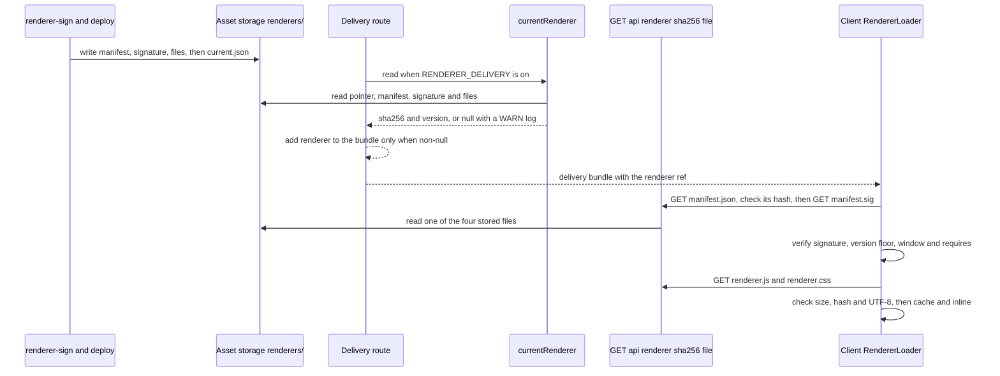

# Signed renderer delivery

This page covers the server-delivered renderer: the signed manifest, how the design tool stores and serves it, and how the macOS client fetches, verifies and uses it.

## Status

- **Server side (implemented).** The design tool resolves a current signed renderer from storage and names it in the delivery bundle only when `RENDERER_DELIVERY=on`. The flag is set for both the staging and production stacks (`design-tool/infra/lib/app-service.ts`), because a v2.0 client refuses a bundle without the field (D-11). The file route `GET /api/renderer/[sha256]/[file]` is not behind that flag: it serves any stored signed file to a signed-in student or staff session, and returns 404 for anything else.
- **Client side (implemented, verify-before-use).** Before lockdown begins, the macOS shell reads the bundle's `renderer` ref, fetches the four files by hash, verifies the manifest, and inlines the verified `renderer.js` and `renderer.css` into the test page. Details are in [client verification path](#client-verification-path). The shell refuses a served renderer it cannot verify; it falls back to its bundled page only in a Debug build when the bundle names no renderer.
- **Bridge mode (implemented).** The published `renderer.js` and `renderer.css` are not authored in `packages/renderer`. `scripts/build.ts` extracts them from the client's Swift string literals (`rendererScript`, `itemStyles`, `richTextStyles` in `AssessmentPage.swift` and `AssessmentPageRichText.swift`) through `scripts/extract-swift.ts`, so the served file is byte-identical to the page a v1.x client builds at run time. Moving the page code into this package is a later slice (D-9 in `docs/server-delivered-renderer-design.md`).

The design rationale is `docs/server-delivered-renderer-design.md`. ADR 0018 (`docs/adr/0018-server-delivered-renderer.md`) is still marked Proposed in the repository, even though the client load path now exists; see [lockdown and security](lockdown-and-security.md#sealed-page).

## Components and where they run

| Component | Source | Responsibility |
|---|---|---|
| Manifest model and canonical bytes | `packages/renderer/src/manifest.ts` (`buildManifest`, `canonicalManifestBytes`, `parseManifest`) | Builds the manifest for a set of files and fixes one byte form for signing and serving. |
| Signature and use checks | `packages/renderer/src/verify.ts` (`verifyManifestSignature`, `checkManifestUse`) | ECDSA P-256 / SHA-256 check over the exact bytes; version floor and validity window. |
| `requires` vocabulary | `packages/renderer/src/requires.ts` (`REQUIREMENTS`, `isRequirement`, `PLACEHOLDER_REQUIRES`) | The terms a renderer may ask of a shell. |
| Trusted public keys | `packages/renderer/src/keys.ts` (`RENDERER_PUBLIC_KEYS`), generated from `keys/*.pub.pem` (`working.pub.pem`, `backup.pub.pem`) | Keys the server and tests verify against. Generated: regenerate with `bun run keys` instead of editing. See [signing keys and the backup path](#signing-keys-and-the-backup-path). |
| Build | `packages/renderer/scripts/build.ts` | Writes `dist/renderer.js`, `dist/renderer.css` and `dist/manifest.json`, with `version` from HEAD's committer time and `commit` from HEAD. Refuses any output containing `</`. |
| Swift extraction | `packages/renderer/scripts/extract-swift.ts` (`CLIENT_SOURCES`, `extractRenderer`) | Reads the `static let` multi-line string literals of the client page and resolves them as Swift would (indentation stripping, raw literals, `\#(name)` splices). Anything it does not understand fails the build instead of shipping a different renderer. The proof against Swift itself is `scripts/check-extraction.sh`, which runs on macOS and is run by `deploy.sh` before signing. |
| Signing and verifying CLI | `tools/renderer-sign/Sources/renderer-sign/main.swift`; pure core in `tools/renderer-sign/Sources/RendererSignCore/RendererSignCore.swift` | Signs `manifest.json` with a Secure Enclave key, or a dev PEM key for local use. Verifies a signature with a public PEM. The Swift core mirrors the check the client shell makes in `RendererVerifier`. |
| Storage resolver | `design-tool/lib/renderer/current.ts` (`createRendererResolver`, `currentRenderer`, `rendererObjectKey`) | Reads the stored pointer and renderer objects, re-verifies them, and returns the renderer to name. |
| File route | `design-tool/app/api/renderer/[sha256]/[file]/route.ts` (`GET`) | Serves the four stored files by manifest hash. |
| Delivery bundle | `design-tool/app/api/assessments/[id]/delivery/route.ts` | Adds `renderer` to the bundle only when the flag is on and a renderer verifies. |
| Wire type | `packages/schema/src/delivery.ts` (`RendererRefSchema`, `DeliveryBundleSchema`) | `{ sha256, version }`, strict, optional on the bundle. |

The design tool imports the package through the subpaths `@secure-test/renderer/manifest`, `/verify`, `/requires` and `/keys` (`packages/renderer/package.json` `exports`). The Next config lists the package in `transpilePackages`, and the Dockerfile copies `packages/renderer/package.json` so the workspace link exists at install time.

## The manifest

`buildManifest` produces a `RendererManifest` with these fields. `parseManifest` refuses any other key set.

| Field | Rule |
|---|---|
| `format` | Always `1`. |
| `version` | Positive safe integer. The build uses HEAD's committer time in unix seconds, so it rises on a linear `main`. |
| `commit` | 40 lowercase hex characters. |
| `issued_at`, `not_after` | UTC ISO timestamps ending in `Z`. `not_after` is `issued_at` plus 60 days (`DEFAULT_VALIDITY_DAYS`). |
| `requires` | Sorted, de-duplicated values from `REQUIREMENTS`. |
| `files` | Published file name to `{ sha256, bytes }`. Names must match `^[a-z0-9][a-z0-9._-]*$` with no `..`. |

Invariants that the tests and code enforce:

- **One byte form.** `canonicalManifestBytes` sorts keys recursively, has no whitespace, and allows safe integers only. `parseManifest` rejects bytes that are not the canonical form of what they parse to.
- **Signature covers the exact bytes.** The signature is over `dist/manifest.json` as written. Nothing re-canonicalizes before verification.
- **Only `renderer.js` and `renderer.css` are published files.** The design tool's resolver rejects a manifest that lists any other name (`manifest_files_unservable`).
- **`renderer.js` must not contain `</`.** The build throws on it because the client inlines the script into a `<script>` element.

## Verification order

Every consumer follows the same order: verify the bytes, parse them, then check use. `verifyManifestSignature` returns `false` for a malformed signature and throws for a key that is not P-256. `checkManifestUse` refuses `below_min_version`, `not_yet_valid` and `expired`, with both window ends inclusive.

## Client verification path

The macOS shell applies the same order, in Swift. `AssessmentViewController` runs it after the bundle arrives and its deadline check passes, and before the speech pre-flight and `onBundleLoaded`, which is what begins lockdown. A refusal therefore never starts a secure session.

1. **Start decision.** `RendererStart.plan(for:allowsBundledFallback:)` loads when the bundle carries a `renderer` ref. Without one, a Debug build uses the bundled page and a Release build refuses (`refuseMissing`, D-11).
2. **Cache first, never trusted.** `RendererLoader.load` reads `RendererCache`, one owner-only directory per manifest hash. A cached copy goes through the same `validate` as a fresh one. A failure that a fresh download could fix (a bad signature, a changed script or style) removes the entry and falls through to a fetch. A failure the signed manifest decides (policy, shape, missing capability) is returned without a refetch.
3. **Fresh fetch, verify before code.** The loader fetches `manifest.json` through `APIClient.fetchRendererFile`, which calls `GET /api/renderer/<sha256>/<file>`. The manifest's SHA-256 must equal the bundle's `sha256`. The loader then fetches `manifest.sig` and runs `RendererVerifier.verify`, so a refused manifest costs two small requests and never the code. Only then does it fetch `renderer.js` and `renderer.css`.
4. **Verifier order.** `RendererVerifier.verify` checks the signature against the trusted keys, then the manifest shape, then `version >= RendererPolicy.minimumVersion`, then `issued_at <= now <= not_after` (both inclusive), then that every `requires` term is in `RendererCapabilities.supported`. A refusal caused only by a missing capability sets `isUpdateNeeded`, so the student sees "update SecureTest" rather than "try again".
5. **Code checks.** `validate` requires the manifest `version` to equal the bundle's `version`, each file's size and SHA-256 to match the manifest, both files to decode as UTF-8, and the script to contain no `</`. A verified copy is written to the cache.
6. **Trusted keys.** `RendererStart.trustedKeys(includeDevKey:)` always returns `RendererKeys.working` and `RendererKeys.backup`. It adds the dev key only in a Debug build.

When the outcome is `.served`, `AssessmentPage.html(... renderer:)` replaces the bundled `rendererScript` and the adjacent item and rich-text styles with the verified copies. KaTeX, the page globals, `PageShell`'s styles and the CSP are unchanged, so the page still follows the [client overview](overview.md). A refusal logs one `renderer: REFUSED` line, calls `onRendererRefused`, and returns without asking for the microphone.

Tests: `RendererLoaderTests` covers fresh fetch and cache reuse, tampered cache entries, manifest hash and version mismatches, a bad signature refused before the code is fetched, integrity failures, a missing capability, a version below the floor, eviction, and the cache's file modes. `RendererVerifierTests` covers the cross-language fixture, timestamp shapes, the window edges, and the key and policy pins (`testWorkingKeyMatchesRepoPEM`, `testPolicyMinimumVersionIsTheFirstProductionRenderer`). `RendererStartTests` covers the plan, the Debug fallback, and the served-page splice. Run `cd client/SecureTestCore && swift test --filter RendererLoaderTests` (macOS).

## Signing keys and the backup path

The shell trusts two P-256 release keys, both compiled into `RendererKeys.swift` as `working` and `backup` and mirrored from `packages/renderer/keys/`. `RendererStart.trustedKeys` adds the dev key only in a Debug build.

- **Working key.** `tools/renderer-sign` signs with a Secure Enclave key (`SecureEnclave.P256.Signing.PrivateKey`), so the CLI refuses a Mac without one. Each signature needs the owner's biometric approval. Deploys sign with this key; the deploy pipeline is outside this wiki's scope.
- **Backup key.** The second key sits on a hardware token held under two-person control, as the backup for the working key (design record: `docs/server-delivered-renderer-design.md`). Its signer is `tools/renderer-sign/backup/sign_backup.py`, run through Yubico's bundled Python: `ykman script tools/renderer-sign/backup/sign_backup.py MANIFEST SIGNATURE_OUT SERIAL`. The script selects the token by serial, checks that PIV slot 9c holds an ECCP256 key, reads the PIN from a hidden prompt, waits for a touch and writes the raw DER signature that `renderer-sign verify` and the shell accept. The token serial lives in the operations repository, never in this one.
- **Do not add a `__main__` guard to that script.** `ykman script` runs the file with `exec` and empty globals, so `__name__` is never `"__main__"` and a guarded `main()` silently never runs. The script calls `sys.exit(main())` unconditionally for this reason; a 2026-10-23 rehearsal found the silent exit.
- **Rehearsal fixture.** `packages/renderer/test/fixtures/backup-rehearsal/` holds a manifest and signature from a recorded rehearsal, not a release. `test/verify.test.ts` checks it against `backup.pub.pem`, and the Swift `RendererVerifierTests` check the same bytes. It is a test vector; it does not rotate or use the key.

Change navigation: a new trusted key means a new PEM under `packages/renderer/keys/`, then `bun run keys`, then the matching Swift key constant. Keep the Swift and TypeScript key sets identical: `keys.test.ts` guards the TypeScript side, and `RendererVerifierTests` pins the working key to its PEM (`testWorkingKeyMatchesRepoPEM`).

## Storage layout and the pointer

Files live in the asset storage provider under a hash prefix (`lib/renderer/current.ts`):

```text
renderers/<manifest sha256>/manifest.json   canonical signed bytes
renderers/<manifest sha256>/manifest.sig    DER ECDSA P-256 / SHA-256 signature
renderers/<manifest sha256>/renderer.js
renderers/<manifest sha256>/renderer.css
renderers/current.json                      {"sha256": "...", "version": N}
```

Everything under a hash is immutable. The pointer is written last, so a bundle never names a half-uploaded renderer. The resolver trusts the pointer for nothing. It re-checks, in order: pointer shape, manifest hash against the pointer's `sha256`, signature against `RENDERER_PUBLIC_KEYS`, manifest parse, pointer `version` against manifest `version`, the validity window, the file-name allow-list, and each listed file's size and hash. Any failure logs `renderer_current_invalid` (or `renderer_current_unreadable`) at WARN and the bundle names no renderer. A missing pointer is not an error. Results, including failures, are cached for 60 seconds, and `reset()` drops the cache. The resolver uses `minVersion: 0`, so there is no server-side version floor. The shell's floor is the one that applies.

### Expiry watch

A renderer inside `RENDERER_EXPIRY_WARNING_DAYS` of its `not_after` logs `renderer_expiring` at ERROR on every resolution, and an expired one logs `renderer_current_invalid` at ERROR. Because a v2.0 shell refuses every test after expiry, the fix is a re-signing deploy, so the design tool must surface the warning without waiting for student traffic. `startRendererExpiryWatch` in `lib/renderer/expiryWatch.ts` is started from `instrumentation.ts` only when `RENDERER_DELIVERY=on`. It calls `currentRenderer()` two minutes after boot and then every hour, with timers unref'd. Failures log `renderer_expiry_watch_failed`. The scheduler and alarm side are in [deployment and observability](../operations/deployment-and-observability.md#retention-sweep). Test coverage for the resolver's expiry branches is in `renderer-current.test.ts`.

The file route is open to any signed-in student or practice session (`requireStudentOrPractice`). It reads storage only, not the database, so it answers while Aurora is paused. It returns `Cache-Control: private, max-age=31536000, immutable`. Any unknown name or malformed hash returns 404, the same as a missing object.

## Delivery flow



The bundle's `renderer` field is optional, and `RendererRefSchema` is strict. The schema comment says a client that predates the field ignores it. The `RENDERER_DELIVERY` flag is read in the delivery route itself, and only the exact value `on` enables it. The delivery route tests cover `true` as not enabled.

## The `requires` vocabulary

`REQUIREMENTS` lists the eight bridge handlers (`response`, `withdraw`, `upload`, `submit`, `timer`, `home`, `tts`, `stt`) and two host features that are not handlers: `tts.word_ranges` and `response.generic`. A renderer may name only terms that a shell on the fleet can answer. The placeholder renderer requires `response`, `submit` and `home`. Adding a term is a shell change, not only a renderer change. The bridge handlers themselves are described in [lockdown and security](lockdown-and-security.md) and [client overview](overview.md).

`HOST_CALLBACKS` in the same file maps the page functions the host calls (for example `__secureTestFlushInput` under `response`, `__timeLimit` under `timer`, `__secureTestSpeech` under `tts.word_ranges`) to the term whose feature calls them. A callback has no term of its own. The host guards each call, so a missing function fails silently; `test/extract.test.ts` fails when the bridge-mode page stops defining one.

## Tests

| Behaviour | Test location |
|---|---|
| Manifest build, canonical bytes, strict parse, `requires` normalization | `packages/renderer/test/manifest.test.ts` |
| Signature verification with P-256 keys, malformed signatures, use window and minimum version | `packages/renderer/test/verify.test.ts`, including a cross-language fixture signed by `tools/renderer-sign` and the backup-key rehearsal fixture (`test/fixtures/backup-rehearsal`) |
| Generated keys match the PEM files | `packages/renderer/test/keys.test.ts` |
| Pointer resolution: valid, manifest-hash mismatch, untrusted key, expired or not yet valid, malformed pointer, and the 60-second cache | `design-tool/test/renderer-current.test.ts`, describe "current renderer resolution" |
| File route: four allowed names, rejected traversal and case variants, 404 on missing objects | `design-tool/test/renderer-route.test.ts`, describe "GET /api/renderer/:sha256/:file" |
| Delivery bundle names the renderer only when `RENDERER_DELIVERY=on` and it verifies | `design-tool/test/delivery-api.test.ts`, describe "GET /api/assessments/:id/delivery — renderer" |
| Any signed-in student or staff session may fetch the files, with no owned-row check (both role tests list the route as an exception) | `design-tool/test/access-enforcement.test.ts` and `design-tool/test/auth-role-enforcement.test.ts` |
| Swift signer: canonical checks, signature round-trip, PEM handling | `tools/renderer-sign/Tests/RendererSignCoreTests/RendererSignCoreTests.swift` |

## Change navigation

- **Changing the manifest shape or canonical form.** Edit `manifest.ts` and its tests in `manifest.test.ts`. Regenerate the cross-language fixture as `verify.test.ts` describes, because the Swift core signs those bytes. If the bundle field changes, also update `RendererRefSchema`. Validate with `cd packages/renderer && bun test`.
- **Publishing another file.** Add it to the build's `files` map in `scripts/build.ts`, then to `RENDERER_FILE_TYPES` and `SIGNED_FILES` in `design-tool/lib/renderer/current.ts`. The file route reads `RENDERER_FILE_TYPES`, so it picks up the name automatically. Validate with `cd design-tool && bun test test/renderer-current.test.ts test/renderer-route.test.ts`.
- **Changing the served page script or CSS.** Edit the Swift literals in `AssessmentPage.swift` or `AssessmentPageRichText.swift`, not `packages/renderer`. The extractor follows Swift's literal rules and refuses constructs it does not support (for example `\(…)` interpolation in a plain literal), so keep new literals to what `extract-swift.ts` documents. Validate with `cd packages/renderer && bun test test/extract.test.ts`, then `bun run build` to confirm the output is written. Byte identity with Swift is proved only by `check-extraction.sh` on macOS, which is conditional on changes to those literals.
- **Adding a `requires` term.** Edit `REQUIREMENTS` in `requires.ts` only together with a shell that can answer the term, since the shell refuses a renderer that names what it lacks. Keep `PLACEHOLDER_REQUIRES` unchanged until then.
- **Rotating a trusted key.** Add or replace a PEM under `packages/renderer/keys/`, run `bun run keys`, and never edit `src/keys.ts` by hand. `keys.test.ts` fails while the two drift.
- **Serving behaviour in the delivery bundle.** Changes to when the bundle names a renderer belong in `delivery-api.test.ts` (describe "GET /api/assessments/:id/delivery — renderer"). That suite needs the test database (see [testing](../testing/testing-and-validation.md)).
- **Changing the client load path.** Start decisions belong in `RendererStart.swift`, fetch and cache in `RendererLoader.swift` and `RendererCache.swift`, and checks in `RendererVerifier.swift`. A change to the verify order or the floor needs the matching cases in `RendererVerifierTests` and `RendererLoaderTests`. Keep `RendererKeys` byte-for-byte with `packages/renderer/keys/` (the tests fail if they drift). Validate with `cd client/SecureTestCore && swift test --filter RendererVerifierTests` (macOS).
- **Raising the client floor.** `RendererPolicy.minimumVersion` is the lowest renderer version the shell runs. Raising it retires older renderers on every shell (the exposure runbook), so change it only in a release, and test with `RendererVerifierTests` (`testPolicyMinimumVersionIsTheFirstProductionRenderer` pins the current value).
- **Conditional checks.** `swift test` in `tools/renderer-sign` runs on macOS only. Run it only when `RendererSignCore` or its fixtures change.

Scope boundaries: the signing and deployment scripts are not documented here. The deploy orchestration is in `design-tool/infra`, which this wiki does not cover in detail; see [deployment and observability](../operations/deployment-and-observability.md) for the stacks.

The design-tool tests use `design-tool/test/helpers/renderer.ts`, which generates a throwaway P-256 key in memory and writes a signed renderer into a local storage root. No key file is written to the repository.

Narrow validation:

```sh
cd packages/renderer && bun test
cd design-tool && bun test test/renderer-current.test.ts test/renderer-route.test.ts
cd design-tool && DATABASE_URL=postgres://$USER@localhost:5432/secure_test_design_tool_test bun test test/delivery-api.test.ts
```

The Swift signer test (`swift test` in `tools/renderer-sign`) needs macOS and is only needed when `tools/renderer-sign` changes. The deployment script that signs and uploads (`deploy.sh --staging`) is documented outside this wiki; see [deployment and observability](../operations/deployment-and-observability.md).
ployment and observability](../operations/deployment-and-observability.md).
