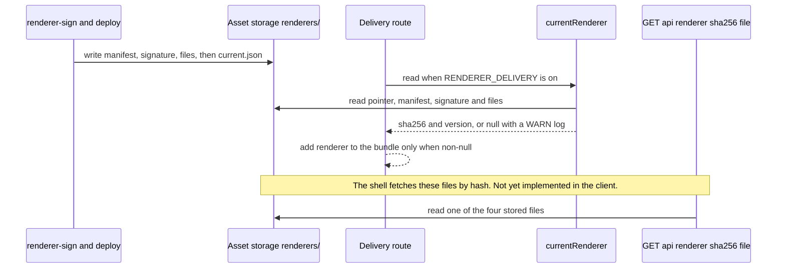

# Signed renderer delivery

This page covers the server-delivered renderer: the signed manifest, how the design tool stores and serves it, and what the macOS client does not yet do with it.

## Status

- **Server side (implemented, staging only).** The design tool resolves a current signed renderer from storage and names it in the delivery bundle, and serves its files. Both are gated by `RENDERER_DELIVERY=on`, which the staging stack sets (`design-tool/infra/lib/app-service.ts`).
- **Client side (not implemented).** The macOS shell still bundles its own renderer script. It does not read the bundle's `renderer` field, fetch `/api/renderer/...`, or verify a manifest signature. The client's `SecureTestCore` sources contain no manifest code; only the separate `tools/renderer-sign` package does.
- **Placeholder content.** `packages/renderer/src/renderer.js` is a placeholder. The real student page is planned to move in later, byte for byte, from the client.

The design rationale is `docs/server-delivered-renderer-design.md`. ADR 0018 (`docs/adr/0018-server-delivered-renderer.md`) is still Proposed; see [lockdown and security](lockdown-and-security.md#sealed-page).

## Components and where they run

| Component | Source | Responsibility |
|---|---|---|
| Manifest model and canonical bytes | `packages/renderer/src/manifest.ts` (`buildManifest`, `canonicalManifestBytes`, `parseManifest`) | Builds the manifest for a set of files and fixes one byte form for signing and serving. |
| Signature and use checks | `packages/renderer/src/verify.ts` (`verifyManifestSignature`, `checkManifestUse`) | ECDSA P-256 / SHA-256 check over the exact bytes; version floor and validity window. |
| `requires` vocabulary | `packages/renderer/src/requires.ts` (`REQUIREMENTS`, `isRequirement`, `PLACEHOLDER_REQUIRES`) | The terms a renderer may ask of a shell. |
| Trusted public keys | `packages/renderer/src/keys.ts` (`RENDERER_PUBLIC_KEYS`), generated from `keys/*.pub.pem` | Keys the server and tests verify against. Generated: regenerate with `bun run keys` instead of editing. |
| Build | `packages/renderer/scripts/build.ts` | Writes `dist/renderer.js`, `dist/renderer.css` and `dist/manifest.json`, with `version` from HEAD's committer time and `commit` from HEAD. |
| Signing and verifying CLI | `tools/renderer-sign/Sources/renderer-sign/main.swift`; pure core in `tools/renderer-sign/Sources/RendererSignCore/RendererSignCore.swift` | Signs `manifest.json` with a Secure Enclave key, or a dev PEM key for local use. Verifies a signature with a public PEM. The Swift core is the same check the client shell is planned to make. |
| Storage resolver | `design-tool/lib/renderer/current.ts` (`createRendererResolver`, `currentRenderer`, `rendererObjectKey`) | Reads the stored pointer and renderer objects, re-verifies them, and returns the renderer to name. |
| File route | `design-tool/app/api/renderer/[sha256]/[file]/route.ts` (`GET`) | Serves the four stored files by manifest hash. |
| Delivery bundle | `design-tool/app/api/assessments/[id]/delivery/route.ts` | Adds `renderer` to the bundle only when the flag is on and a renderer verifies. |
| Wire type | `packages/schema/src/delivery.ts` (`RendererRefSchema`, `DeliveryBundleSchema`) | `{ sha256, version }`, strict, optional on the bundle. |

The design tool imports the package through the subpaths `@secure-test/renderer/manifest`, `/verify`, `/requires` and `/keys` (`packages/renderer/package.json` `exports`). The Next config lists the package in `transpilePackages`, and the Dockerfile copies `packages/renderer/package.json` so the workspace link exists at install time.

## The manifest

`buildManifest` produces a `RendererManifest` with these fields. `parseManifest` refuses any other key set.

| Field | Rule |
|---|---|
| `format` | Always `1`. |
| `version` | Positive safe integer. The build uses HEAD's committer time in unix seconds, so it rises on a linear `main`. |
| `commit` | 40 lowercase hex characters. |
| `issued_at`, `not_after` | UTC ISO timestamps ending in `Z`. `not_after` is `issued_at` plus 60 days (`DEFAULT_VALIDITY_DAYS`). |
| `requires` | Sorted, de-duplicated values from `REQUIREMENTS`. |
| `files` | Published file name to `{ sha256, bytes }`. Names must match `^[a-z0-9][a-z0-9._-]*$` with no `..`. |

Invariants that the tests and code enforce:

- **One byte form.** `canonicalManifestBytes` sorts keys recursively, has no whitespace, and allows safe integers only. `parseManifest` rejects bytes that are not the canonical form of what they parse to.
- **Signature covers the exact bytes.** The signature is over `dist/manifest.json` as written. Nothing re-canonicalizes before verification.
- **Only `renderer.js` and `renderer.css` are published files.** The design tool's resolver rejects a manifest that lists any other name (`manifest_files_unservable`).
- **`renderer.js` must not contain `</`.** The build throws on it because the client inlines the script into a `<script>` element.

## Verification order

Every consumer follows the same order: verify the bytes, parse them, then check use. `verifyManifestSignature` returns `false` for a malformed signature and throws for a key that is not P-256. `checkManifestUse` refuses `below_min_version`, `not_yet_valid` and `expired`, with both window ends inclusive.

## Storage layout and the pointer

Files live in the asset storage provider under a hash prefix (`lib/renderer/current.ts`):

```text
renderers/<manifest sha256>/manifest.json   canonical signed bytes
renderers/<manifest sha256>/manifest.sig    DER ECDSA P-256 / SHA-256 signature
renderers/<manifest sha256>/renderer.js
renderers/<manifest sha256>/renderer.css
renderers/current.json                      {"sha256": "...", "version": N}
```

Everything under a hash is immutable. The pointer is written last, so a bundle never names a half-uploaded renderer. The resolver trusts the pointer for nothing. It re-checks, in order: pointer shape, manifest hash against the pointer's `sha256`, signature against `RENDERER_PUBLIC_KEYS`, manifest parse, pointer `version` against manifest `version`, the validity window, the file-name allow-list, and each listed file's size and hash. Any failure logs `renderer_current_invalid` (or `renderer_current_unreadable`) at WARN and the bundle names no renderer. A missing pointer is not an error. Results, including failures, are cached for 60 seconds, and `reset()` drops the cache. The resolver uses `minVersion: 0`, so there is no server-side version floor. The shell's floor is the one that applies.

The file route is open to any signed-in student or practice session (`requireStudentOrPractice`). It reads storage only, not the database, so it answers while Aurora is paused. It returns `Cache-Control: private, max-age=31536000, immutable`. Any unknown name or malformed hash returns 404, the same as a missing object.

## Delivery flow



The bundle's `renderer` field is optional, and `RendererRefSchema` is strict. The schema comment says a client that predates the field ignores it. The `RENDERER_DELIVERY` flag is read in the delivery route itself, and only the exact value `on` enables it. The delivery route tests cover `true` as not enabled.

## The `requires` vocabulary

`REQUIREMENTS` lists the eight bridge handlers (`response`, `withdraw`, `upload`, `submit`, `timer`, `home`, `tts`, `stt`) and two host features that are not handlers: `tts.word_ranges` and `response.generic`. A renderer may name only terms that a shell on the fleet can answer. The placeholder renderer requires `response`, `submit` and `home`. Adding a term is a shell change, not only a renderer change. The bridge handlers themselves are described in [lockdown and security](lockdown-and-security.md) and [client overview](overview.md).

## Tests

| Behaviour | Test location |
|---|---|
| Manifest build, canonical bytes, strict parse, `requires` normalization | `packages/renderer/test/manifest.test.ts` |
| Signature verification with P-256 keys, malformed signatures, use window and minimum version | `packages/renderer/test/verify.test.ts`, including a cross-language fixture signed by `tools/renderer-sign` |
| Generated keys match the PEM files | `packages/renderer/test/keys.test.ts` |
| Pointer resolution: valid, manifest-hash mismatch, untrusted key, expired or not yet valid, malformed pointer, and the 60-second cache | `design-tool/test/renderer-current.test.ts`, describe "current renderer resolution" |
| File route: four allowed names, rejected traversal and case variants, 404 on missing objects | `design-tool/test/renderer-route.test.ts`, describe "GET /api/renderer/:sha256/:file" |
| Delivery bundle names the renderer only when `RENDERER_DELIVERY=on` and it verifies | `design-tool/test/delivery-api.test.ts`, describe "GET /api/assessments/:id/delivery — renderer" |
| Any signed-in student or staff session may fetch the files, with no owned-row check (both role tests list the route as an exception) | `design-tool/test/access-enforcement.test.ts` and `design-tool/test/auth-role-enforcement.test.ts` |
| Swift signer: canonical checks, signature round-trip, PEM handling | `tools/renderer-sign/Tests/RendererSignCoreTests/RendererSignCoreTests.swift` |

## Change navigation

- **Changing the manifest shape or canonical form.** Edit `manifest.ts` and its tests in `manifest.test.ts`. Regenerate the cross-language fixture as `verify.test.ts` describes, because the Swift core signs those bytes. If the bundle field changes, also update `RendererRefSchema`. Validate with `cd packages/renderer && bun test`.
- **Publishing another file.** Add it to the build's `files` map in `scripts/build.ts`, then to `RENDERER_FILE_TYPES` and `SIGNED_FILES` in `design-tool/lib/renderer/current.ts`. The file route reads `RENDERER_FILE_TYPES`, so it picks up the name automatically. Validate with `cd design-tool && bun test test/renderer-current.test.ts test/renderer-route.test.ts`.
- **Adding a `requires` term.** Edit `REQUIREMENTS` in `requires.ts` only together with a shell that can answer the term, since the shell refuses a renderer that names what it lacks. Keep `PLACEHOLDER_REQUIRES` unchanged until then.
- **Rotating a trusted key.** Add or replace a PEM under `packages/renderer/keys/`, run `bun run keys`, and never edit `src/keys.ts` by hand. `keys.test.ts` fails while the two drift.
- **Serving behaviour in the delivery bundle.** Changes to when the bundle names a renderer belong in `delivery-api.test.ts` (describe "GET /api/assessments/:id/delivery — renderer"). That suite needs the test database (see [testing](../testing/testing-and-validation.md)).
- **Client adoption.** Starting the shell side (reading `renderer`, fetching by hash, verifying in Swift) is a new seam, not a bug fix. It depends on the ADR 0018 decision and needs its own tests in `client/SecureTestCore`.
- **Conditional checks.** `swift test` in `tools/renderer-sign` runs on macOS only. Run it only when `RendererSignCore` or its fixtures change.

Scope boundaries: the signing and deployment scripts are not documented here. The deploy orchestration is in `design-tool/infra`, which this wiki does not cover in detail; see [deployment and observability](../operations/deployment-and-observability.md) for the staging stack.

The design-tool tests use `design-tool/test/helpers/renderer.ts`, which generates a throwaway P-256 key in memory and writes a signed renderer into a local storage root. No key file is written to the repository.

Narrow validation:

```sh
cd packages/renderer && bun test
cd design-tool && bun test test/renderer-current.test.ts test/renderer-route.test.ts
cd design-tool && DATABASE_URL=postgres://$USER@localhost:5432/secure_test_design_tool_test bun test test/delivery-api.test.ts
```

The Swift signer test (`swift test` in `tools/renderer-sign`) needs macOS and is only needed when `tools/renderer-sign` changes. The deployment script that signs and uploads (`deploy.sh --staging`) is documented outside this wiki; see [deployment and observability](../operations/deployment-and-observability.md).
