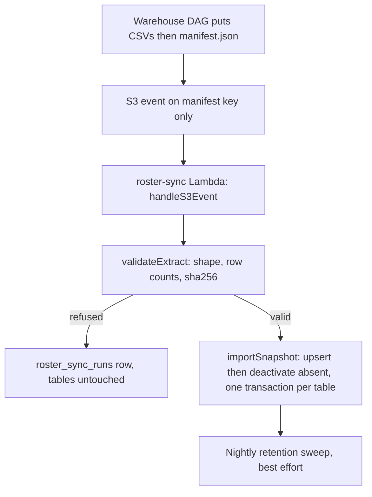

# Accommodations, TIDE import and the warehouse roster mirror

Two data sources decide what a student sees and whether they may sit a test. The **roster** (who exists, who teaches whom) comes from the district warehouse. **Accommodations** (what support each child is entitled to) come from TIDE and teacher edits. The student plane joins them at the moment of redeeming a code ([sittings and attempts](sittings-and-attempts.md)).

## Effective accommodations

`resolveEffectiveAccommodations` and the pure rule `explainAccommodations` (`lib/accommodations/effective.ts`) answer: which tools does this student get on this assessment, and which of those are construct-altering? The delivery route calls it and ships the result as `DeliveryBundle.accommodations` (tool id to setting value) ([wire formats](../architecture/wire-formats.md)); the teacher's "who gets what" preview calls the same rule, so preview and delivery cannot disagree.

Inputs, from broadest to most specific:

1. `assessments.allowed_accommodations`: what the assessment permits at all (a construct-validity decision). An empty list yields nothing, exceptions included.
2. The student's live `student_accommodations` rows. TIDE stores a value for every tool, so `isEnabledValue` treats `""`, `off`, `none`, `none (default)` and `default` as not enabled.
3. Class-period grants (`assessments.section_accommodations`, `lib/accommodations/sections.ts`): everyone in a section gets the tool if the period allows it, but a value already on the student's record wins.
4. `assessment_student_overrides` (per-assessment exceptions). With `assigned_scope = teacher` an exception can grant a tool outside the allowed list (and that tool is then flagged construct-altering, because nobody vetted it). With `school` or `district` the allowed list gates exceptions. An **Off** exception revokes in both cases.

`construct_altering` is always a subset of `allowed_accommodations`, enforced in the API layer (`lib/api/assessments.ts`) and clamped when the allowed list shrinks. The tool vocabulary is `lib/accommodations/catalog.ts` (OSPI tiers, with implementation tiers T1 to T4 and out-of-band), with the TIDE catalogue in `lib/accommodations/tide-catalog.json` regenerated by `scripts/generate-tide-catalog.ts`.

The teacher's pickers for inputs 3 and 4 read two staff-only routes. `GET /api/assessments/[id]/section-options` (`app/api/assessments/[id]/section-options/route.ts`) lists the class periods the Allowed tab offers: the owner's current sections and their co-teachers' sections, plus any configured period that has since left the roster and is still removable. `GET /api/assessments/[id]/exception-students` (`app/api/assessments/[id]/exception-students/route.ts`) lists the students an exception can be added for: the assessment owner's `students` records, plus a co-teacher's own records for children the owner has no record of yet (the overrides route maps those to the owner's row). Both need `edit` access on the assessment.

The **By class period** panel has an "Apply to all my periods" action (`applyToAllPeriods`, `lib/accommodations/applyToAllPeriods.ts`). It copies the source period's whole setting (its allowed list, or the test's when none is set, plus its class-wide grants) onto every other period on the teacher's current class list, replacing those periods' own settings. Periods that have left the roster are not targets. `applyTargets` and `overwrittenTargets` let the panel say which settings would be replaced before it writes, and the server's validator checks the result like any other edit. The design rationale for class-period accommodations is in `docs/coteach-and-section-accommodations-design.md`.

Both accommodation panels save by autosave, not by an explicit Save click. The Allowed tab in `app/dashboard/[id]/AssessmentEditor.tsx` and each period in `PeriodSettings.tsx` each hold a `createAutosave` instance from `lib/autosave.ts` with a 600 ms delay. The Allowed tab sends `allowed_accommodations` and `construct_altering`, and the period panel sends `section_accommodations`, both as a `PATCH /api/assessments/[id]`. The helper keeps one save in flight; a change made during a save runs once afterwards with the newest value. The panel's unmount flushes any pending change. The change came from the earlier explicit-save design, where a teacher who navigated away lost their edits (decision D-8, `docs/multi-source-stimulus-design.md`). The autosave contract is covered by `test/autosave.test.ts`, and the PATCH shape is covered by the "accommodations autosave shape" block in `test/assessments-api.test.ts`.

## TIDE import and the overlay

`students` is a **per-teacher overlay** keyed by `(owner_sub, ssid)` and, once a student has joined, `(owner_sub, roster_ps_id)`. The same child has a different overlay row under each teacher, which is why `loadOwnAttempt` resolves against the assessment owner (`sittingTenantSub`) and not the sitting owner, so co-teacher sittings still find the right row. A student who joins a co-teacher's sitting gets their overlay row under the **assessment** owner, not the co-teacher; filing it under the co-teacher made the delivery route (which resolves under `assessments.owner_sub`) answer 404. The regression test is `co-teacher-tenant.test.ts`.

`POST /api/accommodations/import` (`lib/api/importTide.ts`, `exceljs`) applies fixed merge semantics: values from a TIDE import overwrite `tide_import` rows, a teacher-edited row (`tide_then_edited`) is preserved and surfaced as a diff to accept or keep (`accept-tide`, `keep-mine` routes, review page `app/dashboard/accommodations/import/review`), `manual` rows are never touched, rows absent from the new import are soft-removed, and unknown tool ids are dropped. Deleting a TIDE-origin row returns 409. Soft-deleted ledger rows do not block re-insertion (partial unique index).

The vocabulary bridge is `lib/accommodations/tideCatalog.ts`. It loads the generated `tide-catalog.json` rows and maps a TIDE `(subject, tool, value)` triple to a design-tool catalog id and TDS code through `mapTideToCatalogId` and `tideToolNameToCatalogId`. The tool-name map `TIDE_TOOL_TO_ID` is hand-curated. Non-embedded tools (Non-Embedded Accommodations and Designated Supports) are intentionally absent because they need out-of-band handling, so they map to `null` and the import counts them as dropped. The reverse direction (`mapCatalogIdToTide`, used by the `accept-tide` route) and `tideValueForCode` (used by `pendingDiffs.ts` to state what TIDE now asserts) go through the same module. When a TIDE tool is new, add it to `TIDE_TOOL_TO_ID` rather than editing the generated JSON. Tests: `tide-catalog.test.ts` (mapping and parity) and `tide-import.test.ts`. The column-level correspondence between TIDE's export and upload files and the browser's session schema is recorded in `docs/accommodations-data-dictionary.md`.

## Teacher student records and manual accommodations

The teacher's Students pages edit the same per-teacher overlay through a small CRUD API. Every route calls `requireStaff`, and record-level routes call `authorizeStudent(db, session, id, "own")` from `lib/api/access.ts` ([auth and access](auth-and-access.md)), so a row the caller does not own answers 404 rather than revealing that it exists.

- `GET /api/students` (`app/api/students/route.ts`) lists the caller's overlay rows ordered by SSID, each with a live `accommodation_count`. Practice-overlay rows (`practice_for_sub` set) are excluded, because a staff member's practice child is not a student ([sittings and attempts](sittings-and-attempts.md)).
- `POST /api/students` validates `CreateStudentBody` (`lib/api/students.ts`: SSID required and at most 64 characters, name, grade and school optional). A duplicate SSID answers 409 `ssid_already_exists` with the existing id, so the client can tell a duplicate from a server failure. The unique index on `(owner_sub, ssid)` is the backstop.
- `GET`, `PATCH` and `DELETE /api/students/[id]` (`app/api/students/[id]/route.ts`) read one record (`?include_removed=1` includes soft-removed accommodations), patch only name, grade and school (`UpdateStudentBody`), and delete the record. The database cascade removes its `student_accommodations` rows.
- `POST /api/students/[id]/accommodations` (`.../accommodations/route.ts`) creates a manual row. The server forces `source: "manual"`, so a client cannot write a TIDE origin. A live row for the same subject and tool answers 409 `already_exists`; a soft-removed row does not block re-insertion.
- `PATCH /api/students/[id]/accommodations/[accId]` (`.../[accId]/route.ts`) edits a value. An unchanged value is a no-op that keeps `edited_at` stable, so the next TIDE import sees no phantom edit. A changed value turns a `tide_import` row into `tide_then_edited`, stamps `edited_at` and clears `kept_against_tide_code`, because a new edit supersedes an earlier Keep-mine decision. Manual and already-edited rows keep their source.
- `DELETE` on the same route hard-deletes only `manual` rows. A TIDE-origin row returns 409 `tide_row_not_deletable`, and it leaves the ledger only through a re-import's soft-remove.

Invariant: the server decides a row's origin, and a re-import rather than a client delete is the only way a TIDE-origin row leaves. Tests: `test/students-api.test.ts` (record CRUD and the duplicate-SSID 409) and `test/student-accommodations-api.test.ts` (manual create, the value-edit source transition and no-op, and the delete rules). Narrow check: `cd design-tool && $TESTDB bun test test/student-accommodations-api.test.ts`.

## Student identity binding

`resolveStudentForOwner` (`lib/api/resolveStudent.ts`) answers three ordered questions:

1. **Who**: exactly one active `roster_students` row matches the session's lowercase email (`not_on_roster` for none, `identity_conflict` for two).
2. **Whether**: if a sitting is given, either the explicit `student_ps_ids` list admits them, or they are currently enrolled in a section the sitting owner currently teaches (optionally one named section). `roster/queries.ts` applies the date checks (`start_date`/`end_date`, `dateenrolled`/`dateleft`).
3. **As whom**: find or bind the overlay row, first by `roster_ps_id`, then by SSID (so TIDE rows get matched), and only on an admitted join create one. A student merely probing a route never leaves a row. A staff principal skips the roster and resolves only to its own practice overlay.

It refuses rather than guesses, because a wrong binding would score one child's answers under another's name. `resolutionLog.ts` logs the real reason; the HTTP surface collapses some reasons (see redeem in [sittings and attempts](sittings-and-attempts.md#join-and-answer-flow)).

## Roster sync

Contract: `docs/roster-extract.md` in the repository (five objects under `roster/<snapshot_id>/`: four CSVs and `manifest.json`, written last). The decision is ADR 0017 (warehouse extract instead of ClassLink).

Nightly snapshot import path. A refused extract is recorded with counts and reason only and leaves last-known-good data in place.

- `lib/roster/extract.ts` validates the manifest (`format_version` is literally 1, `files` map or list form, bare file names, row counts, lowercase hex sha256) and the CSV shape before anything is written.
- `lib/roster/importSnapshot.ts` upserts each table and then deactivates rows the snapshot did not carry, inside one transaction per table in foreign-key order. Every row is stamped with `last_seen_snapshot_id`; absence is detected by comparing stamps, not a `NOT IN` over thousands of keys. Re-importing the same snapshot changes nothing.
- `lib/roster/syncHandler.ts` is the Lambda's logic (the CDK wrapper is `design-tool/infra/lambda/roster-sync.ts`). `SnapshotSource` has three implementations: `S3SnapshotSource` in production, `MockSnapshotSource` in tests, and a directory source for manual runs. Only the manifest key triggers an import; the handler also runs the retention sweep ([deployment and observability](../operations/deployment-and-observability.md)).
- Logging rule: counts and codes only, because Lambda logs go to CloudWatch and must never name a student.
- Section teacher roles drive `lib/roster/coTeachers.ts` suggestions ([auth and access](auth-and-access.md#the-access-ladder-docsaccess-model-designmd)). `lib/roster/teacherRoster.ts` supplies display names and section labels used by results and attendance. On the Students page it also groups unmatched overlay rows as "co-taught" when that student has a non-practice attempt through another teacher's class sitting, grouped by that sitting's section and owner (`splitCoTaught`; test `co-teacher-tenant.test.ts`).

## Co-teacher records and the "who gets what" preview

Because `students` is a per-teacher overlay, one child can carry a record under several teachers. `coTeacherEmailsFor` (`lib/accommodations/coTeacherRecords.ts`) decides which colleagues' records count for an assessment besides the owner's: holders of a live assessment-scoped grant, plus the owner's roster co-teachers from `coTeachersOf`. Under the U-17 rule a colleague's record counts for a child only while that colleague currently teaches the child (`teachersCurrentlyTeaching`, which checks roster enrollment dates). Delivery and the preview share this rule, so a student's supports are the owner's record plus the current colleague records; a tool that came from a colleague is marked `from_record_of` in the preview.

- **Symmetric "Also on X's record"**: `relatedTeacherEmails` (`lib/accommodations/sharedRecords.ts`) finds the other teachers related to the caller: roster co-teachers, grantees of live grants on the caller's tests, and owners of tests the caller holds a grant on. `otherTeachersRecords` returns their records for children the caller shares, and `alsoOnRecordLine` (`lib/accommodations/previewView.ts`) words each one. Only records for children the other teacher currently teaches are shown.
- **Pending TIDE changes**: `pendingTideDiffs` (`lib/accommodations/pendingDiffs.ts`) finds `tide_then_edited` rows that a later import changed to a different value. Each entry carries the kept value and the value TIDE now asserts. A row whose stored TIDE code no longer resolves against the catalogue is dropped, because the page cannot state what TIDE says. The accommodations page counts these; the `accept-tide` and `keep-mine` routes under `app/api/accommodations/import/diff/[accId]/` resolve each one.
- **Preview**: `buildAccommodationsPreview` (`lib/accommodations/preview.ts`) is served by `GET /api/assessments/[id]/accommodations-preview` (`app/api/assessments/[id]/accommodations-preview/route.ts`) and accepts `?section=<ps_id>` for one class period. It runs the same `explainAccommodations` rule as delivery, in a fixed number of queries. It lists only students the rule has something to say about and counts the rest in `others_count`. The route needs `edit` access, the same level as the overrides list.

Invariant: a colleague's record never supplies a tool for a child the colleague no longer teaches. Focused tests: `coteach-accommodations.test.ts` (the U-17 "co-teachers' records count" and "F-1" exception cases, the U-17 slice 2 "who an exception can be added for" and "Also on X's record" cases), `accommodations-preview.test.ts` (the preview route), `accommodations-preview-view.test.ts` (the wording), and `accommodation-visibility.test.ts`.

## Change navigation

- Changing which tools a student gets: edit the pure rule in `explainAccommodations`, then confirm `delivery-api.test.ts` and `accommodations-preview*.test.ts` still agree.
- Adding a tool: add it to `catalog.ts`; a client only honours tools it knows. If it changes rendering, handle it in the client's `PageAccommodations` or lockdown plan ([lockdown and security](../client/lockdown-and-security.md)).
- Changing the extract: bump `format_version`, update `docs/roster-extract.md`, `lib/roster/extract.ts` and its tests together. The importer must keep refusing versions it does not know.
- Do not add a hard delete to roster sync; deactivation is how last-known-good survives a bad night.
- Tests: `effective-accommodations.test.ts`, `section-accommodations.test.ts`, `coteach-accommodations.test.ts`, `tide-import.test.ts`, `tide-catalog.test.ts`, `student-accommodations-api.test.ts`, `resolve-student.test.ts`, `roster-extract*.test.ts`, `roster-import.test.ts`, `roster-queries.test.ts`, `roster-sync-handler.test.ts`. Test fixtures use synthetic ids (`roster-fixture-synthetic-ids.test.ts`), and no real student data may be committed.
