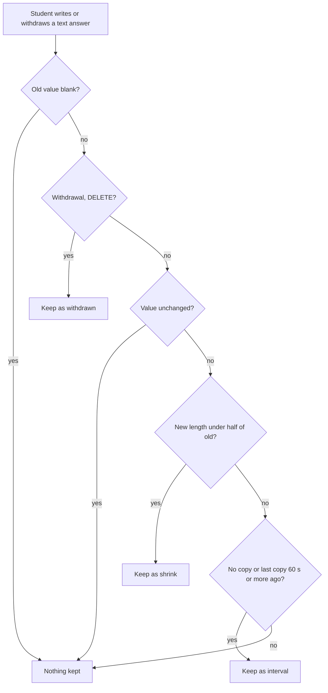

# Answer history, restore and retention

A student's text answer lives in one `responses` row per (attempt, item), and every autosave overwrites it. Before this feature, an accidentally emptied essay could not be recovered from the app. Answer history keeps earlier saved values of text answers in `response_revisions` so a teacher can read and restore them. The design rationale is in `docs/answer-history-design.md` (decisions D-1 to D-9). Source and tests are the authority for the current behaviour.

## Scope

- Only text answers have history: `essay`, `short_text` and `table` (`HISTORY_ITEM_TYPES` in `lib/api/answerHistory.ts`). A table's length is the sum of its cell texts.
- Choice, match, order and hotspot answers have none. Drawing uploads are not kept either: `pruneSupersededUploads` deletes superseded files, as in [sittings and attempts](sittings-and-attempts.md#drawing-uploads).

## Capture rule

Capture runs inside the student write routes, before the new value is written. `captureBeforeWrite` (called from the `PUT` and `DELETE` handlers in `app/api/attempts/[attemptId]/responses/[itemId]/route.ts`) copies the value being replaced into `response_revisions` when `captureReason` says so.

Caption: the D-2 rule as implemented by the pure function `captureReason`.

- **Reasons** (`ResponseRevisionReason`, CHECK constraint in migration `0058_answer_history.sql`): `interval`, `shrink`, `withdrawn` and `restored`. `interval` is the routine once-a-minute copy. `shrink` and `withdrawn` protect against accidental deletion, and they ignore the minute floor.
- **Atomicity.** The read and insert run in a SAVEPOINT (a nested `tx.transaction`) inside the write's own transaction. A failure in capture rolls back only the history step; the student's save still commits, and `captureBeforeWrite` logs `answer_history_capture_failed` at error level, which alarms (D-9).
- **Stored fields.** Each revision keeps the old `response`, `saved_at` (that value's `updated_at`, when the student last saved it) and `captured_at`.

## Viewing

`listAnswerHistory` groups every kept version of an attempt by item, newest saved first. The per-student results page (`app/dashboard/[id]/results/[attemptId]/page.tsx`) shows an **Earlier versions (n)** list under each text answer that has history. Each entry shows the saved time, a measure from `revisionMeasure` (words, or cells filled for a table), a reason note from `revisionReasonNote` (for example "kept before a large deletion"), the text from `revisionText`, and a Copy button (`CopyTextButton`). The wording lives in `lib/reporting/answerHistoryView.ts`, which is pure so it can be tested without rendering.

Access follows the assessment's edit level, not the viewer's sitting (D-4). Admins reading through the All teachers view also have it, because admin is above edit.

## Restore

`POST /api/response-revisions/[revisionId]/restore` is the route. `RestoreVersionControl` (`components/app/RestoreVersionControl.tsx`) renders the **Restore this version** button and dialog; `restoreVersionCopy` and `restoreErrorCopy` provide its words.

Guards, in order:

1. Staff session (`requireStaff`), then a UUID check (400 `invalid_id`).
2. `authorizeAttempt(..., "edit")` on the revision's attempt. Refusals are 404, so the revision id does not reveal existence.
3. `sittingIsOpen` (`lib/api/staffAttempt.ts`): while an open sitting holds an in-progress attempt, the route answers 409 `session_open`. The student's next autosave would overwrite the restored text. A submitted attempt is never blocked.

`restoreAnswerVersion` (`lib/api/restoreAnswer.ts`) then runs one transaction:

1. Lock the current `responses` row (`FOR UPDATE`). If it already equals the revision, return `unchanged`.
2. Keep the current non-blank value with reason `restored`, so a restore can itself be undone from the same list.
3. Upsert the revision's value as the answer, with `updated_at` set to now. A later hand-in therefore screens the restored text again for safeguarding.
4. On a handed-in attempt (`status = submitted`), set the answer's `final` and `proposed` scores to `superseded`. They scored the replaced text. The restored answer is left for the teacher to score; there is no automatic re-score (D-8).
5. Write an `answer_restored` attempt event with `response_id`, `item_id`, `revision_id`, `saved_at` and `superseded_score_ids`. This is a staff-only event kind .

After a restore on a handed-in attempt, the teacher can use Pass back ([sittings and attempts](sittings-and-attempts.md)) so the student can keep working. Superseded scores are listed under "Earlier scores" by the reader described in [score status lifecycle](scoring-and-results.md#score-status-lifecycle).

## Retention

`sweepAnswerHistory` (`lib/retention/sweep.ts`) deletes revisions of attempts that are `submitted` with `submitted_at` older than `ANSWER_HISTORY_RETENTION_DAYS` (30). It runs from the roster-sync handler (`lib/roster/syncHandler.ts`, best effort, beside the other sweeps; see [deployment and observability](../operations/deployment-and-observability.md)). In-progress attempts keep their history, including passed-back attempts, whose `submitted_at` is cleared. Deleting an attempt removes its revisions through the foreign-key cascade.

## Invariants

- Capture never blocks a student's save. A capture failure is logged, not thrown.
- A blank old value and an unchanged value are never copied.
- Capture happens in the same transaction as the write it precedes, so a failed write keeps no phantom version.
- Restore on an open sitting's in-progress attempt is refused with `session_open`; restore on a submitted attempt is allowed.
- Restore never changes a score automatically; it only sets aside the scores of the replaced text.
- The `HISTORY_ITEM_TYPES` set, the `ResponseRevisionReason` CHECK constraint, and the `revisionReasonNote` switch must agree when a reason or type is added.

## Change guidance

- **Start** at `lib/api/answerHistory.ts` for capture and `lib/api/restoreAnswer.ts` for restore. The routes that call them are the write route above and the restore route.
- **Adding a text-like item type**: add it to `HISTORY_ITEM_TYPES`, check `answerLength` and `revisionText` handle its shape, and confirm the per-student page renders its revisions.
- **Changing the rule**: update `captureReason` and its tests together. The thresholds (half length, 60 seconds) are pinned by tests.
- **Schema changes** go through the migration flow in [data model](data-model.md#migrations). Migrations 0058 and 0059 added the table and the `answer_restored` event kind.
- **Not normally needed**: the sweep, the Lambda handler and the teacher UI are not affected by most answer-scoring changes. Keep [scoring and results](scoring-and-results.md) changes separate unless restore behaviour changes.

## Tests

- `design-tool/test/answer-history.test.ts`: the pure `captureReason` rule (a withdrawal always keeps, a blank or unchanged value is never kept, a shrink ignores the minute, the once-a-minute floor, table length), the per-student page's words, and `sweepAnswerHistory` (describe "sweepAnswerHistory (D-3)"). The file imports the database client, so run it with the test database.
- `design-tool/test/answer-restore-api.test.ts`: `POST /api/response-revisions/[revisionId]/restore` (describe at the top level) and the dialog's words (describe "the restore dialog's words"). Needs the test database.
- `design-tool/test/attempt-ingest-api.test.ts`, describe "answer history on the student write routes": history on the student `PUT` and `DELETE` routes.
- `design-tool/test/reporting-views.test.tsx`: the "Earlier versions (1)" heading on the per-student page.

Validation: `cd design-tool && DATABASE_URL=postgres://$USER@localhost:5432/secure_test_design_tool_test bun test test/answer-history.test.ts`. Typecheck with `cd design-tool && bun run typecheck` only after schema or type changes.
