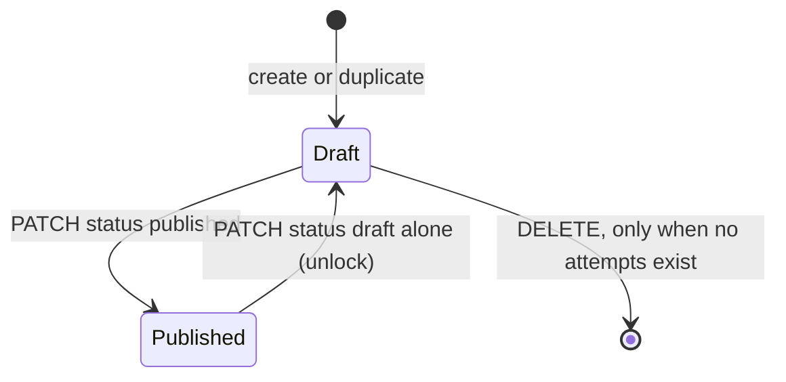

# Assessment lifecycle

An assessment is a teacher's test. Its `status` is either `draft` or `published`, and a second column, `archived_at`, hides it from the default list without changing either status. Publishing is what makes the content safe to deliver, because a sitting can only be created on a published assessment. The rules below are enforced in the API routes, not in the database columns, so any new route that writes an assessment must call the same guards.

Consult this page when changing status transitions, the publish lock, archive or delete behaviour, or anything that copies an assessment. Authoring of items and metadata is in [assessment authoring](authoring.md); the sitting rules that depend on publish are in [sittings and attempts](sittings-and-attempts.md); the columns are in [data model](data-model.md).

## States and transitions



Archiving is orthogonal to this diagram. `PATCH {archived: true}` sets `archived_at` on a draft or a published row, and `PATCH {archived: false}` clears it. A published assessment stays published while archived, so unarchiving restores it exactly.

## The publish lock

`PATCH /api/assessments/[id]` (`app/api/assessments/[id]/route.ts`) is the single chokepoint for assessment metadata. When the row is `published`, the route accepts a body only if `isUnlockOnlyPatch` (`lib/api/requireDraft.ts`) says the PATCH flips status to `draft` and changes nothing else, or if `isFeedbackSettingsOnlyPatch` says the only changes are the feedback settings: the two instant-feedback settings and `allow_highlighting`. Anything else returns 409 `assessment_published_editing_locked` with a hint to unlock first. Item routes apply the same lock through `requireDraft`; the answer-key-only and standards-only exceptions are described in [authoring](authoring.md#draftpublished-lock).

The lock exists so a delivered bundle cannot change under a student. Archiving and the two instant-feedback settings are exceptions because neither reaches the delivery bundle. `allow_highlighting` is a third exception that does reach the bundle, but only as an aid that a student picks up on the next fetch; its gate and client-version rule are in [passage highlighting](passage-highlighting.md#delivery-gate).

## Archive

Archive is owner-level (`own`) and status-only. The route rejects a body that carries `archived` together with any other key with 400 `invalid_body`, so archiving cannot smuggle an edit past the lock.

- **Open sitting guard.** Archiving an assessment that has an open, unexpired sitting returns 409 `session_open`. An expired sitting that was never closed does not block archiving, because expiry is read lazily everywhere.
- **Idempotent.** Archiving an already archived row returns the row unchanged and keeps the original `archived_at`, so the list can show when it was archived.
- **Effect on creation.** A sitting cannot be created on an archived assessment (`POST /api/test-sessions` returns 409 `archived`). Existing sittings, attempts and results stay reachable.
- **Listing.** `visibleAssessments` (`lib/api/visibleAssessments.ts`) hides archived rows by default, and `GET /api/assessments?archived=1` returns only them. The teacher's own list and the grantee's list use the same archived filter, as `reporting-views.test.tsx` and `access-grants.test.ts` check.

Sittings have their own archive flag, set by `PATCH /api/test-sessions/[sessionId]` (`app/api/test-sessions/[sessionId]/route.ts`). It is owner-only, refused with 409 `session_open` while the sitting is open and unexpired, and idempotent. Nothing is deleted: an archived sitting leaves the default Test sessions list, while attendance, the monitor history and its attempts keep working. The sitting model itself is described in [sittings and attempts](sittings-and-attempts.md).

## Delete

`DELETE /api/assessments/[id]` is owner-only (`own`) and hard-deletes the row. The design note `docs/archive-and-delete-design.md` explains why: unpublishing a row with attempts used to be allowed, so "unpublish, then delete" silently destroyed student work, and the attempt-count guard closes that gap (decision D-1). The route checks in this order:

1. `requireDraft`: a published row returns 409 `assessment_published_editing_locked`, so the only path is unpublish first.
2. Attempt count: if any `attempts` row references the assessment, the route returns 409 `has_attempts` with the count and deletes nothing. The comment in the route explains why: deleting student work silently would bypass the per-attempt delete route and its audit row.

When the draft has no attempts, the cascade removes items, item sets, overrides, shares, sittings and any stored upload rows. The editor's Settings tab and the Assessments list both offer delete, and the list disables it with a note when the row is published or has attempts (`DeleteDraftButton.tsx`, `AssessmentEditor.tsx`). Deleting an attempt is covered in [sittings and attempts](sittings-and-attempts.md#attempt-lifecycle).

## Duplicate

`POST /api/assessments/[id]/duplicate` (`lib/api/duplicateAssessment.ts`) is owner-level and works on draft, published and archived sources. It builds the same lossless export bundle used for sharing and re-imports it as a new row owned by the same teacher, so the copy is named "<name> (copy)" or the next free number.

Five settings do not ride the bundle, so the route applies them after the import: description, time limit and the allow flags. The copy keeps the per-period `section_accommodations`. The copy never carries `status` (it is always `draft`), `archived_at` (it is always live), per-student overrides, attempts, sittings or shares. Duplicating an archived or published source does not change the source. Because the import runs in its own transaction, a crash between import and settings update leaves a valid draft with default settings rather than a corrupt row; the code comment in `duplicateAssessment.ts` describes that window.

Bundle structure and the import rules are in [wire formats](../architecture/wire-formats.md) and [authoring](authoring.md#getting-content-in-and-out).

## Change guidance

- To add a new status-only PATCH, decide its level first: archive is `own`, edits are `edit`. Add it beside the existing archive branch in `app/api/assessments/[id]/route.ts`, and keep it status-only so the lock is not bypassed.
- Any new route that writes an assessment's content must call `requireDraft` (or `isAnswerKeyOnlyPatch` for the answer-key exception).
- `visibleAssessments` decides what the list shows for owners and grantees. Change archived semantics there, not in the page.

Focused checks:

```bash
cd design-tool && DATABASE_URL=postgres://$USER@localhost:5432/secure_test_design_tool_test bun test test/assessments-api.test.ts test/duplicate-assessment.test.ts
```

Use `assessments-api.test.ts` for the lock, archive and delete sections (`describe("DELETE /api/assessments/[id] — D-1 has_attempts guard")`, `describe("PATCH /api/assessments/[id] — archive")`, `describe("slice 19 — publish lock")`). The component tests `archive-assessment-button.test.tsx` and `delete-draft-button.test.tsx` cover button wording only. Broader suites such as the full design-tool test run are not needed for a lifecycle change.
