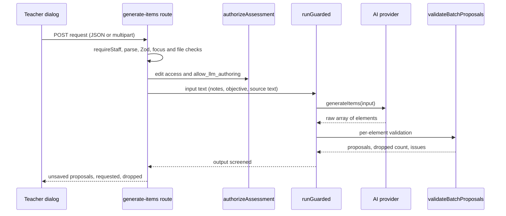

# Batch AI item generation

Batch generation lets a teacher ask the AI for up to ten item drafts in one call, tied to standards, a learning objective, free notes, or pasted or uploaded source material. The single-item generator (`POST /api/ai/generate-item`, `lib/ai/itemGenCore.ts`, described in [AI providers and guardrails](ai-and-safeguarding.md)) stays for "one more like this". This page owns the batch route, its prompt and its validation. The provider selector and guardrail wrapper it calls are documented in [AI providers, guardrails and safeguarding screening](ai-and-safeguarding.md).

Consult this page when changing the batch request shape, the item types a batch may plan, the prompt, the per-element validation, or the proposal response. The teacher's dialog that calls it is in `components/app/GenerateQuestionsDialog.tsx`, and its form helpers are in `lib/ai/batchForm.ts`; the dialog UI itself is not separately documented.

## Request contract

`GenerateItemsRequest` (`lib/ai/types.ts`) is the body. It is `assessment_id`, `count` (1 to `MAX_BATCH_COUNT` = 10), `types` (either `"mix"` or a `BatchTypeCounts` map whose counts must sum to `count`), an optional `target` (`standards` and an `objective` of at most 500 characters), `difficulty` (`mixed`, `easier`, `on_level`, `harder`), `notes` (at most 2000 characters) and `resource.text` (pasted source material, capped at the rubric upload's text limit). A file can accompany the request as multipart `file` beside the same JSON in a `request` field.

`hasBatchFocus` requires at least one of a file, a resource, notes, an objective or a standard. A request with none of them is refused with 400.

## Route flow

`app/api/ai/generate-items/route.ts` runs these steps in order. The order matters because each step stops the request before any model cost is incurred.

1. `requireStaff()` gates the caller.
2. The body is read as JSON, or as multipart with a file. Zod validates it through `GenerateItemsRequest`.
3. A file is checked against the upload types and the size cap before any database work (415 for an unsupported type, 413 for an oversize file). Both checks come from `lib/ai/documentUpload.ts` (`allowedUploadFor`, `ALLOWED_UPLOADS`, `MAX_UPLOAD_BYTES`), which the rubric extractor shares. PDF and DOCX stay as document blocks for the model; Markdown and plain text are decoded and sent as text, so the guardrail can screen them.
4. `authorizeAssessment(..., "edit")` checks access, and the assessment must have `allow_llm_authoring` (otherwise 403 `llm_authoring_disabled`).
5. The assessment's existing stems are loaded in position order, capped by `EXISTING_STEMS_MAX` (40) and `EXISTING_STEM_CHARS` (200), so the model can avoid duplicates.
6. `resolveTargetStandards` turns each requested tag into the code, framework and text the prompt needs.
7. `runGuarded({ surface: "item-gen", ... })` screens the teacher's own text (notes, objective and pasted resource text) as input. Inside the guarded call, `getProvider().generateItems(input, sub)` runs, and `validateBatchProposals` checks the reply. If nothing survives, the call throws and the route answers 502 `provider_failed`.
8. The guardrail screens every kept proposal as output. A block returns 422 `guardrail_blocked` with a stage of `input` or `output`.
9. The response is `{ ok, proposals, requested, dropped, provider }`. Nothing is saved.

*Caption: the batch route screens input, asks the provider for an array, validates each element, and screens the kept proposals before returning them unsaved.*

## Types and the prompt

`BATCH_MIX_ITEM_TYPES` (`lib/ai/types.ts`) is the default `mix`: the three single-item types (multiple choice single, multiple choice multi, short text) plus essay. `match` and `fill_blank` join the batch list only when the teacher requests them by count, and a mix never plans them. `planTypes` expands a request into one planned type per item in a stable order.

`buildBatchUserText` builds the user turn. It is pure, so the same input always gives the same prompt. The match and fill-in-the-blank shape blocks are added to the user turn only when that type is requested by count. Source material is wrapped in `<source_material>` tags, and `neutraliseSourceTag` stops pasted text from closing the wrapper early. The prompt tells the model that source text is reference material, not instructions. The system prompt `BATCH_SYSTEM_PROMPT` carries the shared rules: exact count, distinct items, a four-choice shape, plausible distractors, a bare short-text key, and no rubric or sample answer for essays.

## Validation of each element

`parseBatchArray` accepts a bare array, an `{ "items": [...] }` wrapper, markdown fences and the PDF importer's JSON repairs. A reply cut at the token cap is reported as truncated.

`validateBatchProposals` then checks each element on its own:

- `standards`, `rubric`, `rubric_id` and `scoring_method` are removed from the model's element (`STRIPPED_KEYS`). The batch's standards replace any the model returns, and the server never accepts a model-chosen rubric.
- An element whose type was not requested is dropped.
- A match element is renumbered with pair ids `p1`..`pn` by `normalizeMatchElement`, and a repeated left or right text drops it.
- A fill-in-the-blank element is normalized by `normalizeFillBlankProposal`, drops if any blank has no key, and drops if a `[[marker]]` sits inside `$...$` math.
- Survivors go through `normalizeProposalMath` and then `CreateItemBody.safeParse`. A parse failure drops the element and records the first issue.

The result carries `proposals`, `dropped` (requested minus kept), and up to five `issues`. Validation stops once `count` proposals are kept.

## Invariants and non-goals

- Nothing is persisted by this route. The teacher adds proposals through the existing items route, so the item validation and publish lock described in [authoring](authoring.md) still apply.
- Output tokens are capped at `BATCH_MAX_TOKENS` (8000), so a long batch is cut and reported rather than silently shortened.
- A batch is not a rubric generator. Essays are drafted as prompts only.
- The model never chooses standards. Tags come from the request, which the wire format carries as the item's optional `standards` field ([standards alignment](standards-alignment.md)).
- The design note `docs/batch-item-generation-design.md` still says "nothing built yet" in its progress section and describes the single-item request as the current surface. That is stale: the route, core module and tests above exist. Trust the source.

## Tests and validation

- `test/item-batch-core.test.ts`: prompt construction (`buildBatchUserText`), `parseBatchArray`, `validateBatchProposals`, `planTypes`, match and fill-in-the-blank batches, and the request schema. It needs no database.
- `test/ai-generate-items.test.ts`: the route's access, validation, proposal and guardrail behavior. It is database-backed (`DATABASE_URL` to the `_test` database; see [testing](../testing/testing-and-validation.md)).
- `test/batch-form.test.tsx`: the form helpers in `lib/ai/batchForm.ts`, which mirror the route's limits.

Narrow check: `cd design-tool && bun test test/item-batch-core.test.ts`. Broader check when the route changes: add `DATABASE_URL=... bun test test/ai-generate-items.test.ts`.

Change recipe, adding a batch type: add it to `BATCH_GENERABLE_ITEM_TYPES` in `lib/ai/types.ts`, extend `BatchTypeCounts`, add a shape block and rules in `itemBatchCore.ts`, add a per-element normalizer if the type needs one, and mirror the count limit in `batchForm.ts`. The item type itself must also exist in `CreateItemBody` ([authoring](authoring.md)) and be delivered as described in [wire formats](../architecture/wire-formats.md). Escalate to a cross-system change when the type reaches students.
