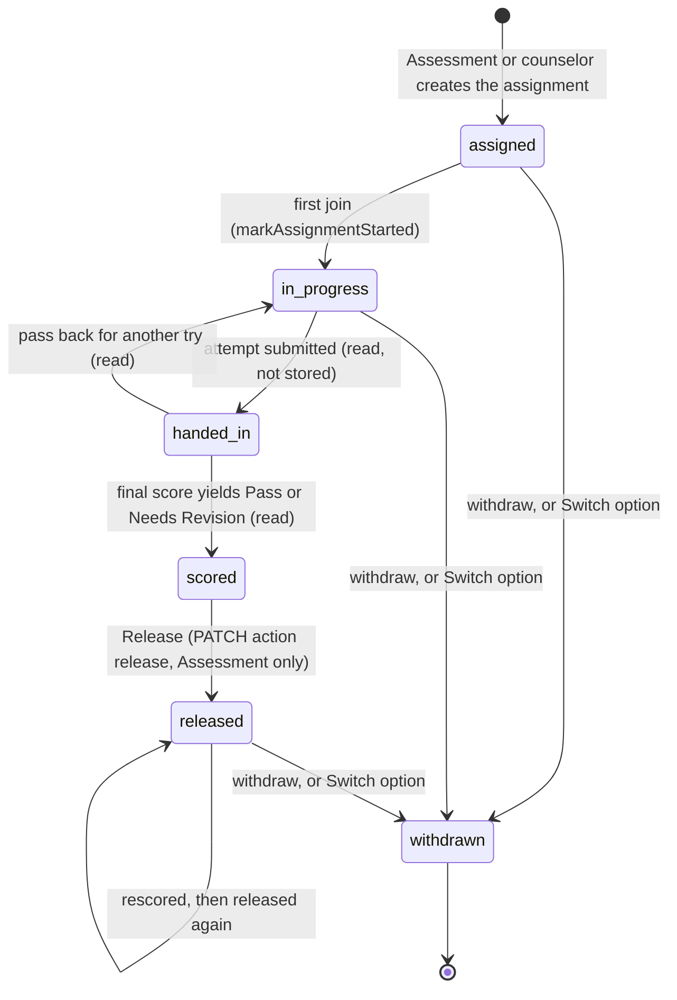
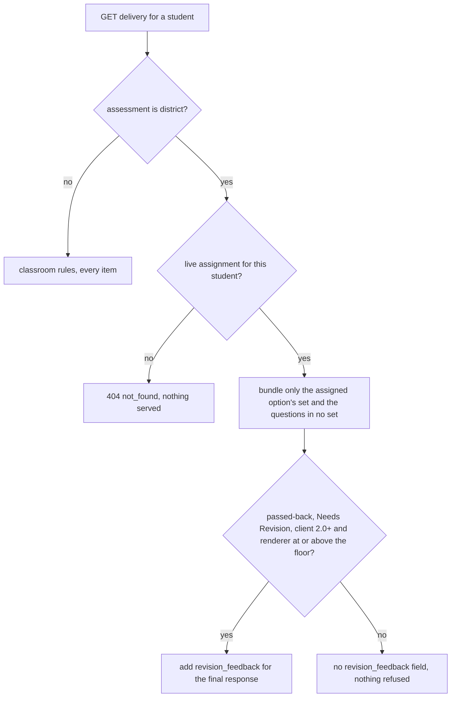

# Competency assessments

A competency assessment (CBA) is a district-owned performance task that a student passes or revisits. SecureTest holds the task, the student's assignment to one option of it, the proctored sittings, the scoring by scorers who hold only the `score` level, and the Pass or Needs Revision result that counselors see after Assessment releases it.

Source of truth: `docs/competency-assessment-design.md` (the decisions and slices) and the source named below. Current code and this page win over the design note where they differ.

## Business context

The paper process this replaces: Assessment issues a number, a counselor or trained proctor runs untimed sittings, the response is scored on the state rubric, and a Pass needs a 3 or higher on every row. The software keeps that rule and the record:

- **One assessment per task and course**, owned by Assessment staff, with `assigned_scope = 'district'`. Each curated option is an item set inside it. The student sees only the option on their assignment (D-4).
- **Typed, sealed responses** in SecureTest; no outside web during the sitting (D-1, D-2). The sources are built into the test (D-17).
- **Result derived, not stored.** A Pass needs at least `competency_pass_min_points` on every rubric criterion. One weak row is a Needs Revision (`design-tool/lib/scoring/competencyResult.ts`).
- **No PowerSchool push** (D-13). The counselor tells the registrar; the response stays in SecureTest as the record.

Content (task text, packets, sources) is district material and never goes in this repository (design note, §"The process today").

## Roles and who can do what

Four kinds of principal touch a competency assessment. Each is refused with the same 404 as any other unreachable row (`notFoundResponse`), so a route does not say which check failed.

| Principal | How they are granted | Reaches | Source |
| --- | --- | --- | --- |
| Assessment staff | Email listed in `COMPETENCY_ADMIN_EMAILS` (config, `isCompetencyAdmin` in `design-tool/lib/auth/admin.ts`); deploy wiring in [deployment](../operations/deployment-and-observability.md) | Every case on every district assessment, plus `PUT /competency` to make an assessment a competency one, Release, Switch option, Pass back | `lib/competency/assignments.ts` (`authorizeCompetency`) |
| Counselor | A `school`-scoped grant at `view` (results) or `run` (assign), made by Assessment staff on `/dashboard/competency-counselors` | Only that school's students' assignments and released results; never Release, never responses | `lib/competency/schoolGrants.ts` (`schoolGrantSchools`), `lib/competency/counselors.ts` |
| Proctor | A live `competency_assignments` row naming them as `proctor_email` | Starting sittings for their own assigned students only; the Monitor for those sittings; their home list `/dashboard/proctoring`. Level `run`, via `"proctor"` | `lib/api/access.ts` (`authorizeProctorAssessment`, the sitting and attempt doors), `lib/competency/proctoring.ts` |
| Scorer | A `score` grant (time-boxed: `ends_at` must be in the future, `ends_at_required` otherwise) given in the Share dialog's Scorers section | The review queue and every scoring action; not items, settings, Release or pass back | `lib/api/grants.ts`, `components/app/ScorersSection.tsx`, `lib/api/accessLevels.ts` |

<!-- openwiki: broken internal link [auth-and-access.md#the-access-ladder-docs-access-model-design-md] heading anchor "the-access-ladder-docs-access-model-design-md" does not exist in "auth-and-access.md". Fix the href or restore the target, then delete this comment. -->
The `score` level sits between `run` and `edit` on the ladder: `view < run < score < edit < own` (see [auth and access](auth-and-access.md#the-access-ladder-docs-access-model-design-md)).

## Lifecycle of one case

A case is one `competency_assignments` row: one student, one option (item set), one proctor. The stored status records only milestones a person or a join writes. Handed in, Scored and Pass or Needs Revision are read from the attempt and the final score, so a Change score or pass back cannot leave a stale status (`lib/competency/caseState.ts`, `caseStatusOf`).

The allowed stored transitions are `ASSIGNMENT_TRANSITIONS` in `lib/competency/assignments.ts`: `assigned → in_progress | released | withdrawn`, `in_progress → released | withdrawn`, `released → released | withdrawn`, `withdrawn` final. A withdrawn case cannot be changed (`assignment_withdrawn`, 409).

`Switch option` (`PATCH …/assignments/[assignmentId]` with `action: "switch_option"`) is one transaction: it withdraws the case, inserts a new assignment for another option of the same assessment, and, when the student's one attempt was already handed in, passes that attempt back through the ordinary pass back (`passBackAttempt`, so old scores become `superseded`). A timed attempt needs `ends_at`. Nothing carries over to the new option (D-18, D-20).

## Delivery: only the assigned option

On a district assessment, `GET /api/assessments/[id]/delivery` looks up the student's live assignment first (`liveAssignmentFor`). With no live assignment the route answers 404 `not_found`, so nothing of any option is served. With one, `buildDeliveryBundle` receives `onlyItemSetId` and bundles that option's item set plus questions that belong to no set. Every other option's sources and items stay out of the bundle, and the progress, results and row maxima read the same rule (`optionByStudent` and `inStudentOption` in `lib/competency/studentItems.ts`). The authoring preview still shows every option.

The design note's slice 3 progress records that the answer-write routes were not yet restricted to the option; check the answer routes before relying on that restriction.

## Proctored sittings

A proctor has no level on the assessment. `authorizeProctorAssessment` admits them at `run` through the `"proctor"` path only when they proctor someone on it. `POST /api/test-sessions` then requires every listed student to be one of the caller's own (`proctoredStudentPsIds`); on a district assessment a proctor's sitting cannot use "all my sections" or a section. The proctor may open and close each sitting, and the sitting stays owned by the proctor, like any sitting. The first join moves the case from `assigned` to `in_progress` (`markAssignmentStarted`, called from `app/api/attempts/route.ts`). Results, the review queue and the editor stay shut to a proctor, because `authorizeAssessment` never returns the proctor path. See [sittings and attempts](sittings-and-attempts.md#starting-a-sitting-scope-and-roster-pickers).

## Scoring, the pass rule and No Score

- **The pass rule.** `PUT /api/assessments/:id/competency` (Assessment staff only, otherwise 404) sets `assessments.competency_pass_min_points` (3 for every OSPI task) and `assigned_scope = 'district'`. `deriveCompetencyResult` returns `pass` when every rubric criterion's picked points are at least the minimum, `needs_revision` when one is below, and `null` when a criterion has no pick or the score has no per-criterion picks. A null is a scoring problem for Assessment to see, never a result for the student.
- **Where it is read.** `loadCaseStates` applies the rule to the final response of each option (the last item with a rubric in the set). Results, the queue and the counselor view all read the derived value; it is not written to `scores`.
- **No Score.** A scorer picks one of five reasons (`NO_SCORE_REASONS`: unintelligible, not in English, off topic, off purpose, copied text). `checkManualScore` (`lib/api/reviewActions.ts`) accepts `no_score_reason` only on a district assessment's rubric-scored response, only with 0 points and no criterion picks; anywhere else the answer is 400 `no_score_not_allowed`. The reason is stored on the final score's `rationale.no_score_reason`, the result is `no_score` (`deriveCompetencyResult` in `lib/scoring/competencyResult.ts`), and the results show "No Score: <reason>" (`noScoreLabel`). The scoring queue offers it on a district rubric card: an "Or No Score" reason picker and a "Save No Score" button (`saveNoScore` in `app/dashboard/[id]/scoring/ScoringQueue.tsx`, shown when the page passes `competency`, which `scoring/page.tsx` sets from `assigned_scope === "district"`). The save asks for confirmation first, because a final cannot be un-made.
- **Scorers score as on any assessment.** The score routes accept the `score` level (`app/api/responses/[responseId]/score/route.ts`, `change-score`, and the AI score routes under `app/api/attempts/[attemptId]/score-ai/`). AI scoring is allowed from v1 (D-19), but items default to human scoring (D-6), and whether AI runs is the item's scoring method, set at `edit`. The AI paths are described in [scoring and results](scoring-and-results.md#batch-and-per-essay-ai-scoring).
- **Scorer grants are time-boxed.** `validateGrant` in `lib/api/grants.ts` refuses a `score` grant without a future `ends_at`. A scorer also gets the scorer invitation email (`lib/email/shareNotifications.ts`, kind `score`).
- **A Pass sends the student nothing** beyond the result itself; revision feedback exists only for Needs Revision (see below).

## Release, counselors and results

- **Release is Assessment's review (D-10).** The PATCH `release` action is refused (409 `not_releasable`) unless the case reads `scored` with a result. It stores the result, `released_at` and `released_by_email`. A counselor's PATCH on release is a 404. A rescore after release reads `scored` again and is released again.
- **Counselors see released results only.** A counselor's list (`GET …/competency/assignments`) carries `result` only for `released` cases; the counselor results page (`/dashboard/competency-results`, `releasedResultsForSchools` in `lib/competency/counselors.ts`) shows the result, not the response.
- **Counselors assign, within their school.** Assessment staff create counselor grants on `/dashboard/competency-counselors` (`app/api/competency/counselors/`). A `run` counselor (checkbox "Can assign students") reaches `/dashboard/competency-assign` and may create, change proctor and switch option for students whose `roster_students.school_id` matches. Anyone else's student is `unknown_student` on create and 404 on change.
- **Students and results are linked by the roster, not by name.** `roster_students.ps_id` is the join key for assignments, proctoring and the counselor list (`lib/competency/caseState.ts` joins `attempts` through `students.roster_ps_id`).

## Revision feedback: the scorer's note reaches the student

When a Needs Revision is passed back, the student sees the scorer's per-row feedback in a read-only "Scorer feedback" panel while they revise.

- **Server.** `loadRevisionFeedback` (`lib/competency/revisionFeedback.ts`) builds `revision_feedback` keyed by the option's final-response item id. It reads the newest `superseded` score on that response, and only while no `final` score exists. Each criterion carries its name, level label and the scorer's rationale; the response's written feedback is the note. Both are clipped to 2000 characters. A superseded Pass or No Score sends nothing.
- **Gate.** `revisionFeedbackDeliverable` (`lib/items/clientSupport.ts`) requires a 2.0+ client and a named renderer at or above `MIN_RENDERER_VERSION_FOR_REVISION_FEEDBACK`. The floor is set to `1793687410`, the committer time of the merge that landed the panel (the comment records this). Below the floor no field is added and no client is refused.
- **Schema.** `revision_feedback` is an optional field on the delivery bundle in `packages/schema/src/delivery.ts`, validated for every key. The delivery route re-checks the bundle with `DeliveryBundleSchema` before adding it.
- **Client.** The served renderer draws the panel (`AssessmentPage.swift`, heading "Scorer feedback", `.revision-feedback-heading`). The client decode is covered by `RendererRevisionFeedbackTests.swift`. The renderer must be re-signed for the panel to reach students, which is why the floor is a renderer version and not a client release.
- **Switching option after a Needs Revision is a new assignment (D-18)**, so no feedback panel follows the student to the new option.

## Routes and pages

| Surface | Source | Who | Purpose |
| --- | --- | --- | --- |
| `PUT /api/assessments/[id]/competency` | `app/api/assessments/[id]/competency/route.ts` | Assessment staff | Make the assessment a district competency one and set the pass minimum |
| `GET`, `POST /api/assessments/[id]/competency/assignments` | `…/competency/assignments/route.ts` | Assessment staff, counselor with `run` (their school) | List cases with derived status and result; create an assignment |
| `GET /api/assessments/[id]/competency/students` | `…/competency/students/route.ts` | same as above | Roster name search for the assign form |
| `PATCH …/assignments/[assignmentId]` | `…/assignments/[assignmentId]/route.ts` | same, Release is Assessment only | `withdraw`, `release`, `switch_option`, `change_proctor` |
| `GET`, `POST /api/competency/counselors`, `DELETE …/counselors/[grantId]` | `app/api/competency/counselors/` | Assessment staff only | Counselor school grants |
| `/dashboard/[id]/assignments` | `app/dashboard/[id]/assignments/AssignmentsPanel.tsx` | Assessment staff | The Assignments tab: assign, switch, withdraw, release |
| `/dashboard/proctoring` | `app/dashboard/proctoring/ProctoringList.tsx` | any proctor | Proctor home list: students, option, status, open sittings |
| `/dashboard/competency-assign` | `app/dashboard/competency-assign/page.tsx` | counselors with `run` | Assign students at their school |
| `/dashboard/competency-results`, `/dashboard/competency-counselors` | `app/dashboard/competency-results/page.tsx`, `competency-counselors/CounselorsPanel.tsx` | counselors; Assessment staff | Released results; manage counselor grants |
| Scorers section of the Share dialog | `components/app/ScorersSection.tsx` (in `ShareDialog.tsx`, shown only for district assessments) | Assessment staff | Give, list and revoke time-boxed `score` grants |

Deleting an option that a student's record uses is refused with 409 by the item-set route (`app/api/assessments/[id]/item-sets/[setId]/route.ts`), and the editor copy for that refusal is in `lib/ui/errorCopy.ts`.

## Invariants

- A district assessment is delivered only as the option on the student's live assignment; no live assignment means 404 on delivery.
- At most one live (not `withdrawn`) assignment per `(assessment_id, student_ps_id)`: the partial unique index `competency_assignments_live_unq`.
- A result is derived from the final score and never stored in `scores`; a missing criterion pick yields no result, not a Needs Revision.
- `no_score_reason` is accepted only on a district assessment's rubric-scored response, with 0 points and no criterion picks.
- The proctor path never resolves `authorizeAssessment`: results, the review queue and the editor stay shut to a proctor.
- A counselor's reach is the school grant's schools; every counselor route filters by them, and Release is never a counselor's.
- A `score` grant has an `ends_at` in the future.
- `revision_feedback` is sent only for a passed-back attempt on a district assessment whose newest superseded score is Needs Revision and whose current final score is absent; no client is refused for lacking it.
- Switch option withdraws, inserts and reopens in one transaction; a stale switch (the case changed under it) is 409 `assignment_changed`.
- Handed in, Scored and in-progress are read, not stored, so they cannot disagree with the attempt.

## Tests and where to look

Every file is under `design-tool/test/` and needs the test database (`$TESTDB`, see [testing](../testing/testing-and-validation.md)).

| Behaviour | File (suite or test names to search) |
| --- | --- |
| `isCompetencyAdmin` gate; `deriveCompetencyResult` table; `PUT /competency` | `competency-slice1.test.ts` (`isCompetencyAdmin`, `deriveCompetencyResult`, `PUT /api/assessments/:id/competency`) |
| `ASSIGNMENT_TRANSITIONS`, assignment create and PATCH | `competency-assignments.test.ts` (`competency assignment routes`) |
| Only the assigned option is delivered; 404 without assignment | `competency-delivery.test.ts` (`competency delivery: only the assigned option`) |
| Option-scoped progress, results and maxima (F-2) | `competency-option-scope.test.ts` |
| Proctor scope on sitting creation; proctor home list; proctor cannot see results | `competency-proctor.test.ts` |
| Switch option: withdraw, insert, reopen; stale-switch 409 (F-1) | `competency-switch.test.ts` |
| Release, `caseStatusOf`, counselor school results | `competency-release.test.ts` |
| Counselor assign within school; cross-school 404 (slice 8) | `competency-counselor-assign.test.ts` |
| No Score accepted only on district rubric responses | `competency-no-score.test.ts` |
| Revision feedback content, gating and superseded rules | `competency-revision-feedback.test.ts` |
| `score` level on the ladder; review routes accept it | `score-level.test.ts` |
| Scorers section and grant time box | `scorers-section.test.ts`, `grants-api.test.ts` |
| Route guards table for every competency route | `access-enforcement.test.ts` (entries that name `authorizeCompetency` and `isCompetencyAdmin`) |
| Scorer invitation subject and body | `share-notifications-email.test.ts` (`scorer (competency slice 5b)`) |
| Body caps for the assignment POST and PATCH | `json-body-cap.test.ts` |
| Client decode and panel | `client/SecureTestCore/Tests/SecureTestCoreTests/RendererRevisionFeedbackTests.swift` |

## Validation

- Focused, after changing a competency lib or route: `cd design-tool && $TESTDB bun test test/competency-assignments.test.ts test/competency-delivery.test.ts`. Add the file that owns the behaviour from the table above.
- Access changes (any new competency route, level or grant rule): `cd design-tool && $TESTDB bun test test/access-enforcement.test.ts`.
- Bundle shape (`revision_feedback`, option filter): `cd packages/schema && bun run build && bun test` before the design-tool typecheck, then the Swift suite below. The shared delivery fixture is in [testing](../testing/testing-and-validation.md#shared-delivery-bundle-fixture).
- Client panel: `cd client/SecureTestCore && swift test --filter RendererRevisionFeedbackTests` (macOS only).
- Conditional and expensive: the full design-tool suite and the Swift suite are only needed for a change that crosses delivery, the access ladder, or the renderer. A renderer change needs a re-sign before students see it; do not change `MIN_RENDERER_VERSION_FOR_REVISION_FEEDBACK` from a branch commit time.

## Change recipes

- **New competency route.** Use `authorizeCompetency(db, session, id, "read" | "write")` for case routes so counselor school filtering applies, and return its `response` unchanged. Assessment-only routes check `isCompetencyAdmin` and return `notFoundResponse()`. Add the route to `access-enforcement.test.ts` and, if it reads a body, to `json-body-cap.test.ts`.
- **New stored case milestone.** Add the status to `COMPETENCY_ASSIGNMENT_STATUSES` and the `competency_assignments_status_check` in `db/schema.ts`, add a migration, and extend `ASSIGNMENT_TRANSITIONS`. Derived states (handed in, scored) belong in `caseStatusOf`, not in the stored enum.
- **New access level or grant rule.** Touch `lib/api/accessLevels.ts`, `GrantLevelSchema` in `lib/api/grants.ts`, and the `access_grants` check (migration `0071_access_grant_score_level.sql` is the precedent); see [auth and access](auth-and-access.md#change-recipes).
- **New field on the delivery bundle for a renderer feature.** Follow the `revision_feedback` pattern: a gate function in `lib/items/clientSupport.ts` with a floor, a schema entry in `packages/schema/src/delivery.ts`, and a route branch in `app/api/assessments/[id]/delivery/route.ts`.

## Scope boundaries and open items

- Not built: scorer pass back (D-15, later), blind online scoring (D-6, later), non-Social-Studies tasks and semester finals (D-9), gradebook or transcript push (D-13), and the setting that would remove Release (D-10).
- Records retention for competency work is an open question in the design note (`docs/archive-and-delete-design.md`); the wiki does not claim a retention rule. The open items are listed in the [quickstart backlog](../quickstart.md#backlog).
- The task content is authored in the app by Assessment staff; nothing about the district's packets belongs in this repository or in this page.
istrict's packets belongs in this repository or in this page.
