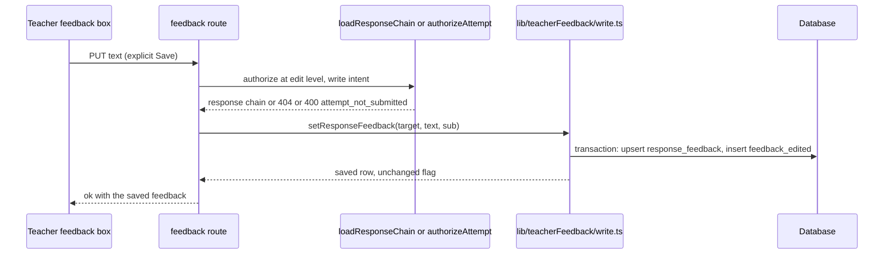
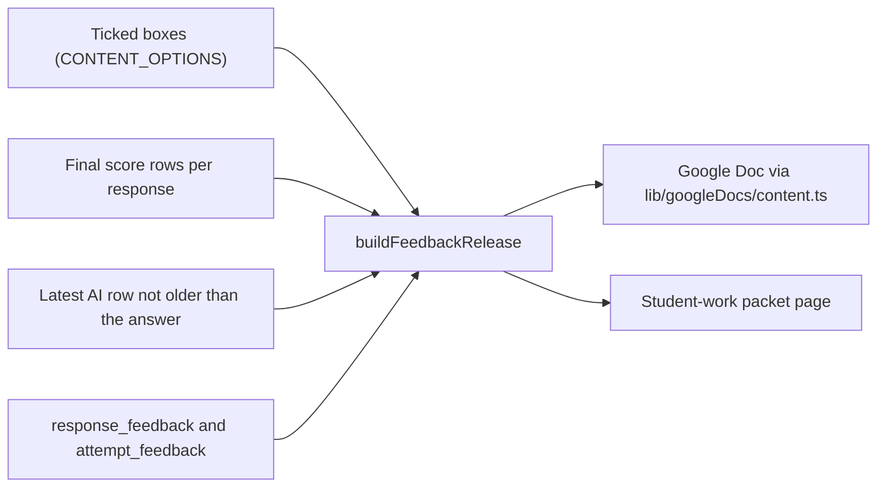

# Teacher feedback and feedback release to students

Teachers write their own feedback on each answer and on each handed-in attempt. A release then decides which teacher score, AI score, teacher feedback and AI feedback reach a student, either as a Google Doc or as a printed student-work packet. The rules were decided by James on 2026-10-29 in `docs/feedback-release-design.md`, and the code in `lib/reporting/feedbackRelease.ts` is the one place that applies them.

Consult this page before changing what a student can read: the feedback boxes, the per-question rules, the Doc dialog, the packet toolbar's URL parameters, or the teacher feedback routes. The score rules themselves (which final counts) are in [scoring and results](scoring-and-results.md), and the outputs are described in [integrations](integrations.md#google-docs-release) and [reporting and packets](reporting-and-packets.md#the-class-work-packet).

## Writing teacher feedback

Feedback is stored apart from scores, because scores are an append-only audit trail (see [data model](data-model.md#invariants-worth-knowing-before-writing-queries)). There are two stores, each with at most one row:

- `response_feedback` holds one comment per answer (`response_id` is unique). `attempt_feedback` holds one overall comment per attempt. Both are 1 to 4000 characters, and `author_sub` records the last editor, so co-teachers share one comment.
- Each save or clear writes one `feedback_edited` attempt event in the same transaction. Its detail names the scope, the response and the item, and the action, never the text. The per-student timeline reads it as "Feedback edited" (`buildTimeline` in `lib/reporting/timeline.ts`).

The write path is `setResponseFeedback` and `clearResponseFeedback` in `lib/teacherFeedback/write.ts`. The routes are `PUT` and `DELETE` on `app/api/responses/[responseId]/feedback/route.ts` and `app/api/attempts/[attemptId]/feedback/route.ts`. They use the same access door as the score routes: edit level with write intent, a 404 for a response the caller cannot reach, and a refusal while the student is still working. An identical save writes nothing, and clearing a comment that is not there is a quiet 200.



Caption: the save path. A failed database write is rethrown as a bare error so the comment text cannot reach the error log (D-14).

The comment box appears on every scoring-queue card and beside each answer on the per-student results page, with an overall box on that page (`components/app/TeacherFeedbackBox.tsx`, used by the scoring queue in [scoring and results](scoring-and-results.md#teacher-review-queue-and-approval)). A non-impersonating admin sees the box read-only.

Teacher feedback is student-record content. It is never printed by the family results report, never sent to a model (not in class insights or the insights chat, D-14), and never written to a log.

## What a release can print

Both outputs offer the same boxes, defined once as `CONTENT_OPTIONS` in `lib/googleDocs/sendDialog.ts`: teacher score, AI score, teacher feedback, AI feedback and rubric table. The Doc also takes prompt and sources. Each box is independent, and none ticked is allowed (D-2). The Doc dialog and the packet toolbar both read this list (D-7), and `test/feedback-release-help-page.test.ts` fails if the help page omits one of its labels.

`buildFeedbackRelease` in `lib/reporting/feedbackRelease.ts` is the single content model (R-3). It takes the ticked boxes, each question's score rows, rubric and teacher comment, and returns labelled blocks. `lib/googleDocs/content.ts` renders those blocks to Doc HTML, and the packet renders them to JSX, so the two outputs cannot drift. The function is pure: it reads no database and needs no Drive or browser.

The rules it applies, per question:

| Block | Source | Prints when |
|---|---|---|
| Teacher score | the `final` row with `method = 'human'` | the teacher score box is ticked |
| AI score | the `final` row with `method = 'ai'` (approved, or a Hybrid final no teacher reviewed) | the AI score box is ticked and the AI's score still stands (D-3, D-17) |
| "Score" | the `final` row with `method = 'auto'` | either score box is ticked (D-13) |
| Teacher feedback | `response_feedback` for the question, and `attempt_feedback` once per student | the feedback box is ticked (D-4) |
| AI feedback | the latest non-research, non-superseded `ai` row, not older than the answer's last edit | the AI feedback box is ticked (D-10); a student copy of a short answer never gets it (see below) |
| Rubric table | the criteria, levels and points of the final row, plus the AI's per-criterion comments | the rubric box is ticked (R-2); levels can print with no score box ticked, which James accepted on 2026-10-29 |

Labels always name the source: "Teacher score", "AI score", "Teacher feedback", "AI feedback" or "Score" (D-1, D-9). No unlabelled "Feedback" reaches a student.

Three rules are easy to break:

- **An overridden AI score never prints.** A teacher override or change supersedes the AI's final, so the AI score box shows nothing for that question. The AI's comments still print under AI feedback, because they come from the AI's own row (D-10).
- **A change reason never prints.** The reason a teacher gives when changing a score is stored in `rationale.note` and is not feedback. Teacher feedback reads only `response_feedback` (R-1).
- **Stale AI comments are dropped.** An AI row written before the answer last changed is about the old answer, so `answer_updated_at` (`responses.updated_at`) excludes it. A pass back leaves proposals in place, which is why this check exists.

Short answers have one extra rule. `withhold_ai_feedback` is set for every `short_text` question on a release a student receives. An AI short answer's level descriptors are seeded from its correct answer, so its comments on a wrong answer could state the expected answer. The AI score and its level label still print under their own boxes. The Doc sets this in `lib/googleDocs/release.ts`, and the packet's student copy sets it too.

## The two outputs

- **Google Doc.** The Doc dialog (`components/app/SendToGoogleDocsControl.tsx`) sends through `POST /api/assessments/[id]/google-docs` (`releaseToGoogleDocs` in `lib/googleDocs/release.ts`). A release covers essays and short answers, one Doc per student, and the Doc is built from `buildFeedbackRelease`. The send mechanics (Drive consent, skip reasons, folders) are in [integrations](integrations.md#google-docs-release).
- **Printed packet.** The work page (`app/dashboard/[id]/results/work/page.tsx`) prints each attempt the packet selects, from the same content model. Its URL carries one parameter per box: `teacher_score`, `ai_score`, `teacher_feedback`, `ai_feedback` and `rubric_table`, each off when absent, plus `teacher_copy`. `answers=0` hides the answers only when a box is ticked, because a sheet with no box would print question numbers and nothing else. The ✓ and ✗ key follows the teacher score box alone (W-1; see [reporting and packets](reporting-and-packets.md#the-class-work-packet)).

The packet has two copies. The **student copy** is the default and follows the rules above. The **teacher copy** (`teacher_copy=1`, D-16) keeps the older AI headings ("AI proposal", "AI score (not reviewed)", "AI score (approved)") for annotating, and prints "Teacher copy — not for students" under the handed-in line and in each page's footer, so a sheet handed back by mistake says what it is. A bookmark that uses only the old `scores=` parameter reads the two score boxes and prints the student copy, without the rubric table or comments that the old form carried.

Choices are remembered in one place only. `feedback_release_prefs` (migration `0067_feedback_release_prefs.sql`) stores the last Doc dialog choices per staff member and assessment (R-4). `loadFeedbackReleasePrefs` reads it on the results, per-student and work pages, and `rememberFeedbackReleasePrefs` writes it after each send. The write is best-effort: a failed write logs a warning and never fails the send. The packet keeps its choices in the URL, not in that table.



Caption: one content model feeds both outputs. Only the inputs differ by output (the Doc also has prompt and sources).

## Invariants

- A score prints only when its box is ticked. A `final` row with method `ai` is the only AI score that can print, and a superseded or proposed AI row never does.
- AI feedback is read from the AI's own row, so an override does not remove it, and a row older than the answer's last edit is ignored.
- A short answer's AI comments never reach a student copy.
- Teacher feedback text reaches only a release with its box ticked, never a log line, an event detail or an AI prompt.
- The same boxes give the same blocks in the Doc and the packet.

## Known gaps and open decisions

These are recorded in `docs/feedback-release-design.md` (§Progress). Their status is what the code does now.

- A comment on a question is deleted with its response row (`response_feedback` cascades from `responses`). If a pass back leads a student to withdraw that answer, the comment goes with it. James accepted this on 2026-10-29.
- A changed Hybrid final loses its AI feedback, because the AI's only row is superseded by the change. James accepted this, since approval cannot split a score from its comments.
- An unreviewed proposal with no final still sends its comments as AI feedback, as D-10 is written (accepted).
- The teacher copy's "AI proposal" can disagree with its AI feedback after a pass back, until the AI re-scores. Accepted.
- Old Google Docs released before the labels and the short-answer rule keep what they were sent. Nothing reissues them.
- The Doc dialog is the only place that remembers choices (R-4); the packet does not.

## Change navigation

- **Changing which boxes exist or how they are labelled**: `CONTENT_OPTIONS` and `DEFAULT_CONTENTS` in `lib/googleDocs/sendDialog.ts`, then `readReleaseContents`, the packet's `parsePacketQuery` in `lib/reporting/workPacket.ts` (its box keys), and `/help.html`. Tests that must agree: `google-docs-send-dialog.test.ts`, `feedback-release-help-page.test.ts`, and `work-packet.test.ts`.
- **Changing what prints for a score or comment**: `buildFeedbackRelease`, `shownScore`, `questionBlocks` and the AI-row selection in `lib/reporting/feedbackRelease.ts`. Keep the pure rules there, because the tests in `feedback-release.test.ts` run without a database. The "every box combination × every score history" suite is the main regression net.
- **Changing the Doc rendering**: `lib/googleDocs/content.ts` only. Do not add rules there.
- **Changing the packet rendering**: `app/dashboard/[id]/results/work/page.tsx` and `lib/reporting/workPacket.ts`. Check `work-packet-page.test.tsx` ("work packet — feedback release boxes (FR)" and "work packet — scores").
- **Changing the teacher comment writes**: `lib/teacherFeedback/write.ts`, the two routes, and `components/app/TeacherFeedbackBox.tsx`. The routes' suite is `teacher-feedback-api.test.ts`, which needs the test database.
- **Adding a column or table**: follow [data model](data-model.md#migrations). Migrations 0066 and 0067 are the latest examples of this area.

Focused checks:

```bash
cd design-tool && bun test test/feedback-release.test.ts
cd design-tool && DATABASE_URL=postgres://$USER@localhost:5432/secure_test_design_tool_test bun test test/teacher-feedback-api.test.ts test/google-docs-release.test.ts test/work-packet-page.test.tsx
```

The first command needs no database. The second needs the test database described in [testing and validation](../testing/testing-and-validation.md). Treat a Drive or browser check as a manual step, not an automated one: the Doc's real render and the printed packet are covered by the hand-run rows in `docs/design-tool-manual-checks.md` (rows 864 to 901), which were not run when this page was written.

