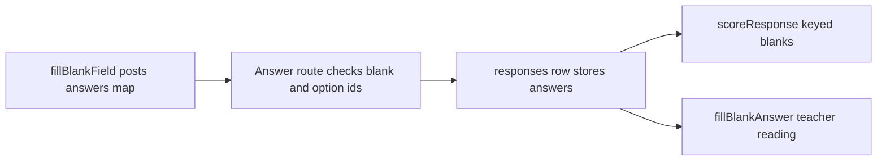

# Fill-in-the-blank items

A fill-in-the-blank item is one sentence (the stem) with numbered gaps. Each gap is either a **dropdown** (the student picks one of the blank's own options) or **typed** (the student writes a short answer), and one item can mix both. The type is one of the `ITEM_TYPES` and is listed with the other types in [assessment authoring](authoring.md#concepts). The design rationale is in `docs/fill-in-blank-design.md`, but parts of that page (for example its "Nothing is built" note) are out of date; the source is authoritative.

## Shape and write boundary

- **Stem and blanks.** The stem holds `[[<id>]]` markers. The `blanks` array holds one entry per marker. `FillBlankItemSchema` in `packages/schema/src/items.ts` keeps the wire layer permissive, while `validateFillBlank` in `design-tool/lib/api/items.ts` enforces marker-to-blank pairing, unique ids, unique option ids and the caps (20 blanks, 12 options, 10 keys). A marker repeated in the stem is refused.
- **Keys.** A dropdown is keyed by `correct_option_id`. A typed blank is keyed by `keys` (one or more accepted answers, any one matching, D-5) and an optional `exact_form`. `isKeyedBlank` in `packages/schema` is the single definition of "keyed" shared by scoring, the scoring-method default and readiness.
- **Stored in jsonb.** Blanks live in `items.config.blanks`, not in a column, so the type needs no migration. `itemConfigForWrite` decides what is persisted.
- **Scoring method.** `effectiveScoringMethod` returns `auto` when at least one blank is keyed and `human` otherwise. A teacher can set `human` explicitly, and then every blank is worth a point.

## Authoring and publish checks

`FillBlankEditor.tsx` (`app/dashboard/[id]/`) is a thin component over the pure logic in `design-tool/lib/items/fillBlankEditor.ts`. That module owns id generation (`nextBlankId` never reuses a removed id), keeps `blanks` in stem order so "Blank n" numbers match what students and reports show, and implements `setBlankKind`, which carries an answer across when a blank switches between dropdown and typed.

Publish readiness is computed in `design-tool/app/dashboard/[id]/readiness.ts`. `questionGaps` delegates fill-blank checks to `fillBlankGaps`, which reports orphan or repeated markers, blanks with no marker, dropdowns with fewer than two options and empty options. A blank with no key is not a gap. The item stays publishable and is hand-scored. Key-only edits are allowed after publish through `isAnswerKeyOnlyPatch` (see [assessment authoring](authoring.md#draftpublished-lock)).

## Student answer

The client posts `{ type: "fill_blank", answers: { <blankId>: string } }`. A dropdown answer is the option id, and a typed answer is the text. An empty blank is absent from the record. `fillBlankField` in `client/SecureTestCore/Sources/SecureTestCore/AssessmentPage.swift` builds the page control: dropdown blanks are a page-built pick control rather than a native `<select>`, and the question is marked answered only when every blank holds an answer. The bundle carries options but no key, so the page never judges an answer.

The server boundary is `studentAttempt.ts`. For a fill-blank response, every answer must name one of the item's blanks, and a dropdown answer must name one of its options. An empty string clears a dropdown pick. Anything else is refused, because it would be stored as an answer no scorer or teacher view can place.

## Scoring and reading

Caption: one stored answer feeds both scoring and the teacher readings.

- **Scoring.** `scoreResponse` in `design-tool/lib/scoring/auto.ts` awards one point per keyed blank. A dropdown matches by option-id equality. A typed blank matches when any key passes `fillBlankTextMatches`, which uses the short-text rule with the blank's `exact_form` opt-out. Unkeyed blanks are never counted, and an item with no keyed blank returns `null`, so it is skipped rather than scored zero.
- **Max points.** `fillBlankMaxPoints` is the keyed count, or all blanks when the item is hand-scored. `results.ts` and `reviewActions.ts` use it, so every student's totals stay comparable.
- **One reading for every surface.** `fillBlankAnswer` in `design-tool/lib/items/fillBlankAnswer.ts` turns a stem and an answer record into segments and per-blank verdicts. The review queue, per-student page, work packet, instant feedback and insights evidence pack all read through it. Its output is raw text with a `format` hint: a dropdown's option text is `content` (it may contain math or emphasis), and a typed answer is `plain` (escape it). HTML is produced by `design-tool/lib/reporting/fillBlankView.ts`, which applies that rule.
- **Stem HTML keeps emphasis whole.** `renderAroundBlanks` in `design-tool/lib/items/renderAroundBlanks.ts` renders a stem around its blanks. It joins the text between blanks with a private-use sentinel, renders the whole stem once through `renderItemContent`, then substitutes each blank's markup at its sentinel. A blank therefore sits inside a `**…**` or `_…_` span instead of cutting it. If a sentinel does not survive as plain text (a marker inside a formula or an image alt text), or lands inside an HTML tag, the function falls back to rendering each segment separately, which is always well-formed. `fillBlankView.ts` (reporting) and `lib/preview/renderHtml.ts` (teacher preview) both call it. The student page applies the same rule in `fillBlankField`. The standalone blank-mode parser in [markup grammar](../architecture/markup-grammar.md) (`parse(s, { blanks: true })`) follows this server rule, so it matches the server here. The client's page renderer differs from the server when a marker sits inside a formula or alt text (findings ER-F1 to ER-F3 in [markup grammar](../architecture/markup-grammar.md#invariants)). Focused test: the "bold around a blank" case in `design-tool/test/fill-blank-read-side.test.ts`, with the preview's blank markup checked in `design-tool/test/preview-render.test.ts`.

## Client compatibility

The client decodes a bundle as a whole, and an unknown item type fails the whole test. `MIN_CLIENT_VERSION_FOR_TYPE` in `design-tool/lib/items/clientSupport.ts` sets `fill_blank` to `1.6.0`. The delivery route (`app/api/assessments/[id]/delivery/route.ts`) returns 409 `client_update_required` before any lockdown begins when `requiredClientUpgrade` says the client is too old. A client that sends no version is treated as too old. The design-tool side of this rule is described in [sittings and attempts](sittings-and-attempts.md#join-and-answer-flow), and the wire layering is in [wire formats](../architecture/wire-formats.md).

Related pages: [scoring and results](scoring-and-results.md) owns the general auto-scoring and results rules, [reporting and packets](reporting-and-packets.md) owns the printed and timeline views, and [macOS client overview](../client/overview.md) owns the page pipeline that hosts `fillBlankField`.

## Change guidance

- Changing marker or blank pairing, id rules or caps: edit `validateFillBlank` and `FillBlankItemSchema` together, then run `design-tool/test/items-api.test.ts` (needs the test database) and `design-tool/test/item-readiness.test.ts`.
- Changing scoring: edit `scoreResponse` and the max-points helpers in `auto.ts`, then run `design-tool/test/scoring-auto.test.ts` and `design-tool/test/fill-blank-read-side.test.ts`.
- Changing a shape that a client decodes (blank or response fields): this crosses TypeScript and Swift. Follow [wire formats](../architecture/wire-formats.md) and run `client/SecureTestCore` with `swift test --filter FillBlank`, plus `design-tool/test/delivery-api.test.ts`.
- Changing the version floor: edit `MIN_CLIENT_VERSION_FOR_TYPE` only when a client release actually renders the new shape. Check `design-tool/test/client-support.test.ts`.
- Changing stem rendering: edit `renderAroundBlanks` and keep the segmented fallback. Run `cd design-tool && bun test test/fill-blank-read-side.test.ts`, and check `test/preview-render.test.ts` if the preview markup changes.
- Non-goals: the client does not judge answers, and no key ever belongs in the bundle. Do not hand-edit generated Swift or schema `dist` output.
