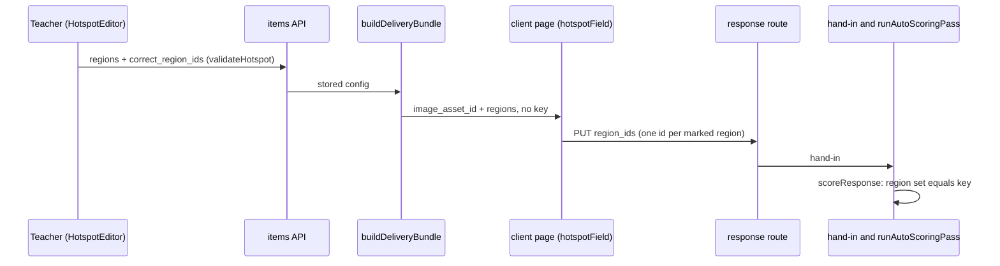

# Hotspot items

A hotspot item ("Click the image") asks the student to mark one or more regions of a teacher's picture. The answer is a set of region ids, and the key is the set of correct ids. The type is listed with the other item types in [authoring](authoring.md) and the wire shapes are in [wire formats](../architecture/wire-formats.md); this page covers the hotspot's own rules, from the editor to the student's buttons.

## Authoring

`HotspotEditor.tsx` (in the assessment editor) lets the teacher pick an image from the assessment's asset library, drag rectangles onto it, and tick which regions are correct. Regions are stored normalized to 0 to 1 so every consumer can draw them at any width. The editor has no move or resize in v1: a wrong region is deleted and redrawn. The key checkboxes are teacher-only, and the preview never receives the key.

The item is created first and configured after. That is why `HotspotItemSchema` (`packages/schema/src/items.ts`) makes every field optional, and why `design-tool/lib/api/itemIntegrity.ts` leaves a draft hotspot alone. The publish checklist flags it: `questionGaps` in `app/dashboard/[id]/readiness.ts` reports "needs an image" and "needs a correct region" for a hotspot, so the teacher sees both gaps before publishing. A hotspot without a key is not an error in the API; it is simply unscorable until a key exists.

## Write-time integrity

`validateHotspot` in `design-tool/lib/api/items.ts` runs on create and update. It rejects duplicate region ids, any region that extends past the image edge, and a `correct_region_ids` entry that names no region. The server also caps a hotspot at 50 regions (`HotspotItem` in the same file). Asset references are checked the same way as stem images, through the shared asset-ref scanner described in [storage and assets](storage-and-assets.md#asset-references-in-content).

Editing a published assessment is restricted by `requireDraft` (`design-tool/lib/api/requireDraft.ts`). The answer-key-only exception covers `correct_region_ids`, so a teacher can fix the key after publishing. A change to `image_asset_id` or `regions` is refused with 409 like any other content edit. The lock is described in [assessment lifecycle](assessment-lifecycle.md).

CSV import refuses hotspot rows with a message to author them in the editor (`design-tool/lib/api/importItemsCsv.ts`, tested in `import-items-csv.test.ts`, "hotspot rows"). AI generation and PDF proposals never produce hotspots; see [batch item generation](batch-item-generation.md) and [PDF import](pdf-import.md).

## Scoring

`scoreResponse` in `design-tool/lib/scoring/auto.ts` treats the answer as all-or-nothing. The points are 1 when the marked set equals the key set (order does not matter) and 0 otherwise, so a subset or an extra region scores 0. A hotspot with no key returns `null`, which the scoring pass skips. `effectiveScoringMethod` makes a hotspot `auto` by default, and a teacher may set `human` (`ALLOWED_SCORING_METHODS` in `lib/api/items.ts`). Auto scoring runs once at hand-in through `runAutoScoringPass` (`lib/scoring/runAutoScoring.ts`), not on each response write.

## Delivery and the student's answer

`buildDeliveryBundle` emits `regions` and `image_asset_id` for a hotspot and drops `correct_region_ids`. The client's `HotspotItem` (`DeliveryItem.swift`) decodes them, and the page's `hotspotField` (`AssessmentPage.swift`) draws the image with one button per region. Each button has an accessible label "Region N" and an `aria-pressed` state. Keyboard users reach one stop per region (the HS-1 rule tested in `RendererKeyboardReachTests`).

The page posts `{type: 'hotspot', region_ids}` through the answer channel on every toggle. Saved answers are restored without posting, and only ids that still exist as regions count (`RendererPrefillTests`). A hotspot with no image, or with no regions, shows "This item is missing its image and cannot be answered" instead of an empty surface (`RendererHotspotTests`).

A gap to know about: `hotspotField` returns without posting when the student deselects the last region. The fill-in-the-blank field and the multi-select choice list call `withdraw` in that case, but the hotspot does not, so the server keeps the previous non-empty answer. The route comment in `app/api/attempts/[attemptId]/responses/[itemId]/route.ts` describes the same behaviour. The withdraw path itself exists (`APIClient.deleteResponse`), so a fix belongs in `hotspotField`, with a test in `RendererHotspotTests`.

## Review, feedback and reporting

The reporting views render each marked region as a line, `Region <id>`, marked correct or not when a key exists (`design-tool/lib/reporting/answerView.ts`, `hotspot` case). `reporting-views.test.tsx` and `work-packet-page.test.tsx` cover the teacher pages and the printed packet that use these views. Instant feedback has its own hotspot case in `design-tool/lib/feedback/buildFeedback.ts`. Answer history does not keep hotspot answers ([answer history](answer-history.md)).

## Change guidance

- Start with `packages/schema/src/items.ts` (`HotspotItemSchema`, `HotspotRegionSchema`) for the shape, then `validateHotspot` for the rules that the schema cannot express. Changing the normalized coordinate rule changes the editor, the client drawing and the preview, so check all three.
- Keep the key out of anything a student can read. `buildDeliveryBundle` and the preview renderer both omit `correct_region_ids`; `delivery-api.test.ts` ("hotspot keeps regions but drops the key") pins this.
- A new hotspot rule has to be mirrored in the readiness checklist if it changes what counts as complete.
- Narrow checks: `cd design-tool && bun test test/scoring-auto.test.ts` for the scoring rules; `cd client/SecureTestCore && swift test --filter RendererHotspotTests` for the page. The database-backed items and delivery suites (`items-api.test.ts`, `delivery-api.test.ts`) need `DATABASE_URL` as described in [testing](../testing/testing-and-validation.md).

Related: [authoring](authoring.md), [scoring and results](scoring-and-results.md), [client overview](../client/overview.md), [table items](table-items.md) (the other keyed, draft-friendly visual type).
