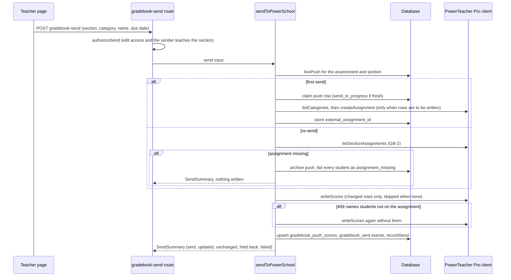

# Outbound integrations

Consult this page for anything that sends data out of the design tool: scores to a gradebook, essays to Google Docs, evidence to a model for class insights, and notifications by SNS or email. All of them consume finals produced by [scoring and results](scoring-and-results.md) and scope teacher access through [auth and access](auth-and-access.md). Each one uses a provider or client selected by an environment variable with a safe default (`mock`/off), the same pattern as [AI and safeguarding](ai-and-safeguarding.md).

## Gradebook push (PowerSchool)

Design page: `docs/gradebook-push-design.md`. Route: `POST /api/assessments/[id]/gradebook-send` (`gradebook-categories` supplies the destination category list).

1. `authorizeSend` (`lib/gradebook/authorizeSend.ts`) decides twice, because PowerSchool does not restrict the plugin by user: the caller needs `edit` on the assessment (a `run`-level substitute is refused), and the sender's own address must currently teach the target section on the roster. Both refusals are the access model's 404. The `users_dcid` sent to PowerSchool comes from that roster row, never from the request body.
2. The Zod body accepts `target: "powerschool" | "schoology"`, but only `powerschool` is implemented; any other target returns 400 `unsupported_target`.
3. `sendToPowerSchool` (`lib/gradebook/sendPowerSchool.ts`) selects attempts, creates or reuses the external assignment, writes scores and records the push. Rules: one destination and one section per send; only fully scored attempts are sent, and held-back ones are reported with a reason from `HELD_BACK_REASONS` (`unscored`, `not_on_roster`, `no_dcid`); points only, against the assessment's maximum; a re-send reuses the stored assignment and skips unchanged rows (`skipped_unchanged`); the destination is remembered per (teacher, section) in `gradebook_section_prefs`; a first-send claim row older than `CLAIM_STALE_MS` is treated as a crashed send, and a claim still fresh answers 409 `send_in_progress`.
4. `getPowerSchoolClient` (`lib/gradebook/powerschool.ts`) selects the client by `GRADEBOOK_PROVIDER`: `mock` (default, in-memory, records every call) or `live` (the district plugin's `/ws/xte/` endpoints with an OAuth client-credentials token). The module never logs tokens or bodies. `GradebookConfigError` becomes a not-configured response. The score-write body shape is in a file named `powerschoolScoreBodyUnconfirmed.ts` because it has not been confirmed against the live API; treat it as the least certain part. The Send button is shown only when `GRADEBOOK_PROVIDER` is set explicitly to `live` or `mock` (`gradebookSendConfigured` in `lib/gradebook/sendDialog.ts`, the results page passes the env value). Without that, an unconfigured server would report "Sent to PowerSchool" while the in-memory mock received it.
5. **Re-send existence check (GB-2).** A re-send whose scores are all unchanged writes nothing, so a deleted assignment would otherwise go unnoticed. Before the write, `sendToPowerSchool` calls `listSectionAssignments` for the section. If the stored assignment is missing, the push is archived (`archived_at`), every student in the send is reported as `assignment_missing`, and the next send creates a new assignment. An unreadable list answers 502 `gradebook_unavailable` and keeps the push. A score write that PowerTeacher Pro refuses with a missing-assignment body (`isAssignmentSectionMissing`: 404, or the 500 "Unable to find … AssignmentSection" message) takes the same archive path.
6. **Partial refusal.** PowerTeacher Pro refuses a whole score batch when one student has no association with the assignment. `parseUnassociatedStudents` reads the named students from the 409 body; they are reported as `not_in_powerschool_section` and the rest of the batch is written once more.

7. **Publish Scores on create.** `buildAssignmentCreateBody` (`lib/gradebook/powerschoolPayloads.ts`) sends the category's `defaultpublishoption` as `publishoption` and its `isdefaultpublishscores` as `isscorespublish`; a null value omits the field. An API-created assignment without `isscorespublish` leaves Publish Scores off, so students saw "not scored" in PowerTeacher Pro (beta report, 2026-10-20). If a create carrying the field is refused with any 4xx (the code cannot tell which field the refusal names), `sendToPowerSchool` logs `create_publish_scores`, retries the create once without the field, and, when the category default was on, adds a note telling the teacher to turn on Publish Scores on the assignment's Publish tab. A 5xx or transport failure is not retried, and a category whose default is null sends no field and is not retried. Assignments created before that fix can still have Publish Scores off. Slice 2 covers them on a Send again: after the GB-2 check, if the stored assignment's section row reports `isScoresPublish === false`, `turnOnPublishScores` (`lib/gradebook/sendPowerSchool.ts`) reads the category, and only when the push's category has `isdefaultpublishscores` on it reads the assignment (`getAssignment`), PUTs it back whole with only our section row's `isscorespublish` set (`buildPublishScoresUpdateBody` in `lib/gradebook/powerschoolPayloads.ts`), and reads it again. `changedAssignmentFields` logs the names (never the values) of any other field the PUT changed (`gradebook_assignment_fields_changed`). Success adds a note that Publish Scores is now on, and `gradebook_publish_scores_turned_on` is logged. Any failure, including a refused PUT (`publish_scores_update`), leaves the assignment as it was, still writes the scores, and adds the manual-turn-on note. Publish Scores is never turned off. The PUT has not yet been run against live PowerSchool; treat the wire shape as unconfirmed. Tests: `gradebook-powerschool.test.ts` (body shape: "a category that holds scores back sends isscorespublish false", "a category with no publish option omits the field") and `gradebook-send.test.ts` (the refused-create retry, "a create refused with isscorespublish is retried once without it", and "a category with no Publish Scores value is not retried"). Slice 2 cases in `gradebook-send.test.ts` (`slice 2: …`): a Send again turns it on and then only reads the list; a category that holds scores back is left alone; a refused update still writes the scores and tells the teacher; a PUT that changes another field is logged by field name.

8. Persistence: `gradebook_pushes`, `gradebook_push_scores`, `gradebook_section_prefs` ([data model](data-model.md)). Each written attempt also gets a server-only `gradebook_sent` attempt event ([sittings and attempts](sittings-and-attempts.md#events-and-the-monitor)). `lib/scoring/rescore.ts` reads `gradebook_pushes`/`gradebook_push_scores` to find sections whose already-sent points a rescore would make stale, and a later send re-writes rows whose points changed ([scoring](scoring-and-results.md)).

Caption: the send path in `sendToPowerSchool`. Every branch that fails a student records a `SendFailure` reason rather than throwing, except an unreadable assignment list, which refuses the send. The missing-assignment branch returns before any write.

Read-only operator checks (`ps-reach`, `student-lookup`) run as one-off ECS tasks ([deployment](../operations/deployment-and-observability.md)).

## Google Docs release

Design page: `docs/google-docs-release-design.md`. Routes: `GET /api/google/drive/start` and `/callback` (Drive consent) and `POST /api/assessments/[id]/google-docs` (the send).

- Auth: `lib/googleDocs/driveAuth.ts` runs a PKCE authorization for the single scope `drive.file` and keeps a one-hour access token in an encrypted httpOnly cookie (`secure-test-gdrive`, path `/api/assessments`). Nothing is stored in the database; no refresh token exists. The callback refuses any token whose granted scopes are not exactly `drive.file` (finding GD-P1).
- Release (`lib/googleDocs/release.ts`): one Google Doc per student per assessment holding every essay, created in the sender's Drive under `<product> / <assessment> / <section>` and shared with the student as editor; optional ownership transfer, double spacing and "include drafts". Skips are decided before anything touches Drive (`SkipReason`: `not_handed_in`, `already_released`, `safeguarding_alert`, `no_email`, `no_essay`, `drive_auth_expired`), concurrency is 3, and a send where everyone is skipped creates no folders. `mode: "skip" | "new"` decides what happens to students who already have a Doc.
- Persistence: `google_doc_folders`, `google_doc_releases`. The content builders (`content.ts`) reuse the results and rubric views, and essay HTML goes through the same sanitiser as the reporting views.

## Class insights

Design page: `docs/class-insights-design.md`. Routes: `POST /api/assessments/[id]/class-insights` (report) and `/class-insights/chat`.

- `buildEvidencePack` (`lib/insights/evidencePack.ts`) is the only thing a model sees. The pure half `buildEvidencePackFromData` holds every exclusion rule: no names, emails, student numbers, SSIDs or internal ids, and no student-written text except anonymous short-text answer clusters (and anonymous fill-in-blank counts), with answers on responses that have an open safeguarding alert excluded. The server keeps the pseudonym `names` map and swaps names back in at render time.
- The model writes claims in four sections (strengths, growth, celebrations, next steps). `fillReport` (`lib/insights/report.ts`) refuses or drops any claim it cannot check: it never repairs one. A number must be a `{key}` reference into `pack.figures`; labels (`Q3`, `S4`) and tags must exist in the pack; and the digit rule says that, after references, labels and allowed strings are removed, the text contains no digit at all, with one exception: a number of two or more digits that the assessment's own question text, keys, choices, answers or top answers contain (`contentNumbers` in `report.ts`, added 2026-10-27). That lets a claim say "births per 1000 people" when the question is about that rate; a lone digit such as "level 3" and any number not in the content are still refused. Chat replies pass through the same `fillClaim` rule (`fillSingleClaim`), so a chat reply is subject to it too. The prompts still tell the model to write no digits; the server check, not the prompt, is the enforcement. Celebrations must cite a student and have evidence behind them. Stored rows hold `[[S4]]`/`[[Q3]]` markers, not names.
- Both routes call `runGuarded` ([AI and safeguarding](ai-and-safeguarding.md)). Tables: `class_insight_reports`, `class_insight_threads`, `class_insight_turns`.

## Notifications

- `lib/notify/provider.ts` (`NOTIFY_PROVIDER`: `mock` default, `sns`) publishes the feedback and alarm emails. A publish failure is logged and swallowed so a teacher filing feedback never sees a 500.
- `lib/email/provider.ts` (`EMAIL_PROVIDER`: `mock` default, SES via `sesProvider.ts`) sends share notifications (`shareNotifications.ts`, see `docs/share-notifications-design.md`) and safeguarding alert emails (`safeguardingNotifications.ts`).

## Change navigation

| Change | Start at | Tests |
| --- | --- | --- |
| Gradebook rules or payloads | `lib/gradebook/mapping.ts` (`planSend`), `sendPowerSchool.ts`, `powerschoolPayloads.ts` | `gradebook-send.test.ts`, `gradebook-powerschool.test.ts`, `gradebook-send-dialog.test.ts` |
| Publish Scores on a PowerSchool assignment (create field, create retry, turn on for an existing assignment) | `sendPowerSchool.ts` (`turnOnPublishScores`, the create retry in `sendToPowerSchool`), `powerschoolPayloads.ts` (`buildAssignmentCreateBody`, `buildPublishScoresUpdateBody`, `changedAssignmentFields`) | `gradebook-send.test.ts` (`slice 2: …` and the `isscorespublish` cases), `gradebook-powerschool.test.ts` |
| Add a gradebook target | add a client beside `powerschool.ts`, branch in `gradebook-send/route.ts`, extend `GradebookTarget` in `db/schema.ts` | same files |
| Drive consent or release behaviour | `driveAuth.ts`, `release.ts`, `content.ts` | `google-drive-auth.test.ts`, `google-docs-release.test.ts`, `google-docs-send-dialog.test.ts` |
| Insights exclusions or claim checks (the digit rule and its `contentNumbers` exception live in `report.ts`) | `evidencePack.ts`, `report.ts` (`fillClaim`, `contentNumbers`), `reportPrompt.ts`, `chat.ts` | `insights-evidence-pack.test.ts`, `insights-report.test.ts`, `insights-chat.test.ts`, `insights-*-route.test.ts` |

Do not exercise `live` gradebook or Drive paths in automated checks; the mock client and injected `DriveClient` exist for that. Related: [scoring and results](scoring-and-results.md), [accommodations and roster](accommodations-and-roster.md) (section and `dcid` data used for the send).
