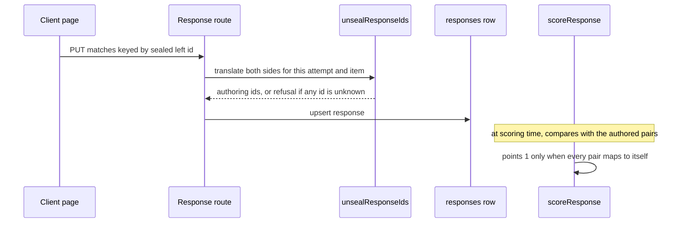

# Match items

A `match` item shows a list of left entries and asks the student to pair each with one right entry from a pool. The teacher writes the pairs (`items.config.pairs`). The server ships the lefts and a shuffled pool of rights, each with a per-attempt sealed id. The student chooses a right for each left, and the server scores the whole mapping exactly, worth one point. The type is listed in [authoring](authoring.md#concepts) and its stored shape is described in [data model](data-model.md). The closest template for another id-sealed type is [ordering items](order-items.md).

## Authoring and the write boundary

- `MatchPairShape` in `design-tool/lib/api/items.ts` caps a pair id at 64 characters and each side at 2,000. `CreateItemBody` requires at least two pairs, and `validateUniqueIds` refuses duplicate pair ids ("pair ids must be unique").
- `design-tool/lib/api/itemIntegrity.ts` (`IncompleteItemError`) refuses a stored match with fewer than two pairs at bundle time, so a bad row cannot reach a student.
- The editor is `design-tool/app/dashboard/[id]/MatchPairsEditor.tsx`, which adds and removes pairs and keeps at least two. `readiness.ts` (`questionGaps`) reports "needs at least 2 pairs", "has an empty pair" and "still has placeholder pairs" on the publish checklist ([authoring](authoring.md#publish-readiness-checklist)).
- Export carries `pairs` (`lib/api/exportBundle.ts`). Bundle import copies them as plain strings with no asset-reference rewrite (`lib/api/importBundle.ts`). The CSV importer refuses `match` rows with an explicit "not supported" error (`lib/api/importItemsCsv.ts`), so pairs are authored in the editor, imported from a bundle, or accepted from an AI proposal.
- AI batch generation proposes a match only when the teacher requests one by count; the Mix option never yields one. Malformed lists are dropped (fewer than two pairs, a repeated left or right, an empty side), and pair ids are renumbered `p1..pn` server-side ([batch item generation](batch-item-generation.md)). PDF import carries detected pairs on the candidate and the panel shows the count ([PDF import](pdf-import.md)).

## Delivery: the split and sealed ids

The stored `pairs` array is itself the key, since each object holds a left beside its correct right. `DeliveryMatchItemSchema` in `packages/schema/src/delivery.ts` therefore splits it into two independent arrays, `lefts` and `rights`, each entry a `{id, text}` choice. `buildDeliveryBundle` (`lib/api/buildDeliveryBundle.ts`, the `match` case) seals both sides with `opaqueId`, using the `MATCH_LEFT` and `MATCH_RIGHT` scopes from `lib/api/opaqueIds.ts`, so the left and right ids of one pair cannot be matched by reading the identifiers. Rights are shuffled. The opaque ids are keyed per attempt, which is why a bundle fetched by one student cannot be replayed for another. The general sealing rule for option ids is described in [sittings and attempts](sittings-and-attempts.md#attempt-lifecycle).

Saved answers for resume prefill are re-sealed by `sealResponseIds` in `lib/api/studentAttempt.ts`. A pair that the teacher has since removed is dropped, and the function returns null when no pair survives, so the item is omitted rather than restored half-filled.

## Answers, scoring and presentation

The client's `matchField` in `AssessmentPage.swift` renders one dropdown per left, with the rights as its options. Each change posts `{type: "match", matches: {leftId: rightId}}` containing only the rows the student has filled, so a partial pairing is saved. The item is marked answered only when every left has a right (batch 0b slice 3). `MatchResponseSchema` in `packages/schema/src/responses.ts` is the wire shape.

On write, `unsealResponseIds` in `lib/api/studentAttempt.ts` translates each sealed left and right id back to an authoring id for this attempt and item. If any id does not resolve, the function returns null and the write is refused, because a half-translated response would look like a real answer and score as one. The stored response holds authoring ids, for example `{p1: "p2", p2: "p1"}`.

`scoreResponse` in `lib/scoring/auto.ts` has a match branch. It awards one point only when the response has exactly as many keys as pairs and every pair id maps to itself. A swap, a missing key or an extra key scores 0. An item with no pairs has no key and is unscorable. The match item is auto or human scored, never AI, as the `scoring_method` test in `items-api` pins.

Other readers use the same pairs. The preview (`renderAssessmentHtml` in `lib/preview/renderHtml.ts`) lays out a static two-column table with the rights sorted. Results and the work packet print the chosen right beside each left ([reporting and packets](reporting-and-packets.md)). Instant feedback can show the key after hand-in ([instant feedback](../client/instant-feedback.md)). Safeguarding screening reads the stem and both sides of every pair ([AI and safeguarding](ai-and-safeguarding.md#hand-in-screening-and-alerts)).

Caption: the answer path for a match item. A refused write stores nothing; a partial pairing is stored and scores 0 until every pair is right.

## Change navigation

| Change | Start at | Focused tests |
|---|---|---|
| Pair validation, limits, readiness | `lib/api/items.ts` (`MatchPairShape`, `validateUniqueIds`), `lib/api/itemIntegrity.ts`, `readiness.ts` | `items-api.test.ts` (describe "match items (slice 47)"), `item-integrity.test.ts`, `item-readiness.test.ts` |
| Delivery split or sealed ids | `lib/api/deliveryItem.ts` (match case), `lib/api/opaqueIds.ts` | `delivery-api.test.ts` ("match splits pairs into independent lefts and rights", "a saved match answer is sealed back into the ids this bundle shows"), `opaque-ids.test.ts` |
| Response ingest | `lib/api/studentAttempt.ts` (`unsealResponseIds`) | `attempt-ingest-api.test.ts` ("a match answer in sealed ids is stored as authoring ids") |
| Scoring rule | `lib/scoring/auto.ts` (match branch of `scoreResponse`) | `scoring-auto.test.ts` ("match fully correct", "match one swap → all-or-nothing 0", "match missing a mapping → 0", "match extra unknown key → 0", "match without pairs (no key) → unscorable") |
| Client dropdowns | `client/SecureTestCore/Sources/SecureTestCore/AssessmentPage.swift` (`matchField`) | `RendererMatchTests` (client) |

Extension note: a new pair field would cross the schema (`MatchPairSchema`, `MatchItemSchema`, `DeliveryMatchItemSchema`), the design-tool write boundary, the bundle builder, the export and import, the preview, and the client page. Check each consumer, because a field that reaches only the editor is silently dropped from the student bundle.

Validation: the focused check is `cd design-tool && bun test test/scoring-auto.test.ts`. DB-backed write and bundle tests need `DATABASE_URL` pointed at the `_test` database, as in [testing](../testing/testing-and-validation.md). The client check is `cd client/SecureTestCore && swift test --filter RendererMatchTests`. A wire-shape change also needs `cd packages/schema && bun run build && bun test`, because consumers read `packages/schema/dist`. Do not edit `dist` by hand.
, because consumers read `packages/schema/dist`. Do not edit `dist` by hand.
