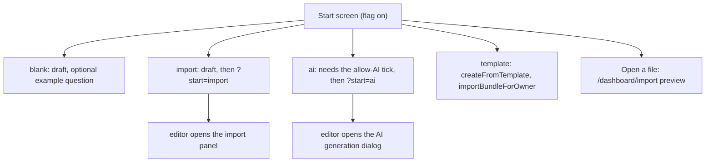
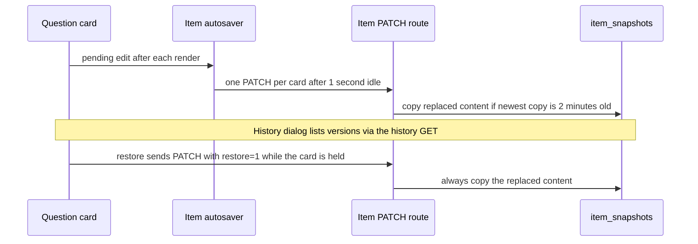
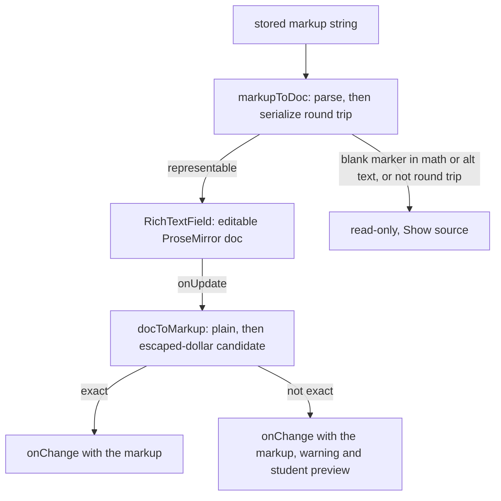
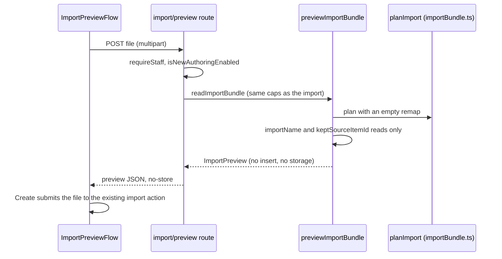

# Authoring editor beta

The item editor in `design-tool/app/dashboard/[id]/AssessmentEditor.tsx` has a redesigned variant that is off by default. It is the part of the [editor redesign](../../docs/editor-redesign-design.md) that exists in source (the design notes call it the prototype track), and it is gated by one flag, **R-12**. The redesign's goal is a WYSIWYG field that never shows formatting markers, while the stored format stays the markup string. This page covers what the source does today. The [assessment authoring](authoring.md) page describes the flag-off editor and the item lifecycle.

## What is built and what is not

Built, and reachable only when the flag is on:

- A rich-text field (`RichTextField.tsx`, built on Tiptap's MIT core) for the question text of every item type (`RICH_TEXT_TYPES` in `lib/authoring/richTextTypes.ts` lists all of `ITEM_TYPES`), and for the text of multiple-choice choices. Each type's own panel (pairs, steps, hotspots, table, blanks, graph, rubric) is the existing sub-editor, reused unchanged below the field.
- Inline nodes for `strong` and `em` marks, line breaks, an escaped dollar, fill-in-the-blank blanks, KaTeX math (click a formula to edit its TeX) and asset-scoped images. There are no lists, headings, links or underline, because the stored grammar has none.
- Clean paste from Word and Google Docs (text, bold, italic and line breaks only; pictures are dropped and counted).
- Question autosave with one status indicator, and no per-question Save button.
- Per-question version history with restore, the outline rail, the "+" and "/" insert menu, in-place type change, choice and ordering-step reordering by drag or buttons, and a before-publishing list.
- The AI short answer key (`ShortAnswerAiKey.tsx`, 2026-10-27): on a short answer, "Score with AI" sets the item to Hybrid, and the teacher writes what earns each level and its points (`lib/authoring/shortAnswerAi.ts`). Level names follow the points, so the stored rubric always reads No credit, Partial credit, Full credit. The rule it writes to is in [authoring](authoring.md#concepts). A level that earns points but has no text yet makes the key unfinished (`keyUnfinished`); `AssessmentEditor.tsx`'s `waitReason` then holds that card's autosave with a "credit" reason until the level is written, so the card does not save a half-finished key.
- The opt-in page at `/dashboard/beta`.
- A side-by-side student preview beside the Questions tab (at 1280 px and wider), running the student's own renderer in a sandboxed frame. It is documented in [interactive preview](interactive-preview.md).

Not built, and described elsewhere as proposals: the MathLive keypad, the preview's speech-to-text, time-limit, contrast and zoom views, the import redesign, the start screen, and the cutover that flips the default (Phase 9). The client renderer does not consume `packages/markup` yet (see [markup grammar](../architecture/markup-grammar.md)). Also not built inside the new editor: autosave for stimulus sets and assessment settings (they keep their own Save buttons), reordering within a stimulus set from the outline rail, reordering whole matching rows, pair, step, table-cell and blank-answer text (these stay plain inputs that take markup), and a blank chip showing its number rather than "blank". Do not describe any of these as existing behaviour.

## The flag

`isNewAuthoringEnabled(db, session)` in `design-tool/lib/authoring/flag.ts` is the only reader of the flag. It returns `NEW_AUTHORING_DEFAULT` (`false`) when the staff member has no row. Every later slice asks this function, so the cutover is a change to that constant.

The row lives in `staff_preferences` (`design-tool/db/schema.ts`, migration `0064_staff_preferences.sql`): one row per `staff_sub`, a `new_authoring` boolean and `updated_at`. The migration is additive and changes no existing data.

Two routes change the flag. The `/dashboard/beta` page (`app/dashboard/beta/page.tsx`) shows the current choice and posts a plain form to `/api/me/preferences`, so it works without JavaScript. `app/api/me/preferences/route.ts` answers `GET` with `{ new_authoring }` and accepts `POST` as JSON or as a form field `new_authoring=on|off`, which redirects 303 back to the beta page. `setNewAuthoring` refuses an act-as session with `impersonating` (403), because a teacher's tool choice must not change under them while an admin is acting as them (impersonation is described in [auth and access](auth-and-access.md)). The beta page is linked from nowhere in the app while the default is off.

The item editor's page (`app/dashboard/[id]/page.tsx`) reads the flag on the server and passes `newAuthoring` into `AssessmentEditor`. The editor switches to `RichTextField` only when `newAuthoring && usesRichTextField(item.type)`. The item PATCH route reads the same flag before it accepts an empty stem or a type change (see [saving and history](#saving-history-and-the-item-patch)).

## The start screen

Editor redesign Phase 8 (D-5) replaces the empty New assessment form with a start screen for staff whose flag is on. `app/dashboard/new/page.tsx` checks `isNewAuthoringEnabled` and renders `StartScreen`; everyone else still gets the plain form. `/dashboard` shows the same screen in place of its empty assessment list when a flagged teacher has no assessments and is not viewing archived or all-teacher lists (`startScreenHere` in `app/dashboard/page.tsx`).

The screen has three parts:

- **Start a new assessment.** Three radio choices, `blank`, `import` and `ai` (`START_CHOICES` in `lib/authoring/startScreen.ts`). Each submits the ordinary `createAssessment` action in `app/dashboard/new/actions.ts` with a hidden `start` field, so it makes a named draft under the same rules. `blank` may also insert one example question (`exampleQuestionRows` in `lib/authoring/exampleQuestion.ts`). `ai` requires the "Allow AI help when writing questions" box on the form. Without it the action returns a field error and creates nothing. This is the same `allow_llm_authoring` gate as the Settings tab.
- **Templates.** `ASSESSMENT_TEMPLATES` in `lib/authoring/templates.ts` is a checked-in, district-curated list of `ItemBundle`s: an exit ticket, a reading check with a passage, and vocabulary and sequence practice. `createFromTemplate` in `actions.ts` looks the id up with `templateById` and passes the bundle to `importBundleForOwner`, so the new draft is what importing that file would create. It then redirects to the draft.
- **Open a file.** A link to `/dashboard/import`, the import preview described below.

After creation, `startRedirect` sends `import` and `ai` drafts to `/dashboard/[id]?start=…`. `editorStartAction` in `lib/authoring/startScreen.ts` reads that parameter once, on first load in `AssessmentEditor.tsx`, and opens the PDF or Word import panel or the AI generation dialog. It does nothing when the flag is off, when the assessment is published, or for `ai` when `allow_llm_authoring` is off.

Caption: the start screen's routes. Every draft is an ordinary assessment; the choice changes only what it starts with and where the editor opens.

`startScreen.ts` has no database imports because the client editor imports it. The row builder for the example question lives in `exampleQuestion.ts`, which is server-only. The example question's stem is `EXAMPLE_QUESTION_STEM`, and `readiness.ts` lists it with the other seed texts, so a teacher who publishes it unchanged gets the placeholder warning.

Focused tests: `design-tool/test/start-screen.test.ts`. The `templates (pure)` suite checks that each template parses with `ItemBundleSchema`, has no pictures or source links, and that an example question left unchanged shows on the Before publishing list. `start choices (pure)` covers `parseStartChoice` and the AI gate. The `createFromTemplate (DB)` suite (one test per template) creates each template through the flag-on action, then checks the stored rows, that every question saves unchanged through the item PATCH body schema, and that the Before publishing list is empty. `createAssessment with a start choice (DB)` covers the three choices and the flag-off case. The DB suites need the test database.

Change navigation for the start screen:

- Adding a template: append an entry to `ASSESSMENT_TEMPLATES`. Write its content for this repository only, with no real student, school or teacher material. Keep it within what the import accepts, because templates use the same bundle rules.
- Adding or renaming a start choice: change `START_CHOICES` and `startRedirect` together, and keep `CHOICES` and `START_SUBMIT` in `StartScreen.tsx`, `aiDraftAllowed` and `editorStartAction` in step with them. Do not add a second creation path next to `createAssessment`.
- Scope boundary: the start screen does not change the import or the plain form. Templates and the file route go through the import; `createAssessment` is unchanged when the flag is off.

## Question cards: autosave, outline and insert

With the flag on, each question card saves itself about a second after its last edit (`ITEM_AUTOSAVE_DELAY_MS` = 1000 in `lib/authoring/itemAutosave.ts`). The save goes through the same item PATCH the flag-off editor uses. `itemPatchBody` (now in `app/dashboard/[id]/editorModel.ts`) builds the body for Save question, autosave and restore alike.

`createItemAutosaver` keeps one debounce per card, so typing in one card never restarts another card's timer. A save that failed is not retried for the same content, which stops a loop of failing PATCHes; the next edit or the Try again link sends it again. An edit undone before the timer fires drops its pending save. `hold(id)` and `release(id)` stop a card from scheduling anything while a restore or type change sends its own PATCH, so an ordinary autosave cannot race it. `AutosaveIndicator.tsx` shows one status above the list: All changes saved, Saving, or Some changes didn't save.

The outline rail (`OutlineRail.tsx`) has one row per block. A lone question and a stimulus set each move as one block, so no reorder can split a set. A row is reordered by drag (@dnd-kit, pointer and keyboard) or by Move up and Move down, and each change saves through the reorder route. A refused order puts the list back. The rail's pure logic is in `lib/authoring/outline.ts`.

Adding a question uses `InsertQuestionMenu.tsx`: a "+" before every block and **Add question** at the end. The menu lists six types first and the rest under More types. The new item is created through the existing items POST and moved into place with the reorder route. It starts empty with placeholder text. `slashOpensInsertMenu` in `lib/authoring/outline.ts` makes "/" open the menu on a card outside a text field, and skips a `<math-field>` so MathLive's own "/" keeps working. `insertTypes.ts` holds the type list.

`BeforePublishingList.tsx` shows the readiness checks from `beforePublishing` in `app/dashboard/[id]/readiness.ts` as links that scroll to the question and focus it. Gaps never block a draft; the publish lock still applies.

## Saving, history and the item PATCH

Every item PATCH copies the content it replaces into `item_snapshots` (migration `0065_item_snapshots.sql`, additive). `lib/authoring/itemHistory.ts` owns the rule, and it applies to the flag-off editor too, so history exists when the default flips:

- The copy runs inside the PATCH transaction under a row lock. A write that changes nothing copies nothing.
- Copies are coalesced: one per item every `SNAPSHOT_INTERVAL_MS` (two minutes), so a teacher typing for a minute leaves one version, not sixty.
- Each item keeps its newest `SNAPSHOT_KEEP` (50) copies. Rows are deleted with the item.
- A restore (`?restore=1`) always copies the version it replaces, so a restore can itself be undone.

`GET /api/assessments/[id]/items/[itemId]/history` (`app/api/assessments/[id]/items/[itemId]/history/route.ts`) lists the versions newest first. It needs `edit` read access, is teacher-plane only, and includes each version's stem as HTML for the History list (`ItemHistoryDialog.tsx`). The route builds that HTML with `versionStemHtml` (`lib/authoring/versionStemHtml.ts`), which renders the stem as the live preview does, so a version shows its bold, math and pictures rather than its markup. Each fill-in-the-blank gap appears as a numbered gap, and a marker that names no blank stays literal text. Restoring is an ordinary PATCH of that content with `?restore=1`, never a write by the history route itself.

Two guards sit in the item PATCH (`app/api/assessments/[id]/items/[itemId]/route.ts`). An empty stem is accepted only for flagged staff (`parseItemBody` with `allowEmptyStem`). A type change is refused with 400 `type_change_not_supported` when the flag is off, and with 409 `type_change_has_responses` once any student has answered the item. A type change also needs a draft and starts the item's config afresh. `TypeChangeControl.tsx` and `lib/authoring/typeChange.ts` keep the stem, keep choices between the two multiple-choice types, map choices to and from ordering steps, and warn before anything is lost.

Caption: a question card's autosave and history path. The card is held while a restore or type change is in flight.

## Load, edit and save

The stored value is always the markup string. `markupToDoc` (`lib/authoring/markupDoc.ts`) parses it with `@secure-test/markup`, maps the AST onto a one-paragraph ProseMirror document, and checks that saving the document reproduces the same string. `docToMarkup` maps the document back to markup and tries a plain serialisation first, then one with every typed `$` escaped as `\$`. It keeps the first candidate whose parse matches what the editor shows.

Caption: the load and save path in `RichTextField`. The field emits a markup string on every edit and reloads only when the value changed outside it.

Two `Unrepresentable` reasons keep an item read-only: `blank_in_math_or_alt` (a `[[id]]` marker inside a formula or alt text, the ER-F1 to ER-F3 disagreements recorded in the [markup grammar](../architecture/markup-grammar.md)) and `not_round_trip` (for example two bolds with nothing between, `**a****b**`, which ProseMirror merges). A typed `**` or `$` is saved as a character, not as markup, so the field warns when the typed text cannot be read back exactly. The schema has no input rules.

Fill-in-the-blank items add **Insert blank** to the field. `lib/authoring/blankInsert.ts` follows the flag-off editor's `insertBlankAt` rule, and `docToMarkup` counts a chip in the document as a blank before the item's blank list catches up. Matching key re-pairing (drag a right onto another row, or Swap) goes through `swapMatchRights` in `lib/authoring/keyOrder.ts`. Ordering steps reorder by a drag handle or Move up and Move down.

## Paste

`transformPastedHTML` in `RichTextField.tsx` sends HTML through `sanitizePastedHtml` (`lib/authoring/pasteSanitize.ts`). The output keeps text, bold, italic and line breaks. Google Docs' `font-weight:normal` wrapper is not bold, and pictures are dropped and counted so the field can say so. Pasting ProseMirror's own slice (a copy from another field) is kept only when it came from this tab, through `rememberCopied`.

## Import preview (JSON assessment files)

Editor redesign Phase 7 slice C (R-9) shows what a `.json` assessment import will create before anything is written. With the flag on, `app/dashboard/import/page.tsx` renders `ImportPreviewFlow` in place of the plain file form. Choosing a file posts it to `POST /api/assessments/import/preview`, which answers 404 with the flag off. The page then shows the name the copy will get, counts by type, sets, pictures, layout, calculator, highlighting and accommodation counts, warning codes, and the questions in the student's own renderer ([interactive preview](interactive-preview.md)). Create then submits the same file to the same import action the flag-off page uses, so the import itself is unchanged.

Caption: the preview is read-only. It shares `planImport` with the import, so the counts and stored rows match what the import then writes.

- `buildImportPreview` (`lib/api/importPreview.ts`) is pure. It derives counts, warning codes (`unknown_types`, `scoring_dropped`, `accommodations_dropped`, `sources_dropped`, `missing_pictures`, `no_answer_key`, `no_items`) and the questions as they will be stored, with preview-only ids. `previewImportBundle` adds the two database facts it needs: the copy's free name and whether an E12 source link can be kept.
- The preview response carries the file's answer keys back to the teacher who sent the file, since they are in the file already. The student view in the page strips them through the delivery projection before any content reaches the sandboxed frame ([ADR 0019](../../docs/adr/0019-scripted-preview-sandbox.md)).
- The request body reading (same caps and refusals as the import) lives in `lib/api/importBody.ts`, shared by the preview and the import.
- Scope boundary: the preview is a second reader of `planImport`. Change the import's rules there, then check the preview's warnings and counts still match. Do not add a second copy of the rules.

Focused checks: `design-tool/test/import-preview.test.ts` covers counts, warnings, refusals, the absence of keys in the student view, that neither the preview nor its route writes a row, and that the preview equals what the import then stores. It needs the test database.

## Invariants

- The flag defaults to off. Turning it on or off changes only the editor's rendering, not the stored items. The history copy is made by every editor, so it does not depend on the flag.
- An act-as session reads the target teacher's choice but cannot write it (`setNewAuthoring` returns `impersonating`).
- The item's `stem` and choice `text` keep their existing markup shape. Export, preview, scoring and delivery read the same strings with the flag on or off.
- Markup that does not round-trip opens read-only. Opening an item never rewrites it.
- A held card schedules no autosave. Only the restore or type-change PATCH writes that content.
- A history copy is coalesced to one per item per two minutes, and the newest 50 are kept.
- A type change is refused once any response exists, and only in a draft with the flag on.

## Focused tests

- `design-tool/test/authoring-editor.test.ts`: the round-trip gate over the 55 golden markup fixtures and 3,000 random strings (`round-trip gate`), the read-only cases (`unrepresentable constructs open read-only`), the typed-text cases (`saving what a teacher typed`), and the rule for which types use the field (`which item types use the new field`). It does not need the database.
- `design-tool/test/authoring-paste.test.ts`: Word and Google Docs fixtures, the clean HTML handed to the editor, and ProseMirror's slice marker. It does not need the database.
- `design-tool/test/new-authoring-flag.test.ts`: `isNewAuthoringEnabled` (default, opt-in, opt-out) and `/api/me/preferences` (JSON and form bodies, the act-as refusal). This file needs the test database (`DATABASE_URL` must contain `secure_test_design_tool_test`).
- `design-tool/test/item-autosave.test.ts`: the per-card debounce, the indicator states, the capture rule and the item list.
- `design-tool/test/item-history-api.test.ts`: capture and coalescing, the 50-version cap, cascade delete, restore round trip for three types, the publish lock and route access. It needs the test database.
- `design-tool/test/item-insert-type-change-api.test.ts`: the new-item and type-change routes, including the 409 `type_change_has_responses` guard. It needs the test database.
- `design-tool/test/authoring-outline.test.ts`, `authoring-type-change.test.ts`, `authoring-key-order.test.ts`, `authoring-fill-blank-field.test.ts`: the pure outline, type-change and key-order rules, and the fill-in-the-blank field's parity with `insertBlankAt`.

Browser behaviour of the field, the autosave indicator, the rail and the menus is not covered by these tests. The hand-check rows for each slice are in the progress notes of `docs/editor-redesign-design.md`.

## Change navigation

- Changing which types use the field: edit `RICH_TEXT_TYPES` in `lib/authoring/richTextTypes.ts` and check `authoring-editor.test.ts`. The list is typed as `ItemType`, and a test pins it against `ITEM_TYPES` ([authoring](authoring.md#concepts)).
- Changing the stored grammar (a new mark or node): the change starts in `packages/markup` ([markup grammar](../architecture/markup-grammar.md)) and `lib/authoring/markupExtensions.ts`, which must have exactly one node or mark per AST construct. Run `cd packages/markup && bun test` and the golden tests in `design-tool/test/markup-golden.test.ts`.
- Changing save or history behaviour: start at `lib/authoring/itemAutosave.ts` and `lib/authoring/itemHistory.ts`, then the item PATCH route. Run `item-history-api.test.ts` with the test database.
- Adding a flag-controlled surface: read the flag through `isNewAuthoringEnabled`, pass it from a server component the way `app/dashboard/[id]/page.tsx` does, and do not add a second reader.
- Schema changes to `staff_preferences` or `item_snapshots` follow the migration workflow in [data model](data-model.md#migrations).
- Scope boundary: the `/dashboard/beta` page and `/api/me/preferences` are deliberately unlinked while the default is off. Do not add navigation to them as part of an unrelated change.
- Scope boundary: `AssessmentEditor.tsx` still owns all state. Its Settings and Allowed tabs (`SettingsTab.tsx`, `AccommodationsTab.tsx`), the Questions toolbar (`QuestionsToolbar.tsx`), stimulus sets (`StimulusSetCard.tsx`) and a card's per-type editor (`ItemTypeFields.tsx`) were split out in Phase 4 slice D, with shared model helpers in `editorModel.ts`. The question card's header, stem field, scoring select and save row, and the stimulus-set, autosave and outline handlers, still live in the editor, so change a card's chrome there and keep the new helpers in `lib/authoring/`.
 change a card's chrome there and keep the new helpers in `lib/authoring/`.
he new helpers in `lib/authoring/`.
 change a card's chrome there and keep the new helpers in `lib/authoring/`.
 existing markup shape. Export, preview, scoring and delivery read the same strings with the flag on or off.
- Markup that does not round-trip opens read-only. Opening an item never rewrites it.
- A held card schedules no autosave. Only the restore or type-change PATCH writes that content.
- A history copy is coalesced to one per item per two minutes, and the newest 50 are kept.
- A type change is refused once any response exists, and only in a draft with the flag on.

## Focused tests

- `design-tool/test/authoring-editor.test.ts`: the round-trip gate over the 55 golden markup fixtures and 3,000 random strings (`round-trip gate`), the read-only cases (`unrepresentable constructs open read-only`), the typed-text cases (`saving what a teacher typed`), and the rule for which types use the field (`which item types use the new field`). It does not need the database.
- `design-tool/test/authoring-paste.test.ts`: Word and Google Docs fixtures, the clean HTML handed to the editor, and ProseMirror's slice marker. It does not need the database.
- `design-tool/test/new-authoring-flag.test.ts`: `isNewAuthoringEnabled` (default, opt-in, opt-out) and `/api/me/preferences` (JSON and form bodies, the act-as refusal). This file needs the test database (`DATABASE_URL` must contain `secure_test_design_tool_test`).
- `design-tool/test/item-autosave.test.ts`: the per-card debounce, the indicator states, the capture rule and the item list.
- `design-tool/test/item-history-api.test.ts`: capture and coalescing, the 50-version cap, cascade delete, restore round trip for three types, the publish lock and route access. It needs the test database.
- `design-tool/test/item-insert-type-change-api.test.ts`: the new-item and type-change routes, including the 409 `type_change_has_responses` guard. It needs the test database.
- `design-tool/test/authoring-outline.test.ts`, `authoring-type-change.test.ts`, `authoring-key-order.test.ts`, `authoring-fill-blank-field.test.ts`: the pure outline, type-change and key-order rules, and the fill-in-the-blank field's parity with `insertBlankAt`.

Browser behaviour of the field, the autosave indicator, the rail and the menus is not covered by these tests. The hand-check rows for each slice are in the progress notes of `docs/editor-redesign-design.md`.

## Change navigation

- Changing which types use the field: edit `RICH_TEXT_TYPES` in `lib/authoring/richTextTypes.ts` and check `authoring-editor.test.ts`. The list is typed as `ItemType`, and a test pins it against `ITEM_TYPES` ([authoring](authoring.md#concepts)).
- Changing the stored grammar (a new mark or node): the change starts in `packages/markup` ([markup grammar](../architecture/markup-grammar.md)) and `lib/authoring/markupExtensions.ts`, which must have exactly one node or mark per AST construct. Run `cd packages/markup && bun test` and the golden tests in `design-tool/test/markup-golden.test.ts`.
- Changing save or history behaviour: start at `lib/authoring/itemAutosave.ts` and `lib/authoring/itemHistory.ts`, then the item PATCH route. Run `item-history-api.test.ts` with the test database.
- Adding a flag-controlled surface: read the flag through `isNewAuthoringEnabled`, pass it from a server component the way `app/dashboard/[id]/page.tsx` does, and do not add a second reader.
- Schema changes to `staff_preferences` or `item_snapshots` follow the migration workflow in [data model](data-model.md#migrations).
- Scope boundary: the `/dashboard/beta` page and `/api/me/preferences` are deliberately unlinked while the default is off. Do not add navigation to them as part of an unrelated change.
- Scope boundary: `AssessmentEditor.tsx` still owns all state. Its Settings and Allowed tabs (`SettingsTab.tsx`, `AccommodationsTab.tsx`), the Questions toolbar (`QuestionsToolbar.tsx`), stimulus sets (`StimulusSetCard.tsx`) and a card's per-type editor (`ItemTypeFields.tsx`) were split out in Phase 4 slice D, with shared model helpers in `editorModel.ts`. The question card's header, stem field, scoring select and save row, and the stimulus-set, autosave and outline handlers, still live in the editor, so change a card's chrome there and keep the new helpers in `lib/authoring/`.
ave and outline handlers, still live in the editor, so change a card's chrome there and keep the new helpers in `lib/authoring/`.
 change a card's chrome there and keep the new helpers in `lib/authoring/`.
