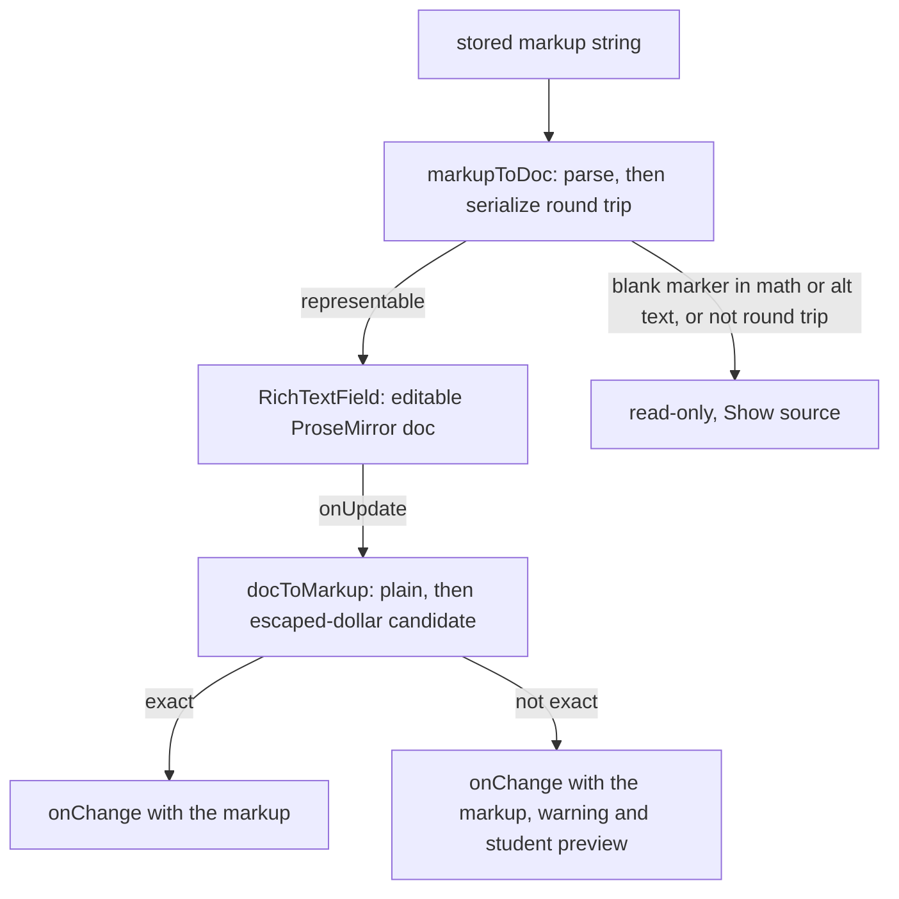

# Authoring editor beta

The item editor in `design-tool/app/dashboard/[id]/AssessmentEditor.tsx` has a redesigned variant that is off by default. It is the first part of the [editor redesign](../../docs/editor-redesign-design.md) that exists in source (the design notes call it the prototype track), and it is gated by one flag, **R-12**. The redesign's goal is a WYSIWYG field that never shows formatting markers, while the stored format stays the markup string. This page covers what the source does today. The [assessment authoring](authoring.md) page still describes the current editor and the rest of the item lifecycle.

## What is built and what is not

Built, and reachable only when the flag is on:

- A rich-text field (`RichTextField.tsx`, built on Tiptap's MIT core) for the question stem of `multiple_choice_single`, `multiple_choice_multi` and `short_text` items, and for each choice's text. Every other type keeps its textarea.
- Inline nodes for `strong` and `em` marks, line breaks, an escaped dollar, fill-in-the-blank blanks, KaTeX math (click a formula to edit its TeX) and asset-scoped images. There are no lists, headings, links or underline, because the stored grammar has none.
- Clean paste from Word and Google Docs (text, bold, italic and line breaks only; pictures are dropped and counted).
- The opt-in page at `/dashboard/beta`.

Not built, and described elsewhere as proposals: the MathLive keypad, the scripted side-by-side preview (R-3), the import redesign, the start screen, and the cutover that flips the default (Phase 9). The client renderer does not consume `packages/markup` yet (see [markup grammar](../architecture/markup-grammar.md)). Do not describe any of these as existing behaviour.

## The flag

`isNewAuthoringEnabled(db, session)` in `design-tool/lib/authoring/flag.ts` is the only reader of the flag. It returns `NEW_AUTHORING_DEFAULT` (`false`) when the staff member has no row. Every later slice asks this function, so the cutover is a change to that constant.

The row lives in `staff_preferences` (`design-tool/db/schema.ts`, migration `0064_staff_preferences.sql`): one row per `staff_sub`, a `new_authoring` boolean and `updated_at`. The migration is additive and changes no existing data.

Two routes change the flag. The `/dashboard/beta` page (`app/dashboard/beta/page.tsx`) shows the current choice and posts a plain form to `/api/me/preferences`, so it works without JavaScript. `app/api/me/preferences/route.ts` answers `GET` with `{ new_authoring }` and accepts `POST` as JSON or as a form field `new_authoring=on|off`, which redirects 303 back to the beta page. `setNewAuthoring` refuses an act-as session with `impersonating` (403), because a teacher's tool choice must not change under them while an admin is acting as them (impersonation is described in [auth and access](auth-and-access.md)). The beta page is linked from nowhere in the app while the default is off.

The item editor's page (`app/dashboard/[id]/page.tsx`) reads the flag on the server and passes `newAuthoring` into `AssessmentEditor`. The editor switches to `RichTextField` only when `newAuthoring && usesRichTextField(item.type)`; `usesRichTextField` in `lib/authoring/richTextTypes.ts` is typed as `ItemType`, so a misspelt type fails typecheck.

## Load, edit and save

The stored value is always the markup string. `markupToDoc` (`lib/authoring/markupDoc.ts`) parses it with `@secure-test/markup`, maps the AST onto a one-paragraph ProseMirror document, and checks that saving the document reproduces the same string. `docToMarkup` maps the document back to markup and tries a plain serialisation first, then one with every typed `$` escaped as `\$`. It keeps the first candidate whose parse matches what the editor shows.

Caption: the load and save path in `RichTextField`. The field emits a markup string on every edit and reloads only when the value changed outside it.

Two `Unrepresentable` reasons keep an item read-only: `blank_in_math_or_alt` (a `[[id]]` marker inside a formula or alt text, the ER-F1 to ER-F3 disagreements recorded in the [markup grammar](../architecture/markup-grammar.md)) and `not_round_trip` (for example two bolds with nothing between, `**a****b**`, which ProseMirror merges). A typed `**` or `$` is saved as a character, not as markup, so the field warns when the typed text cannot be read back exactly. The schema has no input rules.

## Paste

`transformPastedHTML` in `RichTextField.tsx` sends HTML through `sanitizePastedHtml` (`lib/authoring/pasteSanitize.ts`). The output keeps text, bold, italic and line breaks. Google Docs' `font-weight:normal` wrapper is not bold, and pictures are dropped and counted so the field can say so. Pasting ProseMirror's own slice (a copy from another field) is kept only when it came from this tab, through `rememberCopied`.

## Invariants

- The flag defaults to off. Turning it on or off changes only the editor's rendering, not the stored items.
- An act-as session reads the target teacher's choice but cannot write it (`setNewAuthoring` returns `impersonating`).
- The item's `stem` and choice `text` keep their existing markup shape. Export, preview, scoring and delivery read the same strings with the flag on or off.
- Markup that does not round-trip opens read-only. Opening an item never rewrites it.

## Focused tests

- `design-tool/test/authoring-editor.test.ts`: the round-trip gate over the 55 golden markup fixtures and 3,000 random strings (`round-trip gate`), the read-only cases (`unrepresentable constructs open read-only`), the typed-text cases (`saving what a teacher typed`), and the rule for which types use the field (`which item types use the new field`). It does not need the database.
- `design-tool/test/authoring-paste.test.ts`: Word and Google Docs fixtures, the clean HTML handed to the editor, and ProseMirror's slice marker. It does not need the database.
- `design-tool/test/new-authoring-flag.test.ts`: `isNewAuthoringEnabled` (default, opt-in, opt-out) and `/api/me/preferences` (JSON and form bodies, the act-as refusal). This file needs the test database (`DATABASE_URL` must contain `secure_test_design_tool_test`).

Browser behaviour of the field is not covered by these tests. The 2026-10-26 progress notes in `docs/editor-redesign-design.md` record the hand-check status of the slices.

## Change navigation

- Changing which types use the field: edit `RICH_TEXT_TYPES` in `lib/authoring/richTextTypes.ts` and check `authoring-editor.test.ts`. Adding a type to the field also means the type must already be in `ITEM_TYPES` ([authoring](authoring.md#concepts)).
- Changing the stored grammar (a new mark or node): the change starts in `packages/markup` ([markup grammar](../architecture/markup-grammar.md)) and `lib/authoring/markupExtensions.ts`, which must have exactly one node or mark per AST construct. Run `cd packages/markup && bun test` and the golden tests in `design-tool/test/markup-golden.test.ts`.
- Adding a flag-controlled surface: read the flag through `isNewAuthoringEnabled`, pass it from a server component the way `app/dashboard/[id]/page.tsx` does, and do not add a second reader.
- Schema changes to `staff_preferences` follow the migration workflow in [data model](data-model.md#migrations).
- Scope boundary: the `/dashboard/beta` page and `/api/me/preferences` are deliberately unlinked while the default is off. Do not add navigation to them as part of an unrelated change.
