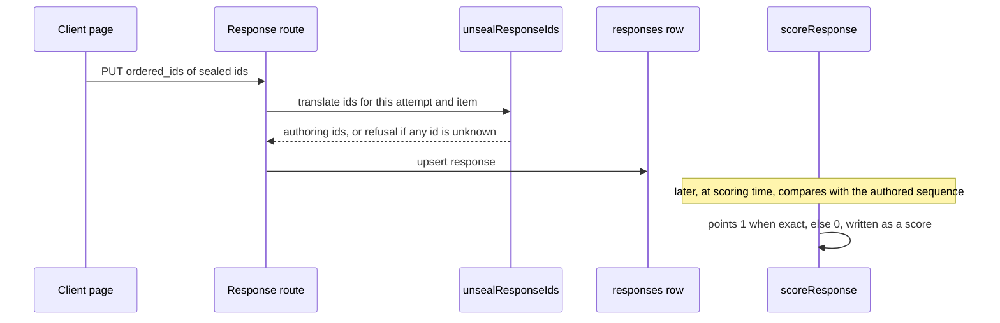

# Ordering items

An `order` item asks the student to put a list of steps into the right sequence. The teacher writes the steps in the correct order; the server ships them shuffled with sealed ids; the student rearranges them; the server compares the submitted list with the authored order. The type is one of the `ITEM_TYPES` listed in [authoring](authoring.md#concepts), and its stored shape is the `sequence` key of `items.config`, described in [data model](data-model.md).

Caption: the answer path from the student page to the stored row and the later scoring pass.

## Authoring

- **The sequence is the key.** `CreateItemBody` and `UpdateItemBody` in `lib/api/items.ts` take `sequence` as `{ id, label }` entries with `min(2)`. The order of the array is the correct order, and `itemConfigForWrite` stores it as `items.config.sequence`. The column enforces nothing; the write boundary does.
- **Teacher editor.** `SequenceEditor.tsx` edits the list. Removing an entry is disabled at two entries, with the reason in the tooltip, and new entries get a fresh id from `nextEntryId`.
- **Publish checklist.** `questionGaps` in `app/dashboard/[id]/readiness.ts` reports `needs at least 2 steps`, `has an empty step` and `still has placeholder steps`. See [authoring](authoring.md#publish-readiness-checklist).
- **Export and import.** `exportBundle.ts` writes the sequence in correct order, which is why an exported bundle carries the answer key. `importBundle.ts` accepts plain-string steps in v1.
- **Not AI-generable.** The generate-item routes reject `order` with 400 (`design-tool/test/ai-generate.test.ts`, the `not AI-generable` cases).

## Delivery and sealed ids

`buildDeliveryBundle.ts` maps an order item to `{ type: "order", id, stem, entries }`. Entries are shuffled with the module's Fisher-Yates helper and each entry id is replaced with `opaqueId(attemptId, itemId, realId)`. The authoring ids and the correct order never reach the student. The per-attempt id scheme is described in [wire formats](../architecture/wire-formats.md) and [sittings and attempts](sittings-and-attempts.md).

On write, `unsealResponseIds` in `lib/api/studentAttempt.ts` maps each sealed id back to its authoring id before the row is stored. If any submitted id does not resolve, the function returns `null` and the write is refused, so a half-translated answer can never score. The inverse, `sealResponseIds` in the same file, is used by `savedResponses.ts` so a resumed attempt's saved order is sent back with sealed ids ([resume prefill](sittings-and-attempts.md#resume-prefill)).

`MIN_CLIENT_VERSION_FOR_TYPE` in `lib/items/clientSupport.ts` has no `order` entry, so no client-version floor applies to order items. Only `fill_blank` and `graph` have one ([wire formats](../architecture/wire-formats.md)).

## Scoring

`scoreResponse` in `lib/scoring/auto.ts` handles `response.type === "order"`:

- No key (`sequence` empty): returns `null`, so the item is not auto-scored.
- Otherwise the response must list every authored id, in authored order, with nothing extra. The result is `points: 1` or `points: 0` with `max_points: 1`.

Partial credit is not given. Match (exact pair set), hotspot and multi-choice items use the same all-or-nothing rule in the same function.

## Integrity

`assertItemsAreBundleable` in `lib/api/itemIntegrity.ts` throws `IncompleteItemError` when a stored order row has fewer than two entries. This is a backstop for direct database writes or legacy rows. Without it, a teacher pressing Export would see a bare 500 with no item named.

## Student page (macOS client)

`AssessmentPage.swift` builds the order item in `orderField`. The rows are `order-row` elements that keep their DOM nodes and swap contents when moved, so keyboard focus stays on the row the student moved. Each row has labelled **Move up** and **Move down** buttons (`order-move`), and the boundary buttons are disabled. A pointer drag is implemented with pointer events, not HTML5 drag and drop, because the HTML5 drop did not land inside the locked-down web view. A drop posts once, on pointer-up, and yields the same ordered list as the equivalent run of button presses.

On a resumed attempt, `orderField` restores the saved `ordered_ids` before building the rows. Entries the saved list does not name keep their shuffled relative order after the named ones, so every entry appears exactly once. Restoring does not post anything. See [client overview](../client/overview.md#the-page) for the page build and [resume prefill](sittings-and-attempts.md#resume-prefill) for the server side.

Text-to-speech reads the order item in its current on-screen order (`RendererTextToSpeechTests`, `testOrderReadsItsCurrentOnScreenOrder`), so the spoken order matches what the student moved.

## Change navigation

| Change | Start at | Focused tests |
|---|---|---|
| Authoring rules, minimum length, editor | `lib/api/items.ts`, `SequenceEditor.tsx`, `readiness.ts` | `items-api`, `item-readiness`, `item-integrity` |
| Scoring rule | `lib/scoring/auto.ts` (order branch) | `scoring-auto` (order cases with `ordered_ids`) |
| Shuffle, sealed ids, unseal on write | `deliveryItem.ts`, `studentAttempt.ts` | `delivery-api` (order cases), `attempt-ingest-api` |
| Client rendering, Move buttons, drag | `AssessmentPage.swift` (`orderField`, `order-row`, `order-move`) | `RendererOrderTests`, `RendererOrderDragTests` |
| Client prefill of saved order | `AssessmentPage.swift` (`orderField`) | `RendererPrefillTests` (order entries case) |

Validation: `cd design-tool && bun test test/scoring-auto.test.ts` needs no database and is the quickest check for a scoring change. Route and delivery tests such as `delivery-api` need `DATABASE_URL` pointed at the design-tool test database (see [testing](../testing/testing-and-validation.md)). Client tests run with `swift test` on macOS.

## Scope boundaries

- Partial credit for order is not implemented. Adding it means changing the scoring branch, the `max_points` value that results and any reporting code that assumes 0 or 1 points.
- Do not hand-edit `packages/schema/dist`. Re-run the schema build after changing `packages/schema/src/items.ts`, `delivery.ts` or `responses.ts`, because the design tool consumes the built package.
- The per-attempt id scheme is shared with match items. Changes to `opaqueId` affect both, so check [wire formats](../architecture/wire-formats.md) before editing it.
-formats.md) before editing it.
