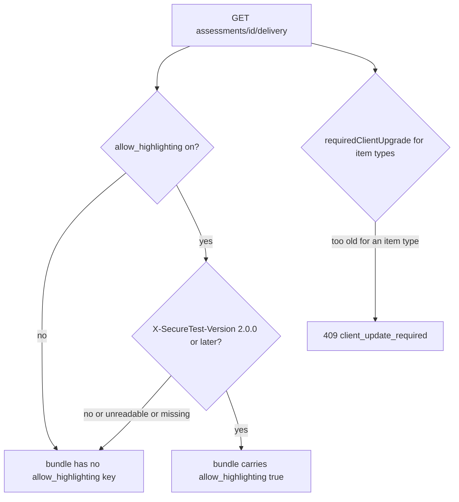

# Passage highlighting

Passage highlighting is a teacher-controlled aid: when the assessment allows it, a student may mark text in a stimulus passage or a multi-source panel. The design note `docs/passage-highlighting-design.md` describes the whole feature. This page records what the source ships today, which covers the design tool half and the client page half.

**Status.** The design tool half is implemented: the setting, its publish-lock exception, the delivery gate, and export, import and Duplicate. The macOS client page also implements the feature: mouse marking (slice 2) and a keyboard sentence cursor (slice 3, keyboard model (b)), both in `AssessmentPage.swift`. The client gates on `allow_highlighting` and keeps every mark in page memory. Its gate is the bundle flag, not a client version check of its own, so a client below 2.0 never receives the flag and never shows the tool. The client project's `MARKETING_VERSION` in `client/SecureTest.xcodeproj` is now 2.0.0, so a build of this tree meets the floor and clients below it never receive the flag. Whether a 2.0 build is deployed is a rollout decision recorded in `docs/passage-highlighting-design.md` (its deploy is held until v2.0), not something the source decides.

## The setting

`assessments.allow_highlighting` is a boolean that defaults to `false`. The create body in `design-tool/lib/api/assessments.ts` accepts it, and the PATCH body accepts it optionally. The Settings tab in `AssessmentEditor.tsx` renders the checkbox "Let students highlight passages". That control saves itself through its own PATCH, separate from the editor's main save.

Because the setting is student-facing but does not change what a student answers, it shares the feedback door of the publish lock. `isFeedbackSettingsOnlyPatch` in `design-tool/lib/api/requireDraft.ts` treats `allow_highlighting` like `student_feedback` and `answers_release`: on a published assessment, the PATCH is accepted only when those keys are the only ones sent and at least one of them actually changes. The lock mechanics are described in [assessment lifecycle](assessment-lifecycle.md#the-publish-lock). The difference from the feedback pair is that this flag does reach the delivery bundle, so a student mid-test gets or loses the tool on their next bundle fetch. The code comment accepts that because highlighting is an aid rather than part of answering.

## Delivery gate

The flag rides the student delivery bundle only in one case. `buildDeliveryBundle` in `design-tool/lib/api/buildDeliveryBundle.ts` adds `allow_highlighting: true` when the assessment flag is on and `clientSupportsHighlighting(clientVersion)` is true. The delivery route passes the `X-SecureTest-Version` header through.

Two rules in `design-tool/lib/items/clientSupport.ts` keep this gate separate from the item-type gate. `MIN_CLIENT_VERSION_FOR_HIGHLIGHTING` is `"2.0.0"`. The highlighting floor is never checked by `requiredClientUpgrade`, which reads only `MIN_CLIENT_VERSION_FOR_TYPE`, so a client below 2.0 still opens the test and simply gets no tool. The comment in that file records decision H-1 from the design note: older clients are not refused, because a refusal would block students while the fleet updates. Reversing that is a deploy-only change: add a 409 check for the highlighting floor, the same way `MIN_CLIENT_VERSION_FOR_TYPE` works.

On the wire, `DeliveryBundleSchema` in `packages/schema/src/delivery.ts` declares `allow_highlighting` as optional, and its comment states the same gate. The teacher bundle `ItemBundleSchema` in `packages/schema/src/items.ts` also declares it optional, as described in [wire formats](../architecture/wire-formats.md#two-bundles-adr-0016).

## Teacher bundle, import and Duplicate

- **Export** (`design-tool/lib/api/exportBundle.ts`) writes `allow_highlighting: true` only when the flag is on, so older bundles stay byte-stable.
- **Import** (`design-tool/lib/api/importBundle.ts`) reads `bundle.allow_highlighting ?? false`, so an absent field means off.
- **Duplicate** goes through the same export and import path (`duplicateAssessment.ts`), so the copy keeps the flag. The explicit settings update in that file does not list it. See [assessment lifecycle](assessment-lifecycle.md#duplicate).

## Client page (SecureTest)

The page half lives in the script that `AssessmentPage.swift` builds, and it is wired only when the bundle says so. `ALLOW_HIGHLIGHTING` is `BUNDLE.allow_highlighting === true`; when it is absent or false there is no `st-highlightable` class, no listener and no button, which keeps the page exactly as before.

- **Mouse marking (slice 2).** A non-empty selection that starts and ends inside one opted-in passage (a stimulus or source body) shows one floating "Highlight" button (`hlButton`, `hlFromSelection`, `.st-highlight-button`). Pressing it calls `hlApply`, which wraps the text in `mark.st-mark` elements through `hlWrap`. Clicking a mark removes it (`hlMarkClicked`), and "Clear highlights" removes that passage's marks (`hlClearAll`). Marks never cross a blank line (`hlWrapText`), and rendered math is wrapped whole, never split inside KaTeX (`hlIsMath`).
- **Sentence cursor (slice 3).** Each highlightable passage with text gets a "Highlight mode" toggle above it (`hlPlaceToggle`). Entering the mode (`hlEnterMode`) focuses the first sentence. Arrow keys, Home and End move by sentence (`hlModeKey`), Space marks the current sentence or removes its marks when fully marked, and Escape leaves the mode (`hlLeaveMode`). Sentence boundaries come from `hlSplitSentences`, and VoiceOver hears each move through one polite live region (`hlAnnounce`). The keys the mode uses stop at the passage, and every other key passes through.
- **Nothing persists.** Marks are DOM state only. No bridge message carries them, nothing is stored, and the copy rule still comes from `ALLOW_CLIPBOARD` ([lockdown and security](../client/lockdown-and-security.md)). The sentence cursor implements keyboard model (b), as the source comments date it (2026-10-14).

The behaviours are pinned in `client/SecureTestCore/Tests/SecureTestCoreTests/RendererHighlightTests.swift`: the flag gate (`testFlagAbsentOrFalseChangesNothing`, `testFlagOnOptsInPassagesAndNothingElse`), mark wrapping across blank lines and formulas (`testASelectionAcrossABlankLineMakesOneMarkPerParagraph`, `testAFormulaTouchedByTheSelectionIsWrappedWhole`), removal and clear (`testClickingAMarkRemovesItAndNormalizesTheText`, `testClearHighlightsRemovesEveryMarkOfThatPassage`), page-turn persistence (`testMarksSurvivePageTurnsOnAnOwnPagePassage`), the sentence cursor (`testSentenceSplitting`, `testSpaceMarksExactlyTheSentenceAndSpaceAgainRemovesIt`, `testEscapeLeavesTheModeAndReturnsToTheToggle`), no posting (`testMarkingRemovingAndClearingPostNothing`, `testKeyboardMarkingPostsNothing`), and AA contrast for every mark pair (`testEveryContrastSetDefinesAMarkPairAtAA`).

## Tests and focused checks

- `design-tool/test/passage-highlighting-api.test.ts` covers the setting on create and PATCH, the publish-lock behaviour (editable while published, with no-op changes still refused), a non-boolean returning 400, the export, import and Duplicate round trip, and the pure `clientSupportsHighlighting` cases (2.0.0, 2.1, 10.0.0 yes; 1.6.3, absent, garbage no). The whole file requires the test database, because its top-level `beforeAll` checks for it.
- `design-tool/test/delivery-api.test.ts`, describe "passage highlighting on the wire", covers the four delivery cases: on with 2.0.0, on with 1.6.3, on with no header, and off with 2.0.0. The last three must still return 200 with no field.

Narrow check: `cd design-tool && DATABASE_URL=postgres://$USER@localhost:5432/secure_test_design_tool_test bun test test/passage-highlighting-api.test.ts`. Run `delivery-api.test.ts` as well when the gate in `buildDeliveryBundle.ts` changes.

## Change guidance

- Adding a server-side field that mirrors this flag: update the Zod body in `lib/api/assessments.ts`, the publish-lock key set in `requireDraft.ts`, export and import, and the schema. Then update the wire-format and client rows in the wiki.
- Changing the client page: keep highlights out of the response and bridge channels, and keep copy governed by the clipboard rule. The locked-page constraints (`user-select` and `ALLOW_CLIPBOARD`) are covered from the client side in [lockdown and security](../client/lockdown-and-security.md). The client page's own structure is in the [client overview](../client/overview.md).
- The design note's other keyboard options (VoiceOver selection, mouse only) are not shipped. The sentence cursor is the shipped keyboard model.
- The 2.0.0 floor is enforced only on the server. The client reads the flag from the bundle and has no version check of its own, so the `X-SecureTest-Version` header it sends (covered by `APIClientTests`, `testRequestsCarryTheClientVersionWhenGiven`) is what decides whether a build receives the tool.
