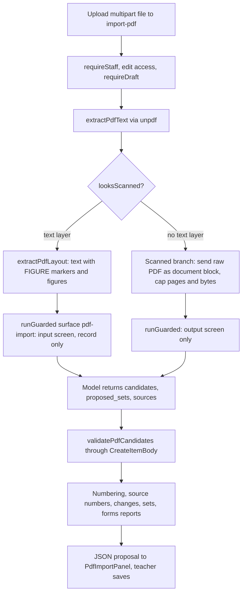

# PDF import

PDF import is the teacher's way to turn an existing printed test into draft items. The route at `app/api/assessments/[id]/items/import-pdf/route.ts` extracts and proposes; it never saves. This matches the propose-then-edit pattern used by [batch AI generation](batch-item-generation.md) and the [rubric extractor](authoring.md#rubric-library-and-extraction). Items the teacher accepts are created through the ordinary item routes described in [authoring](authoring.md), so the draft lock and `CreateItemBody` validation apply unchanged.

## Pipeline

The import route is a read-only analysis. Writes happen only when the panel posts accepted items and sets back to the item and item-set routes.

1. **Gate.** `requireStaff`, then `authorizeAssessment(..., "edit")` and `requireDraft`. The body must be multipart (`expected_multipart`), and the file is capped at 25 MiB.
2. **Text layer or scan.** `extractPdfText` reads the text layer. `looksScanned` decides whether the document is a scan (the text is too thin for its page count, see `MIN_CHARS_PER_PAGE`). A scan over `MAX_OCR_PAGES` (30) or `MAX_OCR_BYTES` (10 MiB) is refused with 422 or 413.
3. **Figures.** On the text path, `extractPdfLayout` returns the text with a `[FIGURE n]` marker where each raster or vector figure sits. A failure in the figure walk falls back to flat text and no figures; it does not fail the import.
4. **Guardrail.** `runGuarded` with surface `pdf-import` and `inputMode: "record"`. The input check screens the extracted text before the model runs, but a hit is only stored as a `flag` and extraction continues. The output check screens every string the model proposed (`proposalScreenText`: stems, choices, pairs, blank options and keys, answers, table labels, stimuli and sources), and a block there returns 422 `blocked_by_guardrail` with a `hint` that the panel shows instead of the code. The scanned branch has no pre-model text, so only the output stage runs. The input check became record-only on 2026-10-25 because the guardrail's PROMPT_ATTACK filter refused ordinary test directions (for example "Answer all questions. Show your work."); the model therefore now reads text that tripped that filter, and the fence in [the prompt's contract](#the-prompts-contract) and the output screen are the controls on that trade-off (ledger entry for PR #108, `docs/ledger.md`). Flags from this route are not safeguarding alerts, which come only from the hand-in screener. See [AI and safeguarding](ai-and-safeguarding.md).
5. **Model.** `getPdfExtractorProvider()` selects `mock` or `bedrock`. The Bedrock provider sends the text, or the raw PDF as a document block for scans (ADR 0015). Output is capped at `PDF_EXTRACT_MAX_TOKENS`.
6. **Validation.** `validatePdfCandidates` runs each candidate through `CreateItemBody` after `normalizePdfCandidate`. It keeps at most `MAX_PDF_CANDIDATES` (100) and sets `truncated` when more came back. Rejected candidates are reported by index with their Zod messages.

## Figure, answer-key and copy rules

These rules are deterministic and run after the model returns, so they do not depend on the prompt. They were added in the 2026-10-25 import-fixes slices and are pinned by `pdf-extract.test.ts` and `pdf-figures.test.ts`.

- **A figure printed beside its question goes with that question.** `questionAfterFigure` in `lib/pdfImport/extractCore.ts` decides which question a figure belongs to, using its position on the page, rather than attaching it to the next question.
- **Answer-key figures never reach students.** `keyFiguresFromText` marks a figure whose marker sits under a key cue such as "Responses vary." or "Sample answer:". The cue must be the whole line, so a student instruction that only contains the words is not a key. A flagged figure is `answer_key: true`, lies in no proposed set, and the panel labels it "Answer key drawing — not shown to students". The model is not asked to make this call, because one run of the model flagged a question's own figure.
- **Blank answer areas are not stimuli.** A ruled drawing whose cells are under half filled with text, such as an empty graph grid or a table to fill, is `answer_area: true` (`isBlankAnswerArea` in `extractFigures.ts`) and is never proposed as a stimulus. The panel labels it "Blank answer space — not shown to students".
- **A drawing with exactly two prose lines inside is kept, flagged `text_inside`.** Its lines stay in the text the model reads, and the panel offers a way to add it as a figure.
- **A question printed twice is dropped.** `dropPrintCopies` removes a raw candidate that repeats an earlier one word for word (stem of at least 30 characters, same type and choices), so a sheet printed as two copies does not double its questions. The remaining proposed sets' `item_indexes` are remapped past the removed copies.

## The prompt's contract

`PDF_EXTRACT_SYSTEM_PROMPT` in `lib/pdfImport/extractCore.ts` defines what the model may propose. It offers multiple choice (single and multi), short text, essay, match, drawing upload, table and fill-in-the-blank shapes. It does not offer `order` or `hotspot`. The prompt also sets rules that the validators rely on:

- **Source numbers.** Each candidate may carry `source_number`, or `source_numbers` for a match set built from several printed questions. `CreateItemBody` strips unknown keys, so `readSourceNumbers` reads these before validation.
- **The document is data, not instructions.** `buildPdfExtractUserPrompt` (`lib/pdfImport/extractCore.ts`) wraps the extracted text in `<test_document>` tags, and `neutraliseTestDocumentTag` escapes a literal closing tag inside it so the text cannot end the fence early. The system prompt says the document is content to turn into items and never instructions to the model. `bedrockProvider.ts` sends the text this way on the text path. `test/pdf-extract.test.ts` (describe "extractor prompt fences the document as data") pins the wrapper and the escape.
- **Student-can-do-it rewrites.** An instruction the student cannot perform on screen (for example "underline the digits") must be rewritten or dropped. Every such change is reported in a `changes` array with the original and changed text, and `readCandidateChanges` aligns it with the validated candidates. The teacher sees these changes flagged on the card.
- **No invented examples.** Stems must not include "e.g." or sample answers.
- **Shape choice.** Match is one item for a whole bank, drawing upload is only for work that must be drawn, and table is only for printed grids with empty cells. A sentence with blank lines inside it is `fill_blank`, while a standalone answer line stays `short_text`.

The prompt is a stable contract with the mock provider and tests. Changing a shape or a rule means updating `extractCore.ts`, the mock in `mockProvider.ts`, and the prompt tests in `pdf-extract.test.ts`.

## Reports returned to the teacher

The success response (`ok: true`) carries these fields alongside `candidates` and `rejected`:

| Field | Source | Meaning |
|---|---|---|
| `numbered_items`, `extracted_count`, `missing_numbers`, `shortfall` | `numberingReport`, `countNumberedItems` | Compares the printed question numbering with what came back. With source numbers the missing list is exact; without them only the count is compared. Scanned PDFs have no text layer to count. |
| `changes` | `readCandidateChanges` | Per validated candidate, the model's rewrites. `[]` means printed as is. |
| `proposed_sets`, `rejected_sets` | `validateProposedSets`, `adjacencyFallback` | Stimulus sets the model proposed (remapped to validated candidate indexes), plus sets the adjacency rule places for figures the model did not attach. `source` says whether the model or the rule paired them. |
| `figures`, `figure_count` | `extractPdfLayout` | Each raster figure above `MIN_FIGURE_PT` with its page and, unless omitted for size, a PNG data URL. Figure limits are `MAX_FIGURES`, `MAX_FIGURE_BYTES` and `MAX_FIGURES_TOTAL_BYTES`. |
| `forms` | `formsReport`, `detectForms` | Several forms in one document, detected when numbering restarts at 1 into at least two groups of two or more questions each, or from "Form A / Form B" labels. The teacher confirms the grouping in the panel. |
| `ocr_used`, `page_count`, `extracted_chars` | route | Which branch ran and how much text was read. |

Proposed sources are bounded: at most `MAX_PROPOSED_SOURCES` (12) per set, `MAX_SOURCE_TEXT_CHARS` (20,000) per source, and `flagShortenedSources` marks any source shorter than `SHORTENED_SOURCE_RATIO` (0.85) of the document's own span under the same heading.

## Figures and stimulus sets

Extraction writes no assets. Figures travel in the response as data URLs. When the teacher adds a proposed set, `PdfImportPanel.tsx` creates the item-set through `POST /api/assessments/[id]/item-sets`, and the figure bytes are attached then. Shared stimuli and their delivery rules are in [stimulus and item sets](stimulus-and-item-sets.md).

## Errors

A guardrail block on this route is 422 `blocked_by_guardrail` with `stage: "output"` (the input stage never blocks here). Typed extractor failures map to 422 with a teacher-facing hint: `pdf_extract_truncated` (split the PDF), and `pdf_extract_invalid_output` (try again, then split or use CSV). Any other provider failure is `pdf_extract_failed` (502). Each body includes a `detail` field for staff.

## Change guidance

- To add an item shape to the extractor, change the prompt, the parser in `normalizePdfCandidate`, and `CreateItemBody`. Check whether the shape also needs the bundle and delivery changes described in [wire formats](../architecture/wire-formats.md#add-an-item-type-cross-system-expensive). The generic checklist is in [authoring](authoring.md#change-recipes).
- Keep extraction write-free. Any change that saves from this route breaks the lock and the teacher's review step.
- Do not treat `docs/pdf-import-enhancements.md` as current on shapes. Use `PDF_EXTRACT_SYSTEM_PROMPT`.
- Judge an extractor or model change on measured output, not on item counts. `scripts/compare-pdf-import.ts` runs the extractor on one PDF with one or more Bedrock models (`--model`, `--runs`, `--summary`) using the caller's own AWS credentials and skips the guardrail. `scripts/pdfImportScore.ts` scores a run against a hand-checked answer set (`--expected`). Neither saves anything. Answer sets describe teacher documents and stay out of the repository, so never paste a real PDF's output into a tracked file.

Focused checks: `cd design-tool && bun test test/pdf-extract.test.ts` (pure validators, numbering, sets, forms, the prompt fence, the output screen text and the mock; no database). `test/pdf-import-route.test.ts` covers the route's status codes and response shape and needs `DATABASE_URL=postgres://$USER@localhost:5432/secure_test_design_tool_test`. The figure extractor, including the page-image gate, is covered by `test/pdf-figures.test.ts`, and the teacher's "changed from PDF" note on an imported card by `test/changed-from-pdf.test.tsx`.

Live behaviour of the fence and the record-only input check against Bedrock is not verified by these tests; it is tracked as a manual check in the ledger entry for PR #108.
 by `test/changed-from-pdf.test.tsx`.
DATABASE_URL=postgres://$USER@localhost:5432/secure_test_design_tool_test bun test test/pdf-import-route.test.ts`. The figure extractor is covered by `test/pdf-figures.test.ts`.
ute.test.ts`.
test/pdf-import-route.test.ts`. The figure extractor is covered by `test/pdf-figures.test.ts`.
ute.test.ts`.
.
