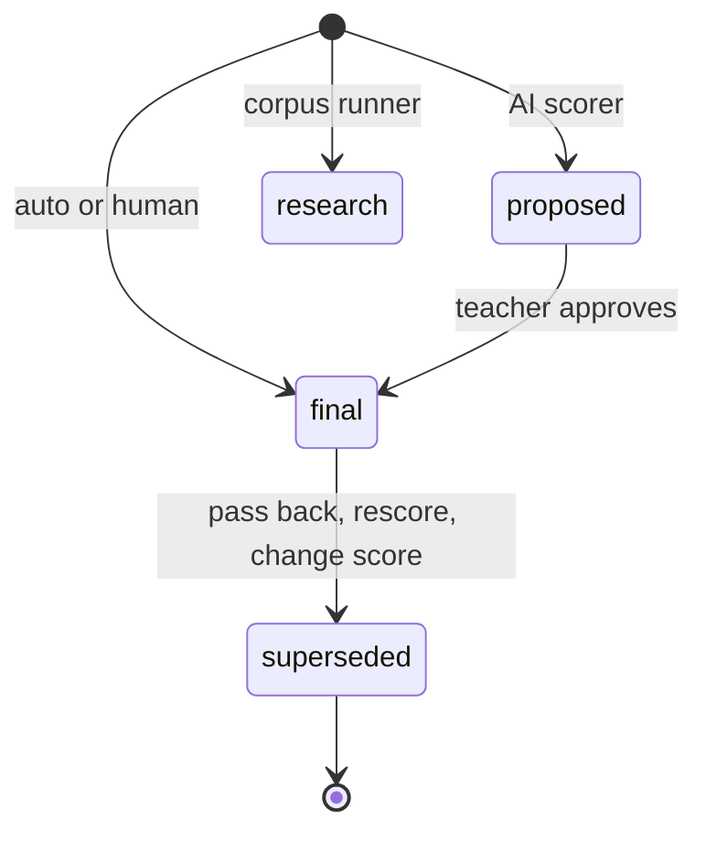
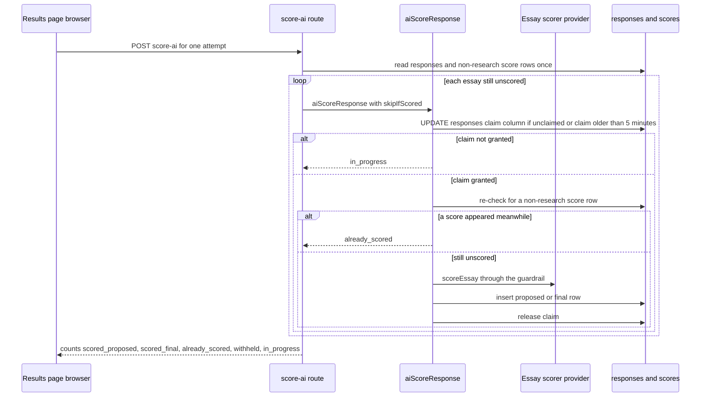
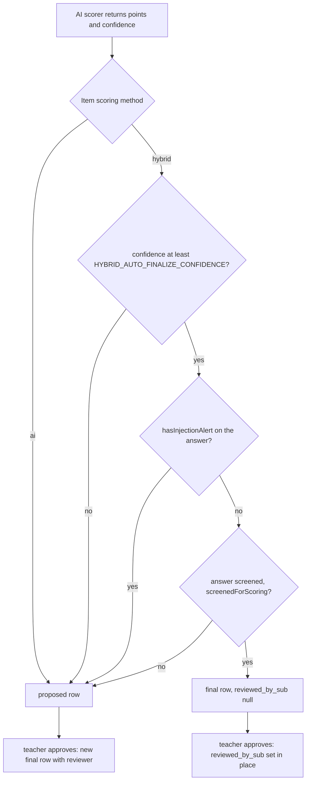

# Scoring, results and score corrections

Scores live in the append-only `scores` table (see [data model](data-model.md#tables-by-domain)). Every response can accumulate rows; the history is the audit trail. This page explains who writes which row, and how corrections keep that history intact.

## Who writes a score

| Method | Producer | Status written | Entry point |
|---|---|---|---|
| `auto` | Deterministic key comparison | `final` directly | `scoreResponse` in `lib/scoring/auto.ts`, driven by `runAutoScoringPass` in `lib/scoring/runAutoScoring.ts` |
| `ai` | Essay scorer provider | always `proposed` (a human finalises) | `lib/scoring/aiScoreResponse.ts`, routes `score-ai` (per attempt) and `rescore-ai` (per response) |
| `hybrid` item setting | AI, then confidence gate | `final` when confidence is at least `HYBRID_AUTO_FINALIZE_CONFIDENCE` and no prompt-injection alert exists on the answer, else `proposed` | `aiScoreResponse.ts`; see [Hybrid and unreviewed AI scores](#hybrid-and-unreviewed-ai-scores) |
| `human` | Teacher | `final` | `app/api/responses/[responseId]/score`, `app/api/scores/[scoreId]/approve` |

`effectiveScoringMethod(type, config)` in `lib/api/items.ts` resolves the item's method: an explicit `items.config.scoring_method` wins. Otherwise the per-type default `DEFAULT_SCORING_METHOD` applies (MC, short text, match, order, hotspot, table and fill-in-the-blank are `auto`; essay and drawing upload are `human`), with one override: a table or fill-in-the-blank item with no key (`cell_keys` or a keyed blank) defaults to `human` and flips to `auto` when the first key is saved (the E3-F1 rule; `items-api.test.ts`, "E3-F1: effective scoring method follows cell_keys"). The schema's `ScoringMethodSchema` is `auto | ai | human | hybrid`.

### Auto-scoring rules (`lib/scoring/auto.ts`)

- Multi-select MC is exact-set, all or nothing.
- Short text compares plain normalised text first (trim, collapse whitespace, case-fold). Only if that fails does it try, in order, numeric equivalence (`1/2` equals `0.5`, switched off per item by `exact_form`) and a formula fold (strips `$`, `\mathrm`, braces and subscripts so `H_2O` equals `H2O`, but `^` is kept because exponents change value). Each later step can only add matches. Students type these answers with the client's math keypad and formula preview, described in [math keypad](../client/math-keypad.md); the server never sees the keypad, only the typed text.
- [Table items](table-items.md) score per keyed cell; fill-in-blank per keyed blank (`tableMaxPoints`, `fillBlankMaxPoints`; the blank rules are in [fill-in-the-blank items](fill-in-the-blank.md#scoring-and-reading)). Items with no key return `null`, which callers count as skipped, never as zero.
- `runAutoScoringPass` is idempotent: it skips responses that already have a `final`, and ignores `research` rows when deciding that.

When the pass runs: in the same request as the student's own hand-in (`app/api/attempts/[attemptId]/submit/route.ts`) and on demand from the teacher score route. A scoring failure is logged and never fails the hand-in.

## Score status lifecycle

Score statuses on a response row. `research` rows are written only by the scoring-corpus runner and are invisible to teacher surfaces.

- The partial unique index `scores_one_final_per_response_unq` allows one `final` per response. Superseding frees the slot so the next hand-in (or the correction itself) can write a new final.
- **Pass back** (`lib/api/passBackAttempt.ts`, design note `docs/pass-back-design.md`): one transaction flips a submitted attempt to `in_progress`, supersedes every `final`, and records a `passed_back` event. `proposed` rows are left alone. A timed assessment requires a new deadline, written to `deadline_override_at`.
- **Rescore with current key** (`lib/scoring/rescore.ts`): `planRescore` is pure; `applyRescore` supersedes only `auto` finals whose answer now scores differently and inserts a new `auto` final with `rationale.changed_from`. Teacher-set scores are counted but never overwritten.
- **Change score** (`lib/api/changeScore.ts`): supersedes a `final` with a new human final and writes a `score_changed` event.
- **Earlier scores** (`lib/scoring/supersededScores.ts`, `listSupersededScores`): the only reader of `superseded` rows. It feeds the per-student "Earlier scores (before pass back)" section. Every row is labelled with a `cause`: `changed` when a later score on the same response names it in `rationale.changed_from.score_id`, otherwise `pass_back`. Every other surface (results, CSV, print, work packet, review queue, auto-scoring pass) reads only `final`, so superseded rows stay out of totals. Tests: `superseded-scores.test.ts`.
- **Answer restore** (`restoreAnswerVersion` in `lib/api/restoreAnswer.ts`): a teacher with edit access makes an earlier saved text version current. A restore on a handed-in attempt supersedes that answer's scores, and the restored answer waits for a new score. The capture, guard and sweep rules are in [answer history](answer-history.md).

Staff-only event kinds (`STAFF_ONLY_ATTEMPT_EVENT_KINDS`) are written by these routes and can never be posted by the client ([sittings and attempts](sittings-and-attempts.md#events-and-the-monitor)).

## Teacher review queue and approval

Human scoring is driven from a per-assessment queue rather than from each attempt.

- `GET /api/assessments/[id]/review-queue` (`view` access) lists responses on the assessment's **submitted, non-practice** attempts whose item's effective method is not `auto` and that have no `final` row. Auto items never appear (they were finalised at hand-in), and neither do practice hand-ins. Each entry is grouped by `proposed`: `null` means "needs a manual score", a non-null proposal means "AI suggestion awaiting approve or override". Stems reach the queue rendered, so teachers score a fraction, not KaTeX source. The response also returns `unreviewed` (the "Finalized by AI — not reviewed" list, see below) and `sections`; `?section=` filters both lists using `lib/scoring/sectionFilter.ts`.
- **First AI proposal (R-4).** A needs-manual card for an `ai` or `hybrid` item with no proposal offers **Score with AI** (`ScoreWithAiRow` in `app/dashboard/[id]/scoring/ScoringQueue.tsx`), which posts to the same per-response `rescore-ai` route as **Re-run AI**. `offersAiScoring` decides it: a `human` item never offers one, and once a proposal exists the card shows Re-run AI instead.
- **Manual score** (`app/api/responses/[responseId]/score`) and **change score** share `checkManualScore` in `lib/api/reviewActions.ts`. `max_points` must equal the item's own maximum (rubric max, table cells, fill-blank count, otherwise 1), so every student's totals stay comparable. When `criterion_scores` are sent they are validated against the scoring view, which expands single-point rubrics into the derived `.below/.meets/.exceeds` levels the queue offers.
- **Approve** (`app/api/scores/[scoreId]/approve`) on a `proposed` AI row inserts a new `final` row copying the proposal's numbers and rationale. The method stays `ai` and the scorer stays the model id, while `reviewed_by_sub` records the approving teacher. The proposal row stays as audit trail. Approve on a `final` AI row with no reviewer marks that row reviewed in place (no new row, and a repeat press returns the row as it stands). Approve refuses a `research` row as `not_found`, any other non-proposal as `not_a_proposal`, and a response that already has a final as `409 final_exists`; the insert uses `onConflictDoNothing` to close the race with a concurrent score.
- Every action in this chain loads the response through `loadResponseChain`, which uses `authorizeAttempt(..., "edit")` and returns `404` for other teachers' rows, and `400 attempt_not_submitted` for unsubmitted attempts.

Invariant: approval and manual scoring never edit a score's points or status. They only append a `final`, and let the partial unique index arbitrate races. The one in-place write is approving an unreviewed final AI score, which sets `reviewed_by_sub` only. An attempt enters the queue only once it is submitted, by student hand-in or teacher hand-in ([sittings and attempts](sittings-and-attempts.md)); `loadResponseChain` ignores `research` rows when it checks for an existing final, and approval never edits the proposal, so an override goes through the manual score or change score path instead. Test focus: `review-queue.test.ts` and `change-score.test.ts`.

## Batch and per-essay AI scoring

The results matrix ([reporting and packets](reporting-and-packets.md)) shows **Score essays with AI (n)** to users with edit access once a section is chosen. The button scores that section's handed-in essays. The browser does the batch: it posts once per student to `POST /api/attempts/[attemptId]/score-ai` and keeps three students in flight (`CONCURRENCY` in `components/app/ScoreEssaysWithAiControl.tsx`), so each request stays well under the load balancer's idle timeout and one failed student does not stop the rest. Pressing again after a closed tab or a failure sends only what is still unscored.

`aiBatchCounts` in `lib/scoring/aiBatch.ts` produces the (n). It counts essays that `isAiBatchItem` accepts (essay, effective method `ai` or `hybrid`, rubric present), whose text has a non-space character, that have no non-research score row, and that have no unforced prompt-injection alert. The route stays the authority: it runs the same skip rules, screens lazily, and withholds flagged answers at press time. The provider and guardrail behind each model call are described in [AI and safeguarding](ai-and-safeguarding.md).

Caption: one batch request per student; each essay is claimed before the model call, so two overlapping batches score it once.

- **The claim.** `aiScoreResponse` (`lib/scoring/aiScoreResponse.ts`) takes a claim with one atomic `UPDATE` of `responses.ai_scoring_claimed_at` (migration `0061_ai_scoring_claim.sql`; see [data model](data-model.md)). A claim is only taken when the column is null or older than `AI_SCORING_CLAIM_TTL_MINUTES` (5). The claim is not held in a transaction, because a pool connection must not wait through a 5 to 30 second model call (the pool allows 5 connections). The release in `finally` matches the exact claim value, so it never clears a takeover's claim. A claim left by a task that died expires on its own.
- **Outcomes.** A lost claim returns `in_progress`. With `skipIfScored` (the batch only), a non-research score row that appears after the request's snapshot returns `already_scored`. The batch JSON reports `scored_proposed`, `scored_final`, `already_scored`, `skipped_not_ai`, `skipped_unscorable`, `blocked`, `withheld`, `in_progress`, `provider_errors` and `total_responses`.
- **Per-essay re-run.** `POST /api/responses/[responseId]/rescore-ai` (the queue's Score with AI and Re-run AI) does not pass `skipIfScored`, so it deliberately adds another proposal. It refuses with `final_exists` (409) once a final exists, `injection_flagged` (409) unless `force` is sent, and `scoring_in_progress` (409) when it loses the claim.
- **Known gap.** Lazy safeguarding screening runs before the claim in both routes, so two overlapping requests can both screen the same unscreened answer. The design note (`docs/ai-score-concurrency-design.md`) records this as unchanged.
- **AI short answers.** A `short_text` item scored `ai` or `hybrid` is sent to the same scorer with `kind: "short_answer"` (`aiScoreResponse.ts` sets it from the item type), which selects `SHORT_ANSWER_SCORE_SYSTEM_PROMPT` in `lib/ai/essayScorer/scoreCore.ts` instead of the essay prompt. That prompt treats brevity as expected and never lowers confidence for it, and it scores against the teacher's holistic key (`items.config.rubric`, see [authoring](authoring.md#concepts)). An essay answer sent to a short-answer item is `unscorable`. The prompt change is versioned with `ESSAY_SCORER_PROMPT_VERSION` (2026-10-27). Live model confidence on short answers was not yet verified against Bedrock when this was recorded (ledger entry 2026-10-27, hand-check rows 835–841), so the hybrid auto-finalize threshold has no measured short-answer basis yet.
- **Invariants.** The (n) and the route must agree: keep `isAiBatchItem` and the route's `isAiEligible` in step when either changes. A rubric-less essay or short answer is counted by the route as `skipped_unscorable`, but `aiBatchCounts` excludes it. Batch scoring writes only proposals and Hybrid finals, through the same `aiScoreResponse` path as the per-essay button, so the rules in [Hybrid and unreviewed AI scores](#hybrid-and-unreviewed-ai-scores) apply.
- **Tests.** `essay-scorer.test.ts`, describe `score-ai concurrency (claim)` (two concurrent batch runs score each essay once; a per-essay press during a batch answers 409 `scoring_in_progress`, and a later deliberate re-run still adds a proposal; a claim older than 5 minutes is taken over and a fresh one is honoured). `ai-batch-counts.test.ts` (`aiBatchCounts`, `isAiBatchItem`; needs the test database). `score-essays-with-ai-control.test.tsx` (tally, summary and the bounded `runPool`).

## Hybrid and unreviewed AI scores

The `hybrid` method lets a confident AI score become `final` without a teacher. The reasoning behind these rules is in `docs/hybrid-scoring-transparency-design.md`. `aiScoreResponse` in `lib/scoring/aiScoreResponse.ts` makes that decision against `HYBRID_AUTO_FINALIZE_CONFIDENCE` (0.85, one global value in `lib/ai/essayScorer/scoreCore.ts`), the injection check, and `screenedForScoring` (`lib/safeguarding/screening/screen.ts`). The last one is the SEC-05 rule from the 2026-10-24 security audit: a screen that failed leaves no alert, so "never screened" must not look like "screened clean". An unscreened answer on a screened item therefore lands as a proposal, and the attempt-wide `score-ai` run skips such an answer for the run and counts it as `screening_failed`, leaving the retry to the next run. Practice attempts and item types the screener does not read are not affected.

Caption: an AI score is final on its own only under Hybrid, and only when the answer carries no prompt-injection alert.

- **The signal is `reviewed_by_sub`.** An `ai` final with a null reviewer was finalized by the scorer. Every teacher approval, manual score and change score sets the reviewer, so the null value cannot be a teacher's decision.
- **Wording.** `isAiUnreviewed` and `finalMethodWord` in `lib/scoring/methodLabel.ts` give the per-student page "AI, not reviewed", "AI, approved by you" (only for the viewer who approved) or "AI, approved". The Change dialog (`lib/scoring/changeScoreDialog.ts`) and the work packet's `packetScoreHeading` (`lib/reporting/workPacket.ts`) have their own strings with the same rule.
- **Results.** A final AI cell with no reviewer shows `•` with the title "AI score, not reviewed (counted)". `unreviewedCountLine` (`methodLabel.ts`) gives the line above the matrix, which links to the queue at edit level. The results CSV's last column is `ai_not_reviewed`, appended after `unscored` so earlier columns keep their positions (`lib/scoring/results.ts`).
- **Queue.** The "Finalized by AI — not reviewed" list (`unreviewed` in the review-queue response, rendered in `app/dashboard/[id]/scoring/ScoringQueue.tsx`) shows read-only cards with Approve, which marks the score reviewed in place, and Change. Those cards show no confidence.
- **Students and gradebook are unchanged.** An auto-finalized score is final for instant feedback, Google Docs and the gradebook send, as before. The labels only tell teachers who reviewed it.
- **Editor copy.** Choosing Hybrid shows `HYBRID_HINT` in `app/dashboard/[id]/AssessmentEditor.tsx`. It says confident scores count at once and the teacher can still change any score. The copy is the only part of the choice that teachers read.

Tests: `test/hybrid-labels.test.ts` (each label string), `test/results.test.ts` (the `ai_not_reviewed` count and CSV column), `test/review-queue.test.ts` (the unreviewed list and approval in place), `test/safeguarding-screening.test.ts` (the injection rule). Narrow check: `cd design-tool && bun test test/hybrid-labels.test.ts`.

## Results and reporting

- `buildResults` (`lib/scoring/results.ts`) builds the teacher matrix of submitted, non-practice attempts by items. Only `final` scores count; unfinished cells report `proposed_pending`, `unscored` or `no_response`. `max` is an assessment-level constant (rubric max for rubric essays, keyed-cell count for tables, otherwise 1), and `percent` stays blank until every cell is scored. Students are resolved against the assessment owner, not the viewer: `assessmentOwner` (same file) reads the owner's sub and email from the assessment row, falling back to the newest sitting's `owner_email` for rows that predate migration 0038. A co-teacher's results therefore resolve students and section labels against the owner's roster. Other callers of the helper are `sectionEnrolment` (the section count), safeguarding alerts, the accommodations preview and the section-options route.
- Reporting views (matrix, per-student page, print report, and the printable work packet) render at `app/dashboard/[id]/results/*`; their pure logic lives in `lib/reporting/` and is described in [reporting views, printable work packets and run comparison](reporting-and-packets.md).
- **Instant feedback** (`lib/feedback/buildFeedback.ts`, `attemptFeedback.ts`): settings `student_feedback` (`off | score | right_wrong | answers`) and `answers_release` (`at_hand_in | on_release`) on the assessment. The submit route builds feedback from the finals the same request just wrote, only for the student's own hand-in and never after a pass back, and records a `feedback_shown` event. Answer keys reach the student only at the `answers` level and after release (`app/api/assessments/[id]/release-answers`). The student's results and handed-in pages are described in [instant feedback on the client](../client/instant-feedback.md).
- Essay scoring is driven by the rubric stored on the item (`items.config.rubric`, `RubricSchema` in [wire formats](../architecture/wire-formats.md)); the rubric library and rubric extraction are covered in [authoring](authoring.md). AI provider plumbing and the guardrail that wraps scoring calls are in [AI and safeguarding](ai-and-safeguarding.md).
- Every AI score row is stamped with `prompt_version` from its provider (`ESSAY_SCORER_PROMPT_VERSION`, written in `lib/scoring/aiScoreResponse.ts`), so a live proposal can be compared with a later corpus run without joining on dates. The version is a hand-bumped date string; `test/essay-prompt-version.test.ts` hashes the system prompt, the user prompt builder and the scoring view, and fails when the prompt changes without a version bump and a recorded hash update.
- The scoring corpus (`lib/scoring/corpus.ts`, `scripts/score-corpus.ts`) replays essays a teacher already settled to measure a prompt or model against the human final; it writes `research` rows tied to a `scoring_runs` label. `scripts/compare-runs.ts` reports agreement for those runs through `lib/reporting/runComparison.ts` ([reporting and packets](reporting-and-packets.md#run-comparison-scoring-corpus)). The broader model-by-model evaluation that would use this harness is only a design note (`docs/scoring-model-eval-design.md`); its progress section says nothing is built yet.

Downstream consumers of finals are the gradebook push and Google Docs release in [integrations](integrations.md).

## Change navigation

- Start with `lib/scoring/auto.ts` for scoring rules, `lib/scoring/results.ts` for totals, and the specific `lib/api/*` module for a correction flow.
- Anything that reads scores must filter on `status = 'final'`; a reader that does not will double count or show superseded or research rows.
- A new scored item type needs a branch in `scoreResponse`, an `itemMax` entry in `results.ts`, and the type-exhaustive switches described in [wire formats](../architecture/wire-formats.md#add-an-item-type-cross-system-expensive).
- Focused tests: `scoring-auto.test.ts`, `scoring-numeric-equivalence.test.ts`, `scoring-math-fold.test.ts`, `scoring-method.test.ts`, `results.test.ts`, `rescore.test.ts`, `change-score.test.ts`, `superseded-scores.test.ts`, `essay-scorer.test.ts`, `hybrid-labels.test.ts` and `safeguarding-screening.test.ts` (the Hybrid rules above), `essay-prompt-version.test.ts` (prompt drift check; a prompt edit needs a version bump in `lib/ai/essayScorer/scoreCore.ts` and a new recorded hash in the same change), `review-queue.test.ts`, `instant-feedback-*.test.ts`, and for the scoring corpus `scoring-corpus-runner.test.ts` (candidate selection, `createRun`, the rule that corpus rows stay `research`) and `scoring-corpus-schema.test.ts` (migration 0035 and the `research` status) with `corpus-args.test.ts` for its CLI argument parsing.
- Do not run the whole suite for a pure scoring-rule change; the DB-backed files above are enough. All of them need the test database ([testing](../testing/testing-and-validation.md)).
