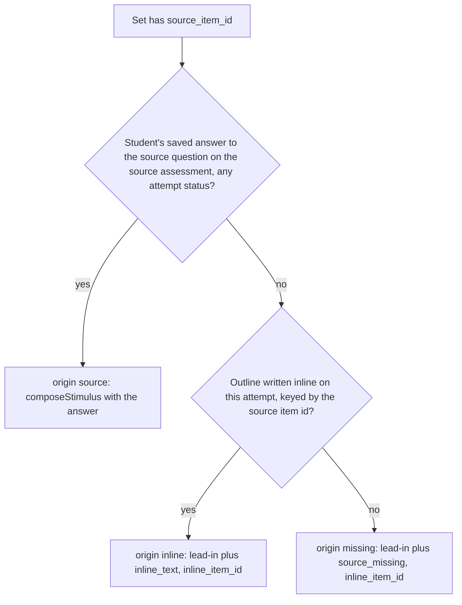

# Stimulus, item sets and multi-source readings

An **item set** is one stimulus (a passage, figure caption, data table, or several labelled sources) shared by consecutive questions. Consult this page when changing how a set is created or edited, how sources are written or rendered, how an E12 source-backed set is resolved for a student, or the publish checks on stimuli. The shared table and the `items.item_set_id` foreign key are described in [data model](data-model.md); the wire shape both bundles carry is in [wire formats](../architecture/wire-formats.md#two-bundles-adr-0016).

## Data and invariants

- `item_sets` holds `stimulus_text`, `sources` (a jsonb list of `{label, text}`), `layout` (`inline`, `own_page` or `side_by_side`, from `ITEM_SET_LAYOUTS` in `db/schema.ts`) and `source_item_id` (the E12 link). A set has no position of its own. Its place is the position of its first item.
- Membership is on the item: `items.item_set_id`. Deleting a set sets it to null on its items, so the questions survive.
- A set's items must be contiguous in assessment order. `isContiguousRun` checks this on create, and `splitSetInOrder` makes the reorder route refuse any order that would split a set.
- Set writes go through `requireDraftStatus` (or `requireDraft` on create). Once the assessment is published, the stimulus, sources, layout and source link are locked, the same as a stem. The test `a source write is locked after publish, like the stimulus text` in `item-sets-api.test.ts` pins this.

## Routes and what they enforce

| Action | Route | Enforced by |
|---|---|---|
| List sets in order | `GET /api/assessments/[id]/item-sets` | `loadItemSetsInOrder` (sets sorted by their first item) |
| Create a set from items | `POST /api/assessments/[id]/item-sets` | `CreateItemSetBody`; items must exist, belong to no set, and form one contiguous run (`items_not_contiguous`, 400) |
| Edit stimulus, sources, layout, source link | `PATCH /api/assessments/[id]/item-sets/[setId]` | `UpdateItemSetBody` (at least one field); `checkSourceItem` for the source link; draft lock |
| Delete a set | `DELETE /api/assessments/[id]/item-sets/[setId]` | draft lock; items are freed, not deleted |
| Attach an adjacent item | `POST .../item-sets/[setId]/items` | Only the question just before or after the block may join (`item_not_adjacent`, 409); an item already in a set gets `item_already_in_set` (409) |
| Detach an item | `DELETE .../item-sets/[setId]/items/[itemId]` | Only an end of the block may leave (`would_split_set`, 409). Detaching the last item deletes the set. |
| Split a page group | `POST .../item-sets/[setId]/split` | `{ item_id }`; page groups only (`not_a_page_group`, 409), not at the first question (`already_first`, 409). In one transaction the questions from `item_id` on leave: two or more form a new empty inline set, one is freed; a head of one is freed and the set deleted. |

Reordering is in [authoring](authoring.md); this page owns the set-specific refusal through `splitSetInOrder`.

## Layout

The layout is a teacher choice that the server stores as sent. `side_by_side` is a third value that the schema documents as never inferred from the source count (decision D-2 in `packages/schema/src/items.ts`). A client that predates it renders the set inline.

The editor is the one place that changes layout automatically. Its `addSource` action calls `defaultLayoutAfterAddingSource` (`lib/itemSetLayout.ts`) in the same update that appends the source. The helper flips `inline` to `side_by_side` only when the set has no sources yet. A set already on `own_page` or `side_by_side` is left alone, and a second or later source changes nothing. The editor-side default is the rule in `itemSetLayout.test.ts`; the server does not run it.

On the student client, `side_by_side` shows the sources on the left and the questions on the right on a wide viewport. On a narrow one it falls back to `own_page` (`AssessmentPage.swift`, the set-layout branch, with the gate in `PageLoadGate.swift`).

## Multi-source readings

`sources` is an ordered list of up to 12 items, each with a trimmed label of 1 to 80 characters and text of at most 20,000 characters (`StimulusSources` and `StimulusSourceSchema` share the same bounds). The list is replaced whole on write, because a source has no id to address it by. The introduction (`stimulus_text`) may be empty when sources hold the reading.

- Teacher preview renders the introduction, then one labelled section per source, in order (`preview-render.test.ts`).
- Readiness treats an empty stimulus as a gap only when there are no sources. Each empty source is its own gap, named by its label (`stimulusGaps` in `app/dashboard/[id]/readiness.ts`).
- Both bundles carry sources and layout. Export and import keep them, and duplication copies them (`duplicate-assessment.test.ts`).
- PDF and Word import proposals carry sources with `side_by_side` and sets without sources with `own_page` (`proposedSetLayout` in `lib/pdfImport/setLayout.ts`; `inline` before 2026-10-28). That is the proposal's own rule, separate from the editor default. See [PDF import](pdf-import.md).

## Page groups

Added 2026-10-28 for the teacher's "page break" request (Route B: no schema change). A **page group** is an item set with no stimulus text, no sources and no source link over two or more questions (`isPageGroup` in `lib/authoring/pageGroup.ts`). It is inferred, not stored: a stimulus stretched over two questions before its text is written reads as a group until it has text (accepted 2026-10-28), and a set of one with nothing in it is still an empty stimulus.

- The student renderer (`isPageGroup` in `AssessmentPage.swift`) hides any block with no text, sources or outline area, lays the set out inline whatever its saved layout, and marks members `in-group` rather than `in-set`. The questions share one page.
- Readiness skips page groups; the static preview and print draw no box for them.
- The editor (new editor only for the controls) shows a group as a "Same page" bar with **Add stimulus text** and **Separate pages**. Per question: **Same page as question above / below**, **Start a new page here** (the split route), **Add to the stimulus above / below**, **Remove from stimulus**. The outline rail captions a group "Same page".
- The PDF import review has the same controls over proposed sets (`lib/pdfImport/groupEdit.ts`), and a group posts as `inline`.

## E12 source-backed sets

A set can use a student's own earlier answer as its stimulus. The `source_item_id` must name an essay or short-text question in another assessment owned by the same teacher. `checkSourceItem` (`lib/api/itemSets.ts`) enforces this. A foreign or missing question reads as `source_not_found`, so ids cannot be probed. A question in the same assessment is refused.

At delivery, `resolveSourceText` (`lib/api/setSources.ts`) decides what each student sees, in this order:

Nothing per student is stored for the set. `applySourcesToSets` removes the teacher-only `source` link from the output, so the student bundle never carries it. Readiness warns, but does not block, when the source assessment is still a draft. The delivery route that calls it is step 3 (Bundle) of [sittings and attempts](sittings-and-attempts.md).

## Change guidance

- **Start with** `lib/api/itemSets.ts` (validation, contiguity, `checkSourceItem`), then the route that owns the write. For delivery, start with `lib/api/setSources.ts` and `lib/api/itemSetsBundle.ts`.
- **Invariants to keep:** contiguity; whole-list source writes; the draft lock on every set write; the teacher-only source link never leaving the teacher side; and the layout default living only in the editor.
- **Cross-system change:** the set shape is in `packages/schema/src/items.ts` and mirrored in `DeliveryBundle.swift`. Adding a field means updating the Swift decoder and the fixture described in [testing](../testing/testing-and-validation.md#shared-delivery-bundle-fixture).
- **Focused checks:** `cd design-tool && bun test test/item-sets-api.test.ts test/itemSetLayout.test.ts`. For readiness, `test/item-readiness.test.ts`. For the student side, `cd client/SecureTestCore && swift test --filter RendererSourcePaneTests`.
- **Usually unnecessary:** the full design-tool suite. These checks cover the route and the pure helpers, and the Swift filter covers rendering.
