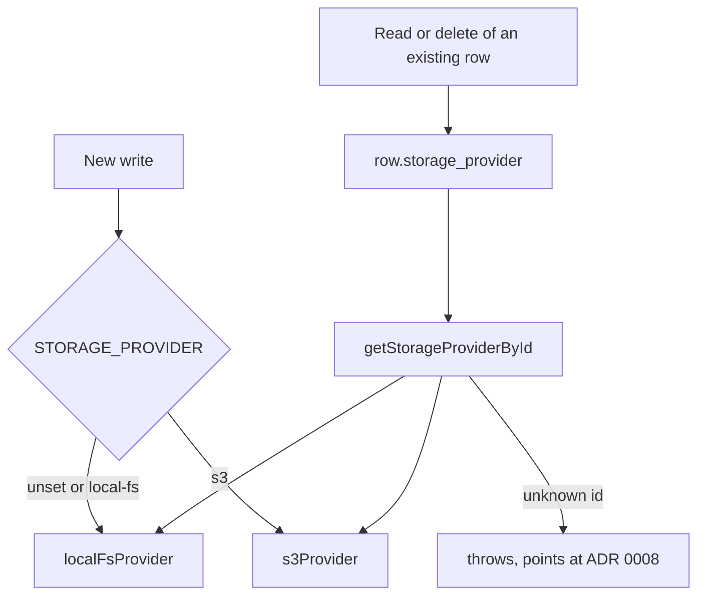

# Storage providers, assets and upload bytes

The design tool keeps binary content in an object store behind one small interface. Three kinds of content use it: the image and PDF assets that teachers attach to items, the bundled asset bytes in an export, and the photos or scans a student submits for a drawing item. Postgres holds the metadata and the access rules; the provider holds only bytes.

Consult this page when changing where bytes are stored, how uploads are signed or served, or any delete path. The attempt-side drawing flow (slot, PUT, completion) is described in [sittings and attempts](sittings-and-attempts.md#drawing-uploads); this page owns the provider contract and the object layout beneath it.

## The provider contract

`StorageProvider` (`lib/storage/types.ts`) has a stable `id` that is persisted in a row, plus `put`, `get` and `delete` by storage key. Two methods are optional:

- `presignPut`: returns a `PresignedUpload` (`url`, `headers`, `direct`, `expires_at`). Only S3 implements it. A provider without it makes the route fall back to the app's own upload route.
- `head`: reports the stored size, or `null` if nothing is there. It lets the server settle a slot whose bytes went straight to S3 and that the app never saw.

Selection happens in two places, and the difference matters:

`getStorageProvider()` (`lib/storage/provider.ts`) picks the provider for **new** writes from `STORAGE_PROVIDER`, defaulting to `local-fs`. `getStorageProviderById()` resolves **existing** rows from the id stored in `assets.storage_provider` or `response_uploads.storage_provider`. This is what lets a deployment move from local-fs to S3 with legacy rows still readable and deletable, without a backfill. Adding a backend means one provider file, registered in `getStorageProviderById`; the design rationale is in `docs/adr/0008-storage-abstraction-local-fs-first.md`.

## Implementations

| Provider | Id | Configuration | Behaviour |
|---|---|---|---|
| `localFsProvider` (`lib/storage/localFsProvider.ts`) | `local-fs` | `STORAGE_LOCAL_ROOT`, default `./storage` | Writes files under the root, keyed by the storage key. No `presignPut`, so uploads route through the app. `head` is a `stat`. There is no per-owner directory; the `assets` table is the access control. |
| `s3Provider` (`lib/storage/s3Provider.ts`) | `s3` | `S3_BUCKET` (required, throws if unset), `S3_REGION` or `AWS_REGION`, optional `S3_KMS_KEY_ID` | Writes with SSE-KMS when a key id is set. `presignPut` binds the exact `Content-Type` and `Content-Length` into the signature. `head` asks S3 whether the object landed. |

The production choice (`STORAGE_PROVIDER=s3`) is pinned in the ECS service definition; see [deployment and observability](../operations/deployment-and-observability.md).

## Assets

`assets` rows are the teacher's library and the item-image store. Each row has an owner, `storage_provider`, `storage_key`, `content_type` and `size_bytes`.

- **Upload**: `POST /api/uploads/image` accepts only `ALLOWED_IMAGE_MIME_TYPES` (png, jpeg, gif, webp). The server re-checks the type because the browser `accept` attribute can be bypassed. The route accepts at most `MAX_UPLOAD_BYTES` (5 MB) and hashes the bytes with `sha256Hex` (`lib/api/uploads.ts`); if the owner already has the same hash, it returns the existing row with `deduped: true`, and the `(owner_sub, sha256)` uniqueness is enforced by the database.
- **Excluded on purpose**: SVG. The asset route serves stored bytes inline on the app origin, so an SVG upload would be a stored-XSS vector. The phase-1-2 review finding that set this rule is cited in the code comment.
- **Serving**: `GET /api/assets/[id]` requires `requireStaff()` and `authorizeAsset(..., "own")`, then streams the bytes with `cache-control: private`, `x-content-type-options: nosniff` and `referrer-policy: no-referrer`. A non-owner gets the same 404 as a missing row.
- **Listing**: `GET /api/assets` returns only the caller's rows.
- **Deleting**: `DELETE /api/assets/[id]` removes the row first, then deletes the bytes best-effort. An orphaned object is tolerated; the row is the source of truth.

Bundle import re-uploads referenced assets and rewrites `asset:` ids, as described in [authoring](authoring.md#getting-content-in-and-out).

## Drawing-upload objects

`registerUpload` (`lib/api/responseUploads.ts`) writes objects under `responses/<attemptId>/<itemId>/<uuid>`. The key is minted on the server and bound to one attempt and one item, and the `response_uploads` row records the same pair, so a response can only name a slot created for it. The limits are `UPLOAD_MAX_BYTES` (20 MB) and a 15-minute `UPLOAD_URL_TTL_SECONDS`. Only the content types in `ALLOWED_UPLOAD_TYPES` are allowed: png, jpeg, heic and pdf.

Two helpers keep storage in step with the database:

- `settlePendingUpload` asks `head` whether a direct S3 upload landed. Without it, a slot stays `pending` forever and the response is refused. A provider without `head` leaves the row unchanged.
- `pruneSupersededUploads` deletes the other slots for an (attempt, item) when a student redraws, and their bytes too, so abandoned student work does not accumulate. Storage errors are logged and the row is still removed.

The practice-sitting sweep deletes stored drawing bytes through a separate Lambda path, `deleteStoredUpload`, which the [deployment and observability](../operations/deployment-and-observability.md) page describes.

## Change guidance

- **Adding a provider**: implement `StorageProvider`, return a stable `id`, and register it in `getStorageProviderById`. Existing rows keep their id, so never rename one. Check that `getStorageProvider` still defaults to `local-fs` for development.
- **Changing upload limits or types**: `responseUploads.ts` owns the drawing limits and `uploads.ts` owns the image limits. The 2 MB saved-drawing cap in the delivery bundle is a separate limit ([wire formats](../architecture/wire-formats.md)). Change all three deliberately.
- **Changing serving headers**: edit `app/api/assets/[id]/route.ts` and keep the nosniff, no-referrer and private-cache headers. The SVG exclusion is a security invariant, not a preference.
- **Deletes**: keep the database row as the authority. Do not make a storage failure roll back a row delete, or the registry can point at bytes that never existed.
- Focused checks: `cd design-tool && bun test test/storage-provider.test.ts test/s3-provider.test.ts` (provider selection and the S3 client). For upload routes, run `uploads-api.test.ts` and `response-uploads-api.test.ts`; check [testing](../testing/testing-and-validation.md) for whether a route suite needs the `_test` database.
- Escalate to a full review when `s3Provider.ts` or the presign binding changes, since the signature is what enforces the declared size and type.
