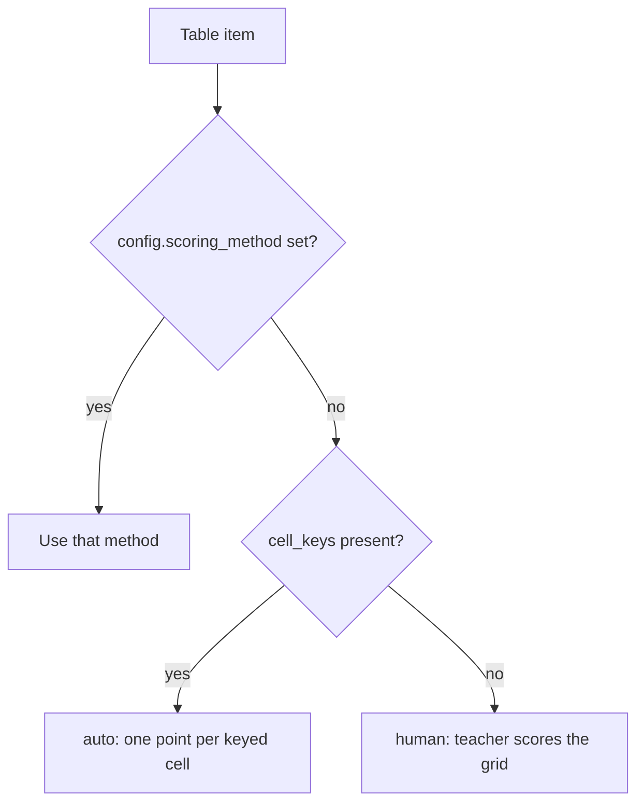

# Table items

A table item is a grid the student fills in. The teacher sets column headings and row labels, and every body cell becomes a text box. Optionally the teacher gives an expected text for some cells (`cell_keys`), and each keyed cell is worth one point. The type was built in E3 slices (design rationale in `docs/e3-table-item-design.md`; the slice labels below follow the source comments). Because a table's grid, key and response all cross the server, the shared schema and the Swift client, read [wire formats](../architecture/wire-formats.md) before changing its shape.

## Shape and limits

The item's config holds `columns` (one to eight, each with a non-empty label), `rows` (one to thirty, where a row label may be blank so a table of empty trials is valid), an optional `corner` heading, and optional `cell_keys` (row id → column id → expected text, at most 500 characters per key). The shared Zod shape is `TableItem` in `packages/schema/src/items.ts`; the design-tool write-side shapes are `TableColumnShape` and `TableRowShape` in `design-tool/lib/api/items.ts`.

- **Write boundary.** `validateTable` in `lib/api/items.ts` refuses duplicate column or row ids and any keyed cell that names a missing row or column. `compactCellKeys` drops rows with no keys, so "no key" is an absent field rather than an empty object.
- **Direct DB rows.** `lib/api/itemIntegrity.ts` throws `IncompleteItemError` for a table row with no column or no row. A database write skips the API, so the bundle schemas would otherwise reject it anonymously.

## Scoring

Scoring is decided in three places that must agree:

Caption: how `effectiveScoringMethod` resolves a table's method when the teacher has not chosen one.

- **Method.** `effectiveScoringMethod` in `lib/api/items.ts` makes an explicit choice win. Otherwise a table with `cell_keys` is `auto`, and a keyless table is `human` (the E3-F1 rule, tested in `items-api.test.ts`).
- **Auto.** `scoreResponse` in `lib/scoring/auto.ts` gives one point per keyed cell. Each cell is compared by `tableCellMatches`, which delegates to `shortTextMatches`, so `1.50` matches a key of `1.5`. A cell the student left empty scores zero. A table with no keys returns `null` and is skipped.
- **Denominator.** `tableMaxPoints` is the keyed-cell count when any key exists, and otherwise `columns × rows`. `results.ts`, `reviewActions.ts` and the review-queue route all call it, so one column carries one maximum for every student.
- **Hand scoring.** A keyless or explicitly human table reaches the review queue with its grid and keys. The manual score route uses the same denominator through `checkManualScore` in `lib/api/reviewActions.ts`; the scoring rules are in [scoring and results](../design-tool/scoring-and-results.md).

## Publish lock and answer keys

Tables are student-facing, so editing a published table is refused by `requireDraft`, with one exception. `isAnswerKeyOnlyPatch` in `lib/api/requireDraft.ts` admits a change that touches only `cell_keys`. Changing columns, rows or the corner still needs a draft. The rule is tested in `answer-key-only-patch.test.ts` under "isAnswerKeyOnlyPatch: table (E3)".

## Delivery and the student response

- **Bundle.** `buildDeliveryBundle` maps a table to `type`, `id`, `stem`, `columns`, `rows` and `corner`. It never ships `cell_keys`. The delivery test "E3: a table ships its grid — columns, rows, corner — and nothing else" in `delivery-api.test.ts` checks this.
- **Response.** The student's answer is `cells`: row id → column id → text. `packages/schema/src/responses.ts` requires at least one cell. The write route stores the cells as sent, because cells are addressed by authoring ids (`attempt-ingest-api.test.ts`, "PUT a table response (E3)").
- **Client version.** `MIN_CLIENT_VERSION_FOR_TYPE` in `lib/items/clientSupport.ts` has no table entry. Only fill-in-the-blank is version-gated for its type (the fill-in-the-blank gate is in [fill-in-the-blank items](fill-in-the-blank.md#client-compatibility)).
- **Client rendering.** `DeliveryItem.swift` decodes `TableItem` (columns, rows, corner). `ItemResponse.swift` encodes `.table(cells:)`. `tableField` in `AssessmentPage.swift` draws the grid as text inputs. Spell-check follows the spell-check accommodation, and autocomplete is off. Each table change posts the whole grid, and cell text is covered by the text autosave described in the [client overview](../client/overview.md). Speech support does not include tables in v1 (`RendererSpeechToTextTests`). Each cell is limited to `BridgeLimits.cellMaxLength` (500) by `BridgeChecks.swift`.

## Authoring

- `TableEditor.tsx` edits the grid. Column headings and row labels are lists, and the key grid sits below them. A blank key means "accept anything" and is never counted. The editor generates ids and does not show them to teachers. Labels accept KaTeX and bold or italic markers.
- `design-tool/app/dashboard/[id]/readiness.ts` (`questionGaps`) requires at least one column and one row before publish. Keys are optional (`item-readiness.test.ts`, "questionGaps: table (E3)").
- Export and import keep `cell_keys` in the teacher bundle (`import-api.test.ts`, "import: table items (E3)"). The items CSV import refuses tables, and PDF import can propose them as table candidates (`pdf-extract.test.ts`, "table candidates (E3 slice 4)"). The teacher preview draws a grid of blank cells and never the key (`preview-render.test.ts`).

## Change recipe

1. Change the shape in `packages/schema/src/items.ts` and `responses.ts`, then run `cd packages/schema && bun run build` so the design tool sees the new `dist`.
2. Update the write boundary in `design-tool/lib/api/items.ts` (`TableColumnShape`, `TableRowShape`, `validateTable`, `compactCellKeys`, and the config builder).
3. Update `buildDeliveryBundle`, `scoring/auto.ts`, `TableEditor.tsx`, and the Swift `TableItem`, `ItemResponse` and `tableField` together.
4. If a bundle's shape changes, regenerate the Swift fixture with `design-tool/scripts/generate-delivery-fixture.ts` before running the Swift decode tests (see [testing](../testing/testing-and-validation.md)).

Scope boundaries: do not put `cell_keys` in the delivery bundle, and do not add speech support for tables without updating the v1 exclusion test. A wire-shape change escalates to the [wire formats](../architecture/wire-formats.md) page and needs the Swift decoder tests.

## Focused checks

- Server: `cd design-tool && bun test test/scoring-auto.test.ts` (suites "scoreResponse: table (E3)" and "tableMaxPoints (E3)"), `test/items-api.test.ts` ("items: table (E3)"), and `test/answer-key-only-patch.test.ts`.
- Client: `cd client/SecureTestCore && swift test --filter RendererTableTests` and `--filter ItemResponseTableTests`.
- Each suite is independent, so run only the ones that match the layer you changed.
