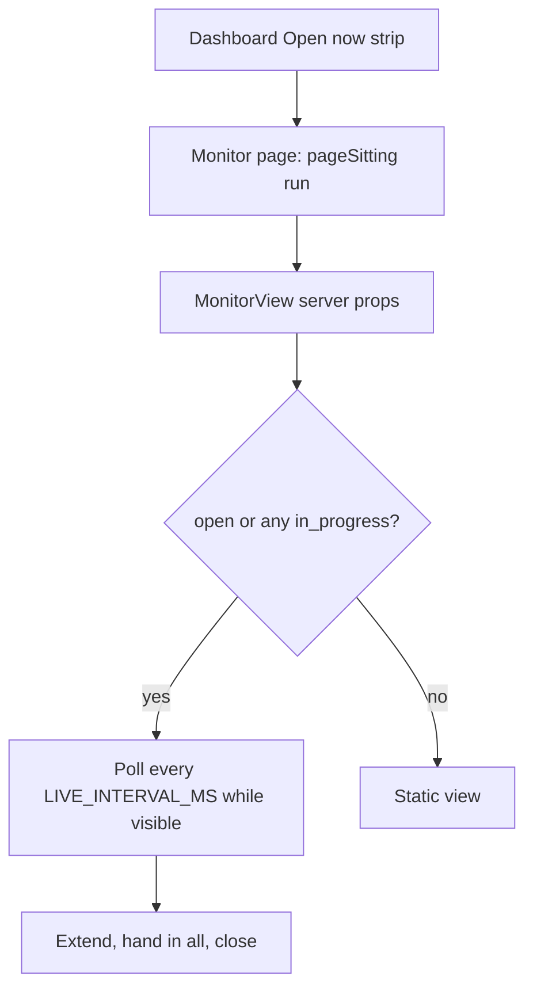

# Teacher dashboard

The teacher dashboard is the staff-facing Next.js UI under `design-tool/app/dashboard/`. Most pages are server components that load data and then hand it to client panels. Every route sits behind the staff session gate described in [auth and access](auth-and-access.md). Panels call existing API routes and hold few rules of their own; the rules live in the `lib/api` and `lib/*` modules that those routes call.

## Route map

| Route | Page source | What it is for |
|---|---|---|
| `/dashboard` | `app/dashboard/page.tsx` (`DashboardPage`) | Assessment list, "Open now" sittings strip, shares offered to you, and the admin "All teachers" view. |
| `/dashboard/new`, `/dashboard/import`, `/dashboard/uploads` | `app/dashboard/new/`, `import/page.tsx`, `uploads/page.tsx` | Create an assessment, import an exported assessment file, and manage uploaded images. |
| `/dashboard/[id]` | `app/dashboard/[id]/page.tsx` (`AssessmentEditorPage`) | Editor for one assessment, with the tabs listed below. |
| `/dashboard/[id]/monitor/[sittingId]` | `monitor/[sittingId]/page.tsx` (`MonitorPage`) | Live proctoring view for one sitting. |
| `/dashboard/[id]/results` | `results/page.tsx`, `results/[attemptId]/page.tsx`, `results/print/page.tsx`, `results/work/page.tsx` | Results matrix, one student's attempt, the printable report, and the work packet. |
| `/dashboard/[id]/scoring` | `scoring/page.tsx` (`ScoringPage`) | Teacher review queue; rules are in [scoring and results](scoring-and-results.md). |
| `/dashboard/accommodations` | `accommodations/page.tsx`, `accommodations/[studentId]/`, `accommodations/roster/[psId]/`, `accommodations/import/` | Student accommodation records, TIDE import, and review of changed imports. |

Page guards follow one pattern. A missing staff session redirects to `/login?next=...`. A malformed UUID, or an assessment or sitting the caller cannot reach, calls `notFound()`, so a guessed id learns nothing. `AssessmentEditorPage` and `ScoringPage` resolve the assessment with `authorizeAssessment` or `pageAssessment` at the `edit` level. `MonitorPage` also checks that the sitting belongs to the assessment named in the URL, not only that the caller may monitor it.

## Assessment list (`/dashboard`)

`DashboardPage` builds every query on one scope fragment, `visibleAssessmentScope(db, session, { all })`, so the list, the counts, and the "Open now" strip cannot disagree about what the caller may see. The list shows live assessments by default; `?archived=1` shows archived ones instead.

- **Open now** lists sittings whose assessment is visible, whose status is `open`, and whose `expires_at` is still in the future. Each row links to the monitor.
- **Shared with you** lists pending offers from colleagues. Accepting one creates your own copy.
- **All teachers** is an admin-only view. `showAllTeachersToggle` gates the link, and `homeListMode` ignores a hand-typed `?all=1` for non-admins. `ownerCell` renders "you" for rows the caller owns.
- A co-teacher grant that has not been opened yet shows a "New" mark, which is cleared when the editor is opened (`markAssessmentGrantSeen`).

Row actions (`DuplicateAssessmentButton`, `ArchiveAssessmentButton`, `DeleteDraftButton`, `ActAsButton`) call existing API routes. Their rules are in [assessment lifecycle](assessment-lifecycle.md) and [auth and access](auth-and-access.md).

## Assessment editor (`/dashboard/[id]`)

`AssessmentEditor` is one large client component. Its tabs are fixed in `EDITOR_TABS`, and the active tab is kept in `?tab=`, so reload and deep links land on the same panel. `parseTab` falls back to Questions for an unknown value.

| Tab (`?tab=`) | Teacher label | Owns |
|---|---|---|
| `questions` | Questions | Items, item sets, imports, AI generation, and standards tags. See [authoring](authoring.md) and [batch item generation](batch-item-generation.md). |
| `settings` | Settings | Name, time limit, layout, feedback and answer-release settings, archive and delete. |
| `accommodations` | Allowed on this test | Assessment-wide allowed list, construct-altering flags, and class-period grants. See [accommodations and roster](accommodations-and-roster.md). |
| `students` | Exceptions for this test | Per-student overrides on this assessment. See [accommodations and roster](accommodations-and-roster.md). |
| `sessions` | Test sessions | `SittingsPanel`: create sittings, show codes, close early, and see who has joined or submitted. Extend and hand-in controls are on the monitor. See [sittings and attempts](sittings-and-attempts.md). |

The editor receives `access.level`, `access.via`, and `owner_email` from the server. Owner-only actions in the header and Settings tab use them, and a co-teacher's editor is labelled as such. A published assessment shows a lock banner; answer keys and standards stay editable while it is locked, as described in [assessment lifecycle](assessment-lifecycle.md).

## Monitor (`/dashboard/[id]/monitor/[sittingId]`)

`MonitorView` is the proctoring screen for one sitting: one card per student, with the join code large enough for a projector. It starts from server props (`code`, `status`, `expiresAt`, `kind`, and whether the assessment is untimed), then replaces them with the live payload.

Polling is the core behaviour. A tick runs every `LIVE_INTERVAL_MS` (5 seconds, from `attendanceView.ts`) while the sitting is open or any student is still `in_progress`. Ticks are skipped while the document is hidden, and a `visibilitychange` handler stops the timer and refreshes once on return. Controls on the page are `ExtendTimeControl`, `HandInAllControl`, `ShowCodeDialog`, and a confirmed Close. The server rules those controls call are owned by [sittings and attempts](sittings-and-attempts.md).

The monitor polls only while there is something left to watch, and each control calls an existing sitting route.

## Results, scoring, and reports

`results/page.tsx` renders `buildResults` with a `sectionFilterOptions` filter; a `NO_SECTION` value covers rows that resolve to no section. Per-attempt actions are small client components that call a route and reload: `ChangeScoreAndReload`, `RescoreAndReload`, `PassBackAndReload`, `ReleaseAnswersAndReload`, `SendToGradebookAndReload`, `HandInAttemptAndReload`, `HandInInProgressAndReload`, `ExtendTimeAndReload`, and `DeleteAttemptAndReload`. Item analytics come from `results/analyticsQuery.ts`, and the class-insights panel is `components/app/ClassInsightsPanel.tsx`.

`scoring/ScoringQueue.tsx` is the review queue for human-method items and AI proposals; its rules are in [scoring and results](scoring-and-results.md#teacher-review-queue-and-approval). The printable pages are described in [reporting and work packets](reporting-and-packets.md).

## Accommodations pages

`accommodations/page.tsx` loads the teacher's student records together with `pendingTideDiffs` and `otherTeachersRecords`, and shows the count of changes to review. The TIDE import flow is `accommodations/import/ImportTidePanel.tsx`, and review is `import/review/DiffReviewPanel.tsx`. The student editor is `[studentId]/StudentEditor.tsx`. The rules and data behind these pages are in [accommodations and roster](accommodations-and-roster.md).

## System admin pages

`/admin` is the one deliberately unscoped page in the staff UI. `AdminPage` lists every test session whose status is `open` and whose `expires_at` is in the future, across all teachers, newest first. Each row shows the code, assessment, owning teacher, section (or "Practice" for a practice sitting) and start time. Its actions are a **Monitor** link to the sitting's monitor and an **Act as** button for a sitting owned by someone else. Its header line counts open safeguarding alerts district-wide and links to `/admin/safeguarding`, where the list is open alerts by default (`adminAlertMode`, `?show=all` for every alert). Acknowledging an alert is a teacher action, not an admin one.

Admin status comes from `ADMIN_EMAILS` through `isAdmin` (`lib/auth/admin.ts`), as described in [auth and access](auth-and-access.md). Both pages return 404 to a non-admin, and an impersonated session is never admin, so the act-as banner hides the admin surface until the session ends. The grants console is not on these pages; the page source records that the `/api/grants` route has no UI yet. Safeguarding alert rules are in [AI and safeguarding](ai-and-safeguarding.md#hand-in-screening-and-alerts).

Focused tests: `test/admin.test.ts` (the admin and impersonation predicate) and `test/safeguarding-alerts-ui.test.tsx` (`adminAlertMode` and the admin alert page). The page itself needs the test database for the render test.

## Shared components

`components/app/` holds the dialogs and controls used across these pages, for example `PublishDialog`, `ShareDialog`, `GenerateQuestionsDialog`, `SuggestStandardsDialog`, `SafeguardingPanel`, and `SendToGoogleDocsControl`. `components/ui/` holds the shared UI primitives. `AppChrome` resolves the header from the session and is shared with `/admin`; it shows the act-as banner when the session is an impersonation.

## Change navigation

- **Where to start.** Find the route in the route map, then read its page source. Rules usually live behind `lib/api/*`, not in the page.
- **Invariants.** Visitors without a staff session are redirected to login. An assessment or sitting the caller cannot reach is a 404, not a forbidden panel. The All-teachers view is admin-only. The monitor polls only while a sitting is open or a student is still working.
- **Focused tests.** `test/all-teachers-ui.test.ts` (toggle and list-mode helpers), `test/reporting-views.test.tsx` (the assessments list and results matrix), `test/co-teach-ui.test.tsx` (owner and co-teacher labels), `test/attendance-view.test.ts` (monitor state), `test/extend-time-control.test.tsx`, `test/hand-in-all-control.test.tsx`, and `test/access-enforcement.test.ts` (route-level 404s).
- **Minimal validation.** `cd design-tool && bun test test/all-teachers-ui.test.ts` for the list helpers. Database-backed suites need `DATABASE_URL`, as set out in [testing and validation](../testing/testing-and-validation.md).
- **Scope boundary.** Changing a button's behaviour usually means changing the route or `lib/api` helper, not the component.

Related pages: the [architecture overview](../architecture/overview.md) gives the system context, and the [data model](data-model.md) covers the tables behind these pages.
