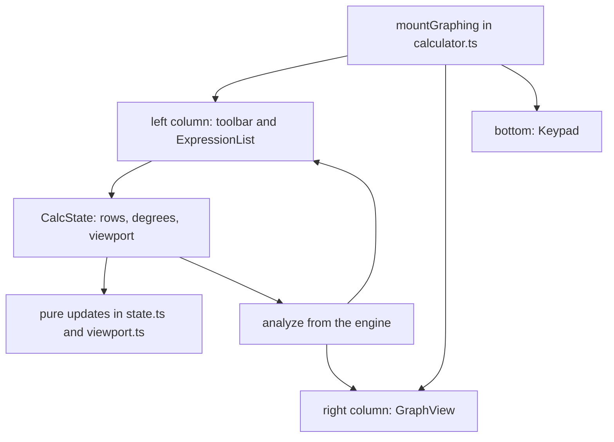

# Calculator and graph UI modules

The browser half of `@secure-test/graphing` lives in `packages/graphing/src/ui/`. One codebase serves three places: the test calculator panel ([calculator](calculator.md)), read-only stimulus graphs and graph answer boards ([graph items](graph-items.md)), and the macOS client page, which receives the built script through `src/page.ts` ([graphing overview](overview.md)). This page explains how the UI modules fit together so a change can start at the right file.

## Composition

`src/page.ts` is the client entry. It exposes `mountGraphing`, `MathfieldElement`, `presetFor`, `isMode`, `mountStimulus` and `mountGraphAnswer` to the page script, and `scripts/build-page.ts` wraps that into `graphingScript`. The design tool's editors load the same modules through the `./ui` package export (`src/ui/index.ts`), which re-exports the calculator, `GraphView`, state, viewport, stimulus and answer-board functions.

`mountGraphing(container, opts)` in `calculator.ts` builds the panel and owns the state:

- The panel's options (`CalculatorOptions`) choose the mode (`graphing`, `scientific`, `four_function`) and preset through `presetFor` in `presets.ts`. The preset's disabled function groups are removed from the keypad and the engine.
- `CalculatorHandle` is the only surface the page uses: `focus`, `save`, `load`, `closeHelp` and `destroy`. `save` returns a `SavedGraph` (rows, angle mode and view bounds); `load` restores one.
- `installStyles` adds the calculator stylesheet once per document, and `configureMathLive` turns off MathLive's fonts and sounds. The comment in that function ties this to the page's Content Security Policy (`default-src 'none'`), which is why the calculator never loads a resource.

## Expression list and keypad

- `ExpressionList` (`list.ts`) renders one row per expression: a colour swatch that doubles as the show/hide toggle, a MathLive field, and the analysis text beneath it (a value, a slider, or an error with "add slider" buttons). Its callbacks (`ListCallbacks`) report edits, inserts, removals, focus moves and slider changes back to `mountGraphing`. Keyboard rules are fixed in the module header: Enter adds a row below, Backspace in an empty row removes it, and the arrow keys at a field's edge move between rows.
- `Keypad` (`keypad.ts`) types into whichever math field last had focus. Its pages are `MAIN_PAGE` (numbers and operators), `ALPHA_PAGE` (letters in alphabetical order, the state-test layout), `FUNCTION_PAGE`, `SCIENTIFIC_PAGE`, and `fourPage(sqrtKey)` for four-function mode. `fourPage` takes a flag that places a square-root key or a fraction key in the same slot, which is how the state preset differs.
- `press(field, key, onEnter)` is the single dispatch point. A key is one of: a command (`executeCommand` for undo, redo, delete, moves and clear), typed characters (`typedText`, which honours MathLive's smart fences), or LaTeX to insert (`insert`, with a `#0` selection placeholder).

## Shortcuts, escape and the exponent hint

- `shortcuts.ts` holds `INLINE_SHORTCUTS`, the words MathLive turns into symbols as they are typed. The table is deliberately short: only names the calculator's parser reads (`sqrt`, `ln`, `log` as base 10, `>=`, `<=`), so an ordinary product such as `c·h` does not turn into `\cosh`.
- `withoutEscape(bindings)` removes every MathLive binding whose key is Escape. Without this, MathLive's LaTeX mode would take the key before the panel's own Escape closes it (finding E-1 in the file comments). `ui-pure.test.ts` pins this under "withoutEscape (finding E-1)".
- `help.ts` supplies `helpSections(mode, sqrtKey)` for the in-app help and the exponent hint. `structureOf`, `caretStructure` and `structureHint` detect when the caret is inside a power, fraction or root and produce a one-line hint. `mountGraphing` shows that hint in a polite live region, so a screen reader announces it once on entry. `help.test.ts` covers "the exponent hint".

## Graph, viewport and state

- `viewport.ts` is pure: `makeViewport`, `toPx`/`fromPx`, `zoomAt`, `pan`, `resize`, `gridStep` and `ticks`. Zoom and pan are functions of a `Viewport` value, which keeps them testable without a canvas.
- `state.ts` is pure row logic: `insertRow`, `removeRow`, `updateRow`, `emptyRow`, `nextColor` (the `PALETTE`), `addSliders`, and slider helpers (`defaultRange`, `setSliderValue`, `snapSlider`). Row IDs come from `newId`.
- `graph.ts` holds `GraphView`, the plotting surface used by the calculator and by stimulus graphs, plus colour helpers (`curveColor`, `mix`, `luminance`) that keep curves legible on the paper colour. `modes.test.ts` covers "curve colours on the paper".
- `implicit.ts` draws implicit relations (`drawImplicit`) by interval tracing (`traceFor`). The tracing rules are tested in `implicit.test.ts` under "tracing equations" and "tracing inequalities".

## Sound and read-only graphs

- `audio.ts` exports `Tones`, a Web Audio trace of a curve: short notes while the student traces it by keyboard, and the whole curve played left to right. It creates its `AudioContext` on the first request, falls back to `webkitAudioContext`, and goes silent (`available` becomes false) if Web Audio is missing or fails. The test is the `Tones` describe block in `summary.test.ts`.
- `stimulus.ts` exports `mountStimulus`, the read-only graph shown with a question. The student can pan, zoom, reset and select a curve, but cannot edit it. The teacher's alt text becomes the accessible name, and the expression list is a legend rather than MathLive fields. No package test drives this DOM mount; `stimulus.test.ts` covers the engine-side description and SVG only.
- `graphAnswer.ts` exports `mountGraphAnswer`, the answer board for graph items, with `snapInside` and `parseCoordinate`. Its scoring semantics are described in [graph items](graph-items.md) and tested in `graphAnswer.test.ts`.

## Change guidance

- Start with `mountGraphing` for panel layout and state flow, `press` for key behaviour, and `state.ts` for row rules. Keep the pure modules pure so `ui-pure.test.ts` can cover them.
- A key added to a page needs a `Key` entry with `insert`, `type` or `command`. If the key types a word, check `INLINE_SHORTCUTS` first, because a new word can change ordinary input.
- A new MathLive binding that uses Escape would be swallowed by the panel; `withoutEscape` is the filter to extend, not the panel's key handler.
- The page entry `src/page.ts` and anything under `src/ui/` feed the vendored client script. After a change there, rebuild with `cd packages/graphing && bun run build:page` and run the Swift `GraphingScriptTests`, as described in [calculator](calculator.md#client). Do not edit `GeneratedGraphing.swift` by hand.
- Scope boundary: `packages/graphing/playground/` and `scripts/playground.ts` are developer tools and are not part of the calculator's runtime.

Narrow validation: `cd packages/graphing && bun test test/ui-pure.test.ts test/help.test.ts`. Use `bun run typecheck` for type-only changes. The DOM mount (`mountGraphing`, `Keypad`, `ExpressionList`) has no automated test in the package, so changes to it need a hand check in the client's calculator (see [testing](../testing/testing-and-validation.md)).
