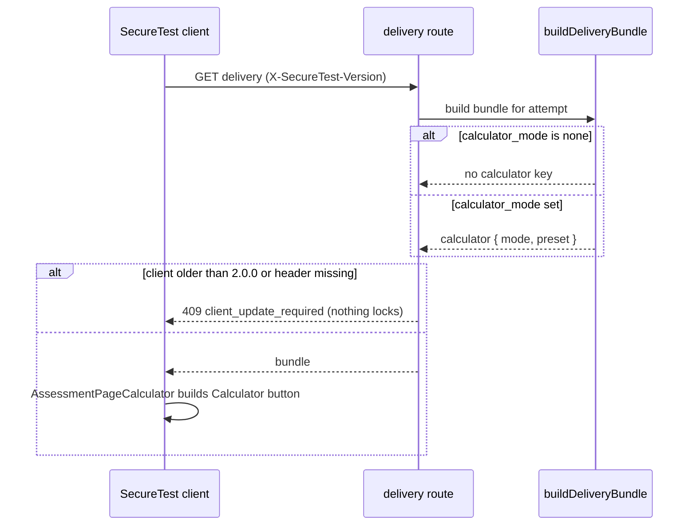

# Test calculator

A teacher chooses one calculator for a whole assessment. Each student then gets the same calculator in the macOS SecureTest page. The feature's package and gating are described in [graphing overview](overview.md). This page covers the settings and the client wiring.

## Settings

Two columns on `assessments`, both declared in `design-tool/db/schema.ts` and added by migration `0063_calculator_setting.sql`:

- `calculator_mode`: `none` (default), `four_function`, `scientific` or `graphing`.
- `calculator_preset`: `full` (default) or `state_wa`. The preset is the Washington (WCAP) state-test configuration. `packages/graphing/src/ui/presets.ts` defines what it disables: reciprocal and hyperbolic trig, advanced statistics and geometry, and in four-function mode the square-root key. The file records that the configuration sheet must be re-checked each school year.

The API accepts both in `design-tool/lib/api/assessments.ts`. An unknown value returns 400, and the database CHECK constraints refuse one even past the API.

The publish lock treats these as measurement settings. `calculator-api.test.ts` ("locked once Published — unlike highlighting, it changes what is measured") expects 409 for a change to either field on a published test. It also expects the same request, when it carries only the unchanged calculator fields alongside `allow_highlighting`, to return 200. The general lock rules are in [assessment lifecycle](../design-tool/assessment-lifecycle.md).

## Per-question mark

`no_calculator` on an item (`design-tool/db/schema.ts` item config, set through the item PATCH route) hides the calculator for that question. The client code states the limit: the per-item mark is honoured in the paged layout only, because one scrolling page shows every question at once. See [paged delivery](../client/paged-delivery.md). `calculatorForPage` in the client closes the panel and disables the button on such a page, and labels the button "No calculator on this question".

## Delivery

`buildDeliveryBundle` (`design-tool/lib/api/buildDeliveryBundle.ts`) adds `calculator: { mode, preset }` only when the mode is not `none`. The same route refuses a bundle the client cannot render: `requiredClientUpgrade` returns `2.0.0` for the `calculator` feature. A client that sends no `X-SecureTest-Version` also gets 409. The delivery tests "graphing calculator on the wire" cover 2.0.0 (bundle delivered), 1.6.3 (409), and a missing header (409).

## Client

- `AssessmentPageCalculator.swift` is the glue. When the bundle names a calculator it adds a Calculator button, and the first open calls `__secureTestGraphing()` and mounts the panel. Without the field the page is unchanged: no button, no style, no call. The panel's own modules (keypad, expression list, sliders, exponent hint) are described in [calculator and graph UI modules](calculator-ui.md).
- The calculator engine is `graphingScript` in `GeneratedGraphing.swift`. It is generated from `packages/graphing/src/page.ts` by `scripts/build-page.ts`. Do not edit the generated file. `GraphingScriptTests` pins its shape.
- Page-level calls are spliced into `AssessmentPage.rendererScript`, so the served renderer carries the same code ([signed renderer delivery](../client/signed-renderer.md)).

## Change guidance

- New modes or presets need changes in four places: the CHECK constraint and a migration (`design-tool/db/schema.ts`, `db:generate`), the API validation in `assessments.ts`, the `PRESETS` table in `presets.ts`, and the client `calculatorFunctions` checks. Keep the mode list identical across them.
- Do not relax the publish lock for these fields. A change to calculator settings alters the measurement.
- Check `calculator-help-page.test.ts` when a mode is added; it pins the calculator's in-app help sections that the design tool imports as `helpSections` from `packages/graphing/src/ui/help.ts`.
- Scope: a graphing-calculator change does not normally need the Next build or the Swift full suite. Run the `GraphingScriptTests` and `calculator-api` checks only.
- Hand-run fixtures: `design-tool/scripts/hand-run-calculator.ts` is a dev-only script that imports three tests as the demo teacher, publishes them and opens a sitting on each, so the calculator's client checks can be run by hand. It accepts only a local server URL and needs a local database that already holds the demo roster. It is developer tooling, not product runtime, and is not part of the delivery path above.
