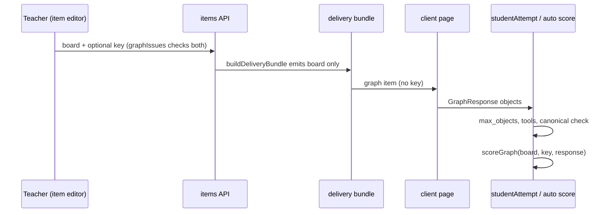

# Graph items and stimulus graphs

Two shapes of graph reach a student. A **graph item** is a question whose answer is a set of objects placed on a board. A **stimulus graph** is a teacher-authored picture attached to any item as context. Both are defined in `packages/schema/src/graph.ts` and their engine is in `packages/graphing`. The package and its client gate are in [graphing overview](overview.md).

## Graph item

The item config holds `graph_board` and optionally `graph_key`. The schemas are `GraphBoardSchema` (`x`, `y`, `grid`, `snap`, `tools`, `max_objects`, optional `fixed` objects shown but not scored), `GraphKeySchema` (`objects` plus `scoring`) and `GraphResponseSchema` (`objects`).

- **Snap.** Every point is a whole multiple of the board's snap, parsed by `parseSnap` (`"1"`, `"1/2"`, `"0.5"`). Coordinates become integers in snap units, so comparisons are exact.
- **Canonical shape.** `canonical(object, board)` turns a placed object into a key string, for example `Q x,y,num/den` for a parabola. Two different click sequences that give the same line produce the same key.
- **Scoring modes.** `scoreGraph` in `packages/graphing/src/engine/graphAnswer.ts` implements both:
  - `all`: full credit only when every key shape is present and the response has no extra shape.
  - `per_object`: the share of key shapes present. The score is zero when the response has more distinct shapes than the key, so drawing everything earns nothing. Repeats count once, and an object whose tool the board does not offer does not count.
- **Scoring method.** `items.ts` makes a graph item `auto` when it has a key and `human` otherwise. `design-tool/lib/scoring/auto.ts` calls `graphPoints` and `graphMaxPoints` from the graphing server surface.

### Flow

### Write-time checks

`graphIssues(board, key)` in `design-tool/lib/api/items.ts` runs on create, PATCH and import. The import path (`design-tool/lib/api/importBundle.ts`, "F19") uses the same check, and a failure is reported as `schema_invalid:items.N.key...` with the question number. `studentAttempt.ts` rejects a response that is over `max_objects`, uses a tool the board does not offer, or has an invalid shape. A response that fails these checks is rejected at write time (the forged-or-stale write rule).

### Review and export

- The review queue (`design-tool/lib/api/reviewActions.ts`, `review-queue` route) shows a graph answer as `graph_lines` built by `graphAnswerLines`. The `review-queue.test.ts` suite "graph answers in the queue" pins the output.
- The teacher export (`design-tool/lib/api/exportBundle.ts`) writes `board`, and `key` only when one exists. The importer stores what it reads.
- Changing a key on a published test is allowed, because `isAnswerKeyOnlyPatch` in `requireDraft.ts` treats `graph_key` like other answer keys. A change to `graph_board` is locked. Auto-scoring re-runs only for unscored responses, and the rescore dialog counts a graph key edit as a change (`rescore-dialog.test.ts`).

## Student answer on the client

The student's board is `mountGraphAnswer` in `packages/graphing/src/ui/graphAnswer.ts`. `packages/graphing/src/page.ts` exposes it on the page's `__gcOut` surface, next to the calculator and stimulus mounts. On the macOS client, `graphField` in `client/SecureTestCore/Sources/SecureTestCore/AssessmentPageCalculator.swift` reserves a holder for each graph item, and `mountGraphAnswers` draws the boards once the graphing script has loaded. A saved answer comes back as `initial`, so a resumed attempt reopens with its objects in place.

The same board serves three purposes: the student's answer, the teacher's key drawing and a read-only review against the key (the `key` and `readOnly` options). A student places objects three ways that produce identical objects: a click snaps to the grid, arrow keys move a cursor one snap step and Enter places it, and typed coordinates go through a form (fractions accepted). Every object is listed in words with a Remove button, and each change is announced to screen readers.

Each change posts `{type: 'graph', objects}` through the generic answer channel. Clearing the last object withdraws the saved answer instead of posting an empty list, because the server would store an empty answer and count the question as answered. `GraphAnswerShellTests` pins this on the page glue's source, since the board cannot run in JavaScriptCore.

The generic channel is what lets a graph item ship without a new client shell. `ItemResponse.generic(type:fields:)` in `ItemResponse.swift` carries any response type the Swift model does not name. `BridgeChecks` checks such a response against the generic caps (depth 8, 256 KB) rather than a per-type check. The renderer declares `response.generic` among its requirements (`RendererKeys.swift`, see [signed renderer delivery](../client/signed-renderer.md)). `GraphAnswerShellTests` also confirms that ten two-point objects, the largest answer `GraphResponseSchema` accepts, fit inside those caps. The client's floor for graph items is 2.0.0 ([graphing overview](overview.md#gating-client-200)).

Validation: the engine's `packages/graphing/test/graphAnswer.test.ts` covers the shapes, and `cd client/SecureTestCore && swift test --filter GraphAnswerShellTests` covers the decode, caps and page-glue rules. The generic channel itself is tested by `GenericAnswerChannelTests`. Changing the generated graphing literal needs `GraphingScriptTests` as well (see [graphing overview](overview.md)).

## Stimulus graphs

`StimulusGraphSchema` attaches a `graph` (rows of LaTeX, a `view` window and required `alt` text) to any item. It is content, so it reaches the student in the delivery bundle, and the server rejects a `view` whose `xmin` is not below `xmax` (`calculator-api.test.ts`, "stimulus graphs"). The design tool renders the picture with `renderGraphSvg` in the no-script preview and print path (`design-tool/lib/preview/renderHtml.ts`, tested by `preview-graph.test.ts`). Its `graph_stimulus` client floor is 2.0.0 ([graphing overview](overview.md#gating-client-200)). Stimulus text and passages are a separate concept, described in [stimulus and item sets](../design-tool/stimulus-and-item-sets.md).

## Change guidance

- Any change to canonical shapes or tolerance changes scores for existing responses. Check `packages/graphing/test/graphAnswer.test.ts` and `design-tool/test/graph-item.test.ts` (its scoring cases) before changing them.
- Adding a tool touches `GRAPH_TOOLS`, `canonical`, `describeObject`, the schema shapes, and the client UI. Also update `importBundle` tests in `import-api.test.ts` ("import: graph items (D-9)").
- Keep the key out of anything student-facing. `buildDeliveryBundle` reads only `board`; a regression would show in `delivery-api.test.ts` ("graphing calculator on the wire").
- Scope: the graphing engine's `analyze`, `poi`, and `implicit` modules serve the calculator and stimulus rendering, not graph-item scoring. Do not expect a graph-item change to need them.

Validation: start with `cd packages/graphing && bun test test/graphAnswer.test.ts`. Use `cd design-tool && $TESTDB bun test test/graph-item.test.ts` for the server half. Run `import-api.test.ts` and `review-queue.test.ts` only when the import or queue shape changes.
